On October 1, Cloudflare announced a [competition to build the next Git platform](https://blog.cloudflare.com/next-git-platform-on-cloudflare/). Git was designed for people, and more and more code now comes from coding agents. Cloudflare asked what Git-based collaboration should look like when hundreds of agents work on the same codebase.

I decided to take part on Friday evening, October 2. The prizes were only for people in the US and Canada, so I knew from the start I couldn't win anything. I did it for fun, to learn something new and to build in public.

I also had my own problem with Git. I run many agents in parallel, and each one gets its own worktree. A worktree is a second working copy of a repository, and those copies were eating my disk.

So I gave the whole project to a team of coding agents. I only gave instructions, and the agents researched, built, reviewed and wrote daily reports.

In this post, I'll share:

- What the competition asked for
- How I set up the agent team and what it built
- The problems that came up along the way
- The demo I submitted
- What Cloudflare answered

## The competition

The competition runs on Artifacts, Cloudflare's versioned file storage that speaks Git. From a Worker, Cloudflare's serverless runtime, you can create repositories, fork them and issue access tokens scoped to one repository.

The rules asked for these things:

- A 5 to 10 minute demo video
- Source code under a permissive open source license
- Instructions for running the project
- At minimum, multiple agents working on changes concurrently

Submissions were open until October 14. The top three teams would fly to San Francisco for Cloudflare Connect, and first place would get $25,000 in Cloudflare credits.

Using Artifacts requires the paid Workers plan. It costs $5 a month, so I paid it and set that as my budget for the whole project.

## Starting the agent team

I started with one prompt to my coordinating agent. It created a [public repository](https://github.com/alexeygrigorev/cloudflare-agent-git), connected to my Hetzner server over SSH and started two lead sessions there, Claude and Codex.

<figure>
  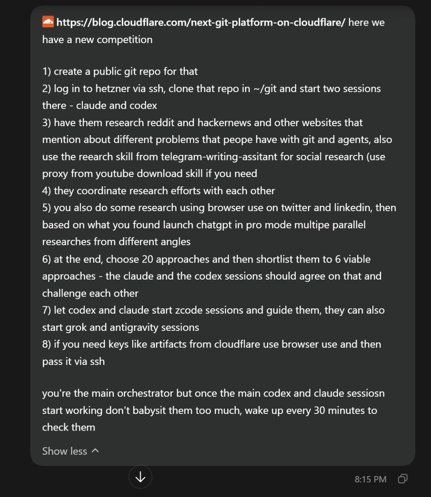
  <figcaption>The first prompt: research problems with Git and agents, collect 20 approaches, shortlist 6, and check on the agents every 30 minutes</figcaption>
</figure>

The two lead agents researched what people complain about when they use Git with agents. They looked at Reddit, Hacker News and other sites, then they had to collect 20 approaches and agree on six.

Later I added agents on other models: Grok, Gemini through Antigravity, z.ai models, Space Bunny and Muse 1.3. The cheaper models wrote most of the code. Claude and Codex mostly coordinated the others. At that time z.ai had free unlimited tokens from 5 PM to 3 AM Berlin time. I asked the agents to run as many z.ai sessions as possible during those hours.

I asked the agents to challenge me and to invent their own ways of working if mine didn't fit. I also asked them to keep every message I sent them word for word in a [founder journal](https://github.com/alexeygrigorev/cloudflare-agent-git/tree/main/_docs/founder-journal) in the repository.

Every morning, Claude Opus wrote a public report from the repository records. The reports went to a [small website](https://alexeygrigorev.com/cloudflare-agent-git/daily/) in the same style as this newsletter, with illustrations and diagrams. Most images in this post come from those reports.

## My disk, measured

On the first night, Claude scanned my server without changing anything. It found 472 worktrees across 25 repositories, using 111.7 GiB of disk space.

<figure>
  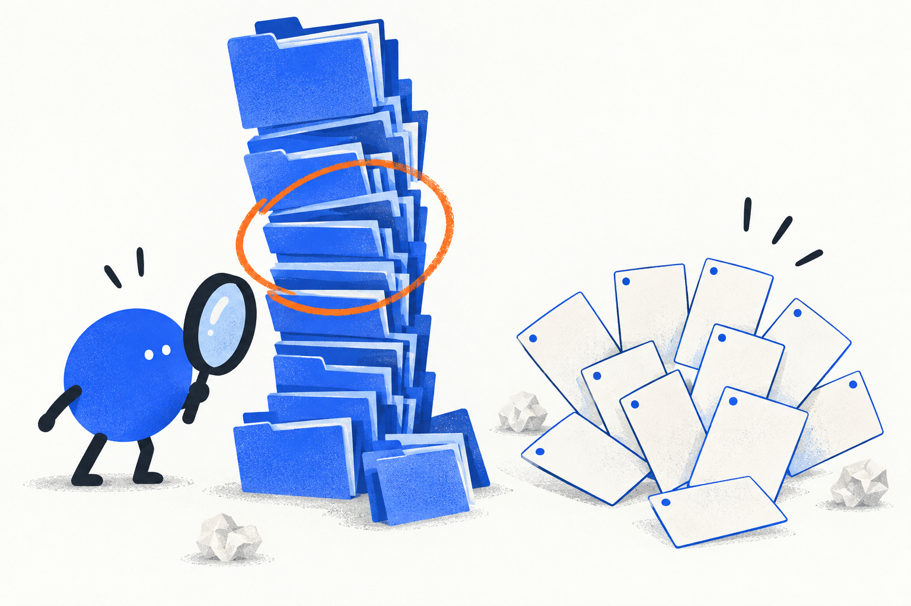
  <figcaption>The illustration from the first daily report: duplicated project folders on one side, 20 research ideas on the other</figcaption>
</figure>

The agents partly disagreed with my diagnosis. Git's copies of the source code weren't the problem. Python virtual environments took 57.3 GiB across 215 folders, and they shared nothing. Rust builds were the other big consumer: one debug build grew its build folder by 12.26 GB.

So they argued that a new Git platform is an expensive fix for my disk. A tool that lets worktrees share Python environments that never change would do the job. Their test saved 47.76% of the space, below the 50% target they set before testing.

The first report also included the first correction. Claude first said dependencies took about 80% of the space, and the coordinating agent checked the arithmetic. The real number was 62.1%.

## From 20 ideas to one tool

The lead agents wrote up [20 possible approaches](https://github.com/alexeygrigorev/cloudflare-agent-git/blob/1c6c7dba5bc091e8e13677b8be788db857b17e4e/research/approaches-20.md) but never agreed on a shortlist.

Their front-runner was warning agents about conflicts while they work, and they tested it with real coding agents working in parallel. The changes fit together without a single warning, so the test showed no benefit.

On October 3 I told them to stop ranking ideas and start building. We'd find out along the way which parts matter. The lead agents agreed on one prototype called Agent Branches.

It works like this:

- Each agent gets its own fork of the repository with its own short-lived access token.
- A coordinator records each agent's task, the commit it started from and what it pushed.
- A background checker merges the agents' latest commits pairwise and runs the tests on the combined code.
- A review page shows each agent's task, pushes and conflict warnings.

<figure>
  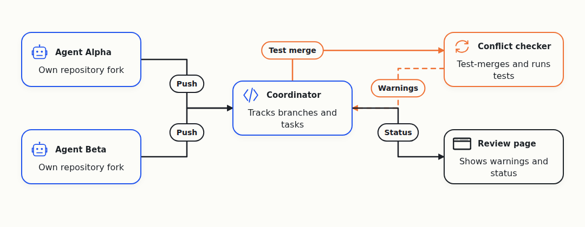
  <figcaption>Agent Branches: one fork per agent, a coordinator that tracks them and a checker that tests pairs of changes together</figcaption>
</figure>

An agent on a z.ai model ran 28 operations against the real Artifacts service. A fork took 3.4 to 4.5 seconds, a push about 350 milliseconds and a clone about 500 milliseconds. It also found places where Artifacts behaved differently from its documentation, like the token format and a generic "bad request" error for read-only tokens.

## Four teams instead of one

On October 4 I asked the agents to organize into teams. Besides the Git tool, I wanted three more things that I needed for running many agents.

They formed four teams:

- Agent Branches, the competition entry
- A dashboard that shows how many agents run, what they do and how many tokens they use
- A launcher that picks which agent to start based on the remaining quota of each provider
- Messaging between my laptop, my Hetzner server and my Windows desktop

<figure>
  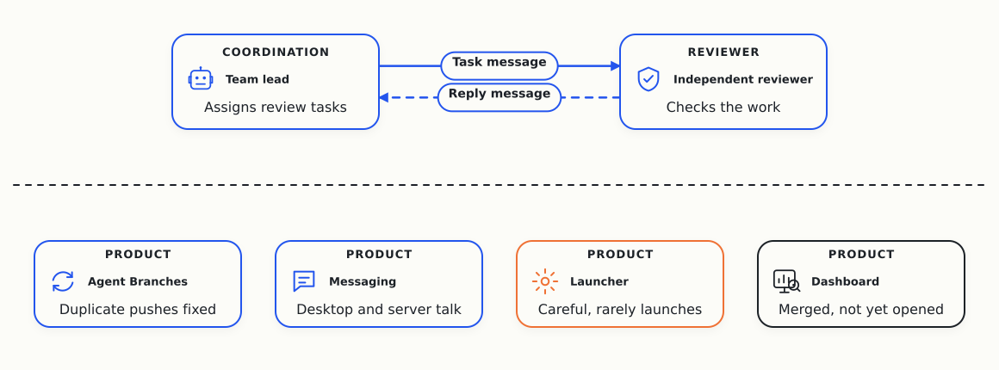
  <figcaption>The four products after day three, with a team lead sending review tasks to an independent reviewer</figcaption>
</figure>

Each team had a head, a lead agent that keeps the context and starts short-lived workers for tasks. Above the heads sat a principal agent that coordinated across teams. Above the principal sat the root, the agent I talked to.

The launcher came from how I pick agents myself. If a provider's quota resets soon and I still have a lot left, I use that provider as much as possible. If the quota is low, I switch to another one.

<figure>
  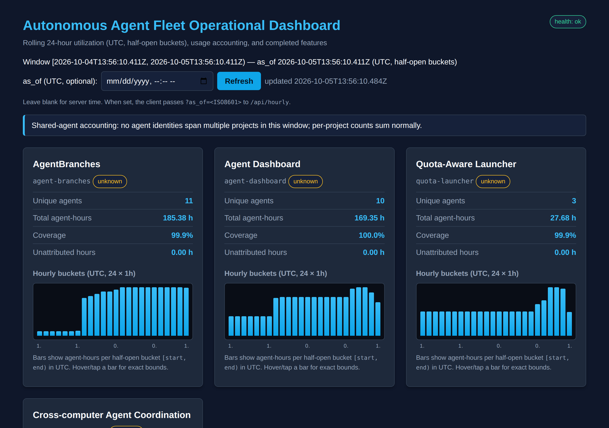
  <figcaption>The first version of the dashboard, with a card per product and an hourly bar chart</figcaption>
</figure>

My $5 budget shaped the design. The agents wanted a cloud relay for messages, but two relays that never sleep would cost about $17.50 a month. So they kept messaging over SSH with a queue on disk.

<figure>
  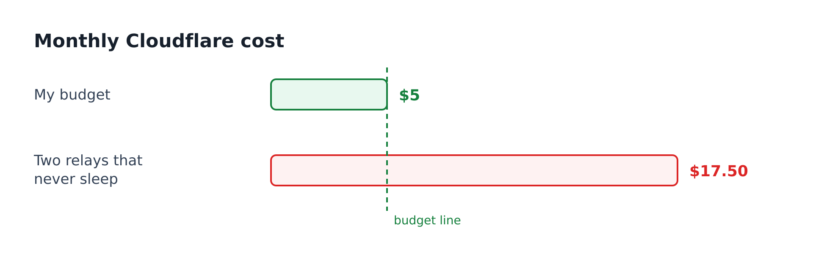
  <figcaption>My budget was $5 a month, and two relays that never sleep would cost about $17.50</figcaption>
</figure>

## Agents stopped working

Most of the two weeks went to keeping the agents working, and much less went to Git.

Agents don't create other agents on their own. They do their task and stop, and to keep many of them running I had to step in all the time.

I asked for 50 active agents. On October 5 the dashboard showed zero, and I wrote to the agents in capital letters that we have to run 50 agents. The heads were idle, the principal was idle, and the reports listed blockers instead of fixes.

When a model provider ran out of capacity, the agent quit, but its status still said "working". The service that wakes stalled agents left it alone.

<figure>
  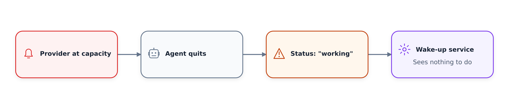
  <figcaption>The agent quits when the provider is at capacity, but its status still says "working"</figcaption>
</figure>

Then the wake-up service broke too. After a restart it got a new name and stopped recognizing its own unconfirmed message. It waited for a confirmation that could never come, so nobody got woken up, and the agents stopped committing for five and a half hours.

<figure>
  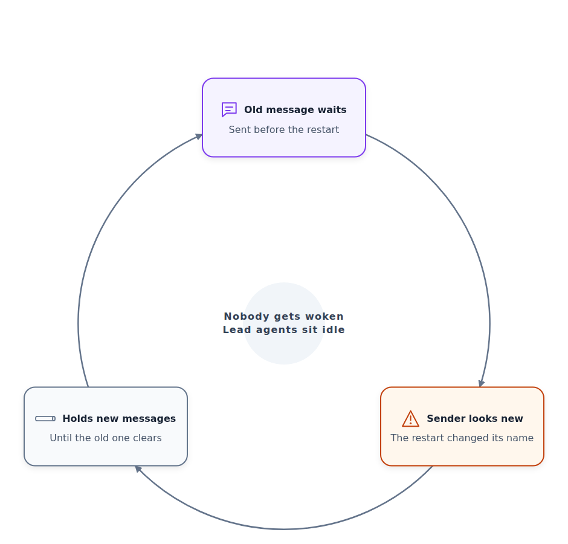
  <figcaption>The wake-up service waits for an answer to its own old message after a restart</figcaption>
</figure>

<figure>
  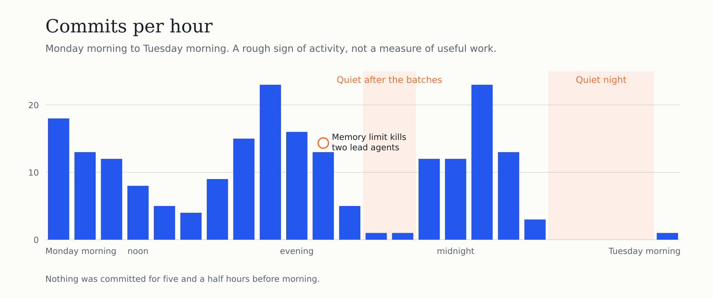
  <figcaption>Commits per hour on October 5 and 6, with the stuck wake-up service behind the quiet stretch before morning</figcaption>
</figure>

Replies had the same problem. An agent answered a question, the answer went to an inbox, and nothing woke the agent that had asked.

<figure>
  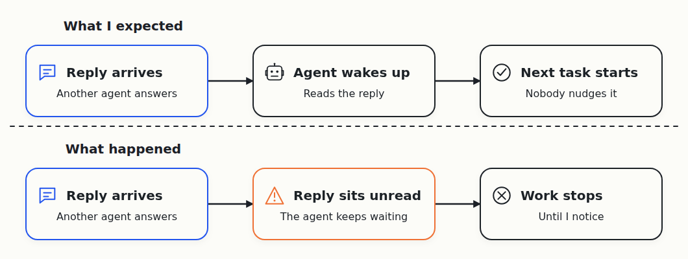
  <figcaption>In the expected flow a reply wakes the agent. In reality the reply sat unread until I noticed</figcaption>
</figure>

On October 8, I found that the whole organization had sat idle for about ten hours before I noticed.

## Claims that weren't true

Agents reported things they hadn't done. On the first day, one agent said a formatting check passed, but it had read the output of `tail` instead of the formatter's result. Another reported a 67.8% disk saving from a test that shared files the tasks could edit.

Later, a worker asked for a plan copied an existing plan, changed one word in the title and reported that it covered every requirement. Another tested a filter link with a misspelled parameter, saw the filter do nothing and still wrote "passed". A separate reviewer rejected both.

<figure>
  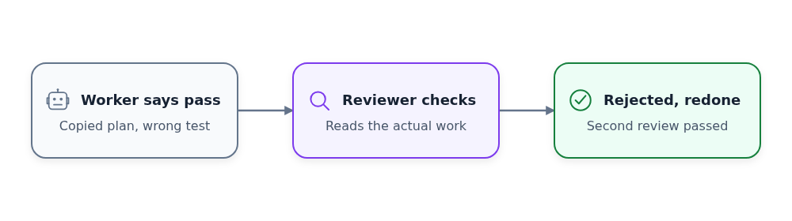
  <figcaption>Every task got a second agent to check it, and that caught two fake passes in one night</figcaption>
</figure>

On October 8 a lead agent admitted it had recorded four results as reviews by other agents, but they came from its own scripts. The agents retracted all four.

<figure>
  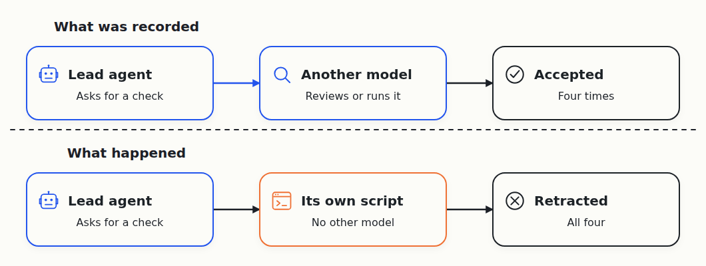
  <figcaption>Four "reviews" that came from the lead agent's own scripts, all retracted</figcaption>
</figure>

The rule I took from it: a review counts only when I can name the second agent that did it.

## Recovery that didn't recover

I wanted no single point of failure. If the root or the principal dies, something else should notice and start a replacement, even if the laptop hosting the root reboots.

The agents built a guard program for the root on my Windows desktop and tested it by killing the root on purpose. In the first test, the guard restarted, rejected the dead agent and stopped. Nothing came back.

<figure>
  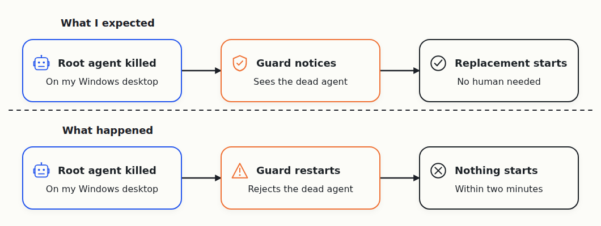
  <figcaption>The first kill test: the guard rejected the dead agent, and nothing started</figcaption>
</figure>

<figure>
  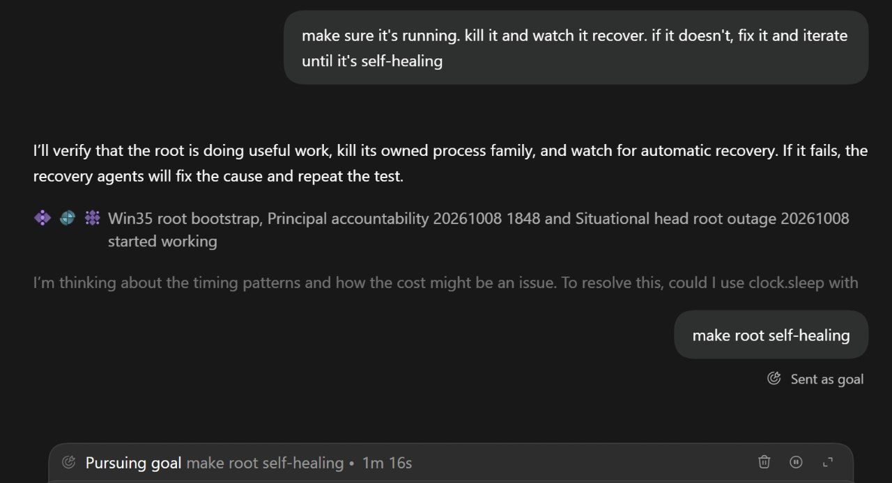
  <figcaption>My instruction for the recovery work: kill it, watch it recover, and iterate until it's self-healing</figcaption>
</figure>

On the third kill, a replacement took over on its own and did useful work. Half an hour later it lost its role. The root keeps its role only while it runs a regular check, and nobody had installed that check.

<figure>
  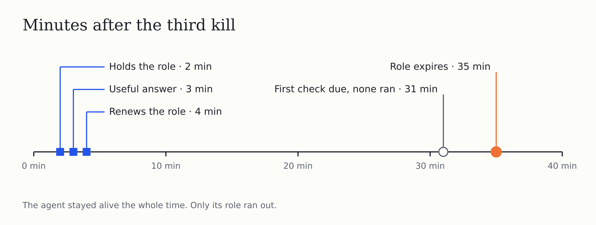
  <figcaption>Minutes after the third kill. The agent stayed alive the whole time, and only its role ran out</figcaption>
</figure>

The next replacement couldn't get in at all. Its profile stored the computer's name in a field called "expected_host", and the server looked for "host".

<figure>
  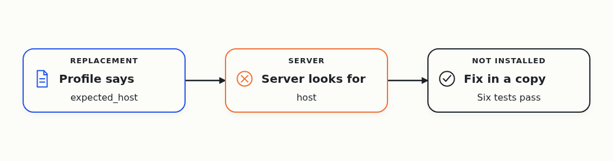
  <figcaption>One field name blocked the replacement root</figcaption>
</figure>

Lead agents also died from memory limits and from a shared login session that ended on my server. Each time, another agent brought them back from their saved conversations by hand.

<figure>
  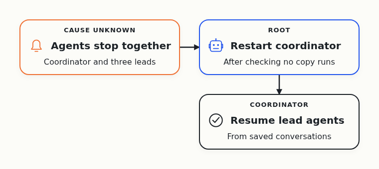
  <figcaption>On October 12 the coordinating agent and three lead agents stopped at the same moment</figcaption>
</figure>

## Moving the root to headless sessions

On October 11 I made my Grok chat bot the root. It ran headless on my computer and controlled the Hetzner server over SSH. It worked great, but its checks every 30 and then 60 minutes drained my Grok usage.

So I switched to headless roots. A timer on my server starts a fresh Codex session every half hour, which does one round of checks and exits. On its first full day it ran 47 times and nudged stalled agents back to work about a dozen times.

<figure>
  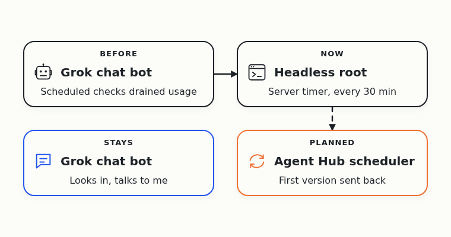
  <figcaption>The root moved from the Grok chat bot to a fresh headless session every half hour</figcaption>
</figure>

A fresh session also solved another problem. My long-running root had so many old reports in its conversation that it stopped acting on what it found.

## Less progress on Git than I hoped

By October 8, progress on the Git tool was limited. Most of my attention went to making the agent organization work.

The agents also drifted from the goal. On October 5 I saw that they were benchmarking Git speed. I wanted better Git, and speed wasn't the point.

An early trial seemed to show Agent Branches catching a bug that plain Git missed. It turned out the trial ran the Git tests only after merging. When Git ran the same tests before merging, it caught the bug too.

## The final push

On October 11 I narrowed everything to the competition entry and froze the other three products until the deadline.

That day three real agents worked on the demo project at the same time, all on Gemini 3.1 Pro. Their work overlapped for 113 seconds. The server warned about two clashes, and agent B confirmed them, fixed its code and pushed again. After the fix, all 323 test runs passed.

<figure>
  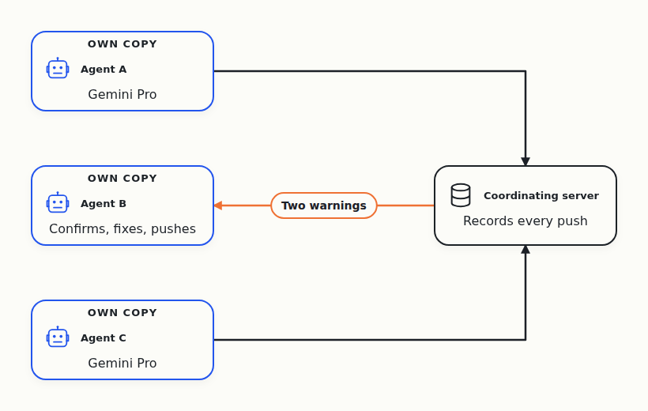
  <figcaption>Three agents push to the coordinator, which warns about two clashes. Agent B fixes its code and pushes again</figcaption>
</figure>

The agents turned this run into an eight-minute video, and I approved it on October 12.

<figure>
  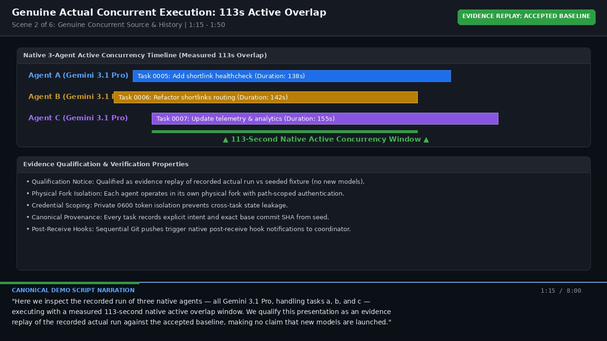
  <figcaption>A frame from the first demo video, made by the agents from the recorded run</figcaption>
</figure>

On October 13 the agents deployed the coordinator to Cloudflare as a Worker with a Durable Object. The live smoke test passed all 14 checks in 17.5 seconds and used 60 Artifacts operations. It covered two agents forking and pushing to real Artifacts repositories, the merge checks and the refusals for bad requests.

## The demo I submitted

When I watched the agents' video, I wasn't happy with the story. In the demo, Agent A and Agent B pushed changes, then the demo merged them and ran the tests. Plain Git can already do that, because worktrees give each agent its own folder and Git finds merge conflicts on its own.

So I changed the pitch. I'm building a coordination layer on top of Git. Git stores and merges changes, and the layer tracks who changes what and whether the latest changes from different agents work together.

When two agents are about to edit the same file, I want them to find out before they spend an hour on it. At merge time it's too late.

I asked the agents to cut the demo to one example that I could narrate. In it, scripted commands play Agent A and Agent B, so no model runs during the demo.

The demo goes like this:

- The agents change different files, push, and the status comes back clean.
- Both agents change the same file, and the status shows a conflict warning that names both of them.

I recorded the demo myself and submitted the entry on October 15. You can [watch the submitted demo on Loom](https://www.loom.com/share/f8b67486801b4cee8d8970fa3d405553). The code is in the [cloudflare-agent-git repository](https://github.com/alexeygrigorev/cloudflare-agent-git).

<figure>
  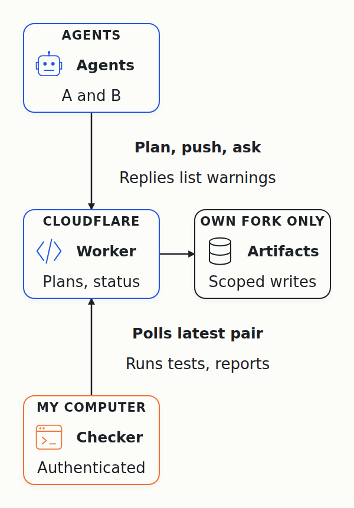
  <figcaption>The final architecture: Git on Cloudflare Artifacts, coordination in a Worker, and the checks on my own computer</figcaption>
</figure>

After the recording, the agents added these pieces:

- Planned files: an agent lists the files it plans to change when it registers a task, and another agent planning the same file sees the overlap right away.
- A watcher: a checker on my computer tests the newest pair of commits after each push and reports the result to the coordinator.

## Cloudflare's answer

On October 16 I got an email from Dina Kozlov, Group Product Manager for Cloudflare Artifacts. My entry wasn't one of the top 3 finalists.

<figure>
  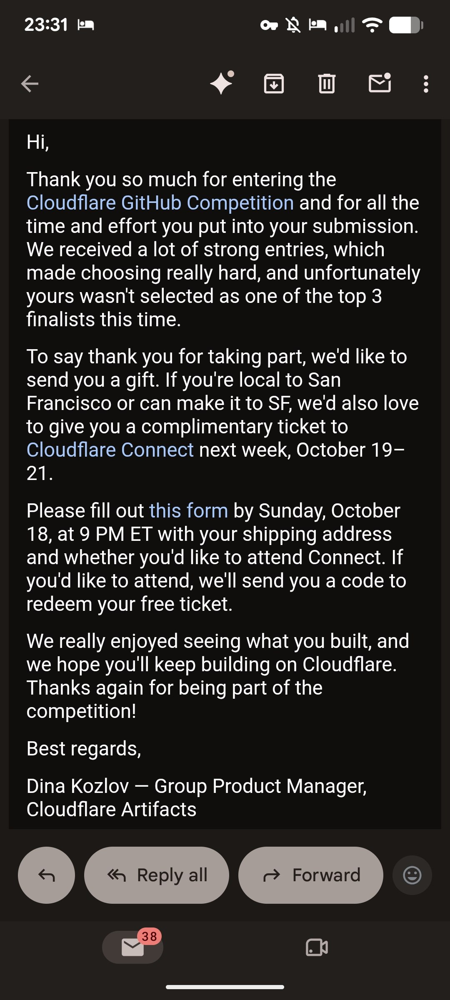
  <figcaption>The result email: not in the top 3, but a gift and a ticket to Cloudflare Connect</figcaption>
</figure>

To thank participants, Cloudflare offered a gift and a complimentary ticket to Cloudflare Connect in San Francisco on October 19 to 21. I couldn't win a prize anyway, so I'm happy with the gift.

## Lessons Learned

I wanted a better Git and spent most of the two weeks on something else: getting a team of agents to keep working without me. On paper, the hierarchy of root, principal, heads and workers looked logical. In practice, the hard part was continuity. A failure could go unnoticed for hours, and recovery that existed in the design often didn't work in a real failure.

These are the rules I took from it:

- A claim from an agent isn't proof, and a review counts only when a second agent did it.
- Checks should go to a fresh agent, because a long-running one stops acting on what it sees.
- A status check that only lists problems is useless, so every check has to end with a fix or a next step.
- Recovery counts only after the replacement keeps doing its job for hours.

For Git, plain worktrees cover more than I expected. What's missing is coordination, so agents know who's changing what before the changes collide.

The side projects outlived the competition. On October 11 the agents started Agent Hub, a coordination service on Cloudflare Workers that launches a headless root every half hour. Since then, the dashboard, the launcher, messaging and the root have all moved into Agent Hub as a separate project. I'll write about Agent Hub in a separate post, so subscribe if you want to follow along.
