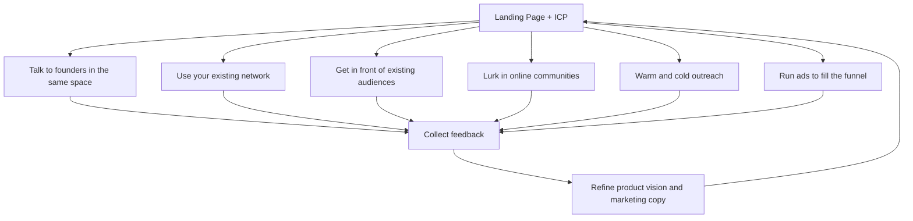

# First 10 SaaS Customers: A Repeatable Playbook

https://youtu.be/Ki3qBvIRo6A

Rob Walling has made 191 investments in B2B SaaS companies. Less than 5% of them had any kind of audience when they started - no social media following, no podcast, no YouTube channel. The ones that succeeded learned marketing as a skill. They didn't wait to get lucky.

This video lays out a process for finding your first 10 customers. The process is repeatable, predictable, and designed to teach you something each time you run it. It starts before you write any code.

## Marketing Before Coding

Most founders want to build first and find customers later. Walling argues for the opposite sequence: start marketing before you start coding.

Marketing here means talking to potential customers. It doesn't mean building in public, which usually means posting to other indie hackers and SaaS founders on social media. That's a different activity. Marketing means getting in front of the people who might actually pay for your product.

The full list of what counts as marketing:

- Content that your target customers want to read
- Search engine optimization
- Pay-per-click ads
- Integrations and partnerships
- Cold outreach
- In-person events
- Appearing on podcasts

Walling lists 20 distinct B2B SaaS marketing approaches in his book The SaaS Playbook.[^1] The ones above are the most relevant for early-stage founders going after their first 10 customers.

## Network Over Audience

The biggest misconception Walling sees among aspiring founders: thinking that building a social media following is a viable marketing strategy for SaaS.

A handful of people have made it work. Tens of thousands have tried and failed. He compares it to saying "I want to play in the NBA" - there are a few hundred people who do it, but it's not a repeatable strategy for everyone else.

His advice: build your network, not your audience. Learn marketing as a repeatable skill rather than trying to grow a following. A skill transfers to your next product. A social media following usually doesn't.

## The Foundation

Before reaching out to anyone, set up two things.

First, a landing page with an early access sign-up list. This applies whether you plan a high-touch funnel (demos, sales calls) or a low-touch funnel (self-serve sign-up). You need somewhere to send people.

Second, an ideal customer profile (ICP). If you think your product can be used by everyone on the internet, you're going to have a hard time. Pick a specific segment.

An ICP can be vertical or horizontal:

- Vertical: owners of construction firms, people who run gyms, martial arts dojo operators
- Horizontal by title: HR directors, directors of software development, engineers at a specific company type

The point is specificity. You need to know who is most likely to need, want, and buy what you're building.

## Six Tactics for Finding First Customers

With a landing page and an ICP in place, the goal is to get into conversations. Not pitch meetings - conversations. You're learning as much as you're selling.

### Talk to founders who sold to the same ICP

Find founders who have sold into the same space - both those who succeeded and those who failed. Get their perspectives on what worked and what didn't.

You can also talk to sales and marketing people from slightly larger companies. If you're just starting out and there's a SaaS company doing $50K a month selling to the same customer type, look someone up on LinkedIn. Reach out and say you're trying to do something similar and need advice. Many people will respond.

### Use your existing network

Reach out to people you know in the industry. Ask for insights. Ask them to connect you with people who might want the product.

If you don't know anyone in the industry, that's a problem. You should be building your network in the space you plan to sell into before you start building the product.

### Get in front of existing audiences

This is different from building your own audience. Building an audience takes years. Finding one that already exists is faster.

Go on podcasts. Ask someone in your network to share your idea with their following. The goal is to get your product in front of people who might care about it, using channels that already exist.

### Lurk in online communities

Join relevant Facebook groups, subreddits, Slack channels, and forums. Don't pitch immediately. Observe. Identify the common problems and complaints people have with existing solutions in your space.

This research helps you understand what the market wants and where current tools fall short.

### Warm and cold outreach

Email, LinkedIn messages, Twitter DMs. This is the tactic most aspiring founders avoid because it's uncomfortable.

Walling cites the story of Tally (tally.so), a form builder. Maria, one of the co-founders, did cold outreach to thousands of people to get the company off the ground. Many observers look at Tally's success and attribute it to the free plan. That's the wrong takeaway. What made Tally work was a free plan in a large space with a low cost to serve, combined with outreach and hard work that most people aren't willing to do.

### Run ads

Facebook ads, LinkedIn ads, Google AdWords. You're not trying to get a positive return on ad spend at this stage. You're trying to get people into the funnel - to find interested people who might be a good fit for the product.

This doesn't work for everyone. You need some budget, and you need to learn how to run ads. But it's one more channel for scratching and clawing toward those first 10 interested people.

## Processing Feedback

As conversations happen, feedback will come in. Some of it will reinforce your original vision. Other feedback will push you in a different direction: can you add this feature, can you pivot to this use case, can you support my workflow.

A common mistake among first-time founders: not knowing which feedback to listen to. You need to learn who to listen to and how to adapt your product vision based on market pull. The odds of your initial idea being exactly right from the start are very low.

Your early access email list is also a survey tool. You can send screenshots of what you're building. You can ask about a value proposition you're considering. You can add a short survey to the landing page itself - collect anonymous feedback first, then ask for an email address after.

<!-- illustration: feedback loop between conversations, landing page refinements, and product direction -->

## Finding Your Position

If you're entering an existing market, you need a unique position. The catch: you have to validate that position with actual customers early on. A unique angle that doesn't matter to anyone who buys in this space is worthless.

The feedback loop from conversations, surveys, and outreach is what tells you whether your position resonates. If it doesn't, the same loop tells you where to pivot.

## The Uncomfortable Truth

Walling keeps returning to one theme: the tactics that work are the ones most founders don't want to do. Cold outreach is uncomfortable. Asking for introductions feels awkward. Running ads when you have no product yet seems premature.

The alternative - posting on social media and hoping for inbound traffic - is a lottery ticket. It might pay off for a handful of people, but it doesn't teach you anything if it doesn't work. The repeatable approach is to learn marketing fundamentals, pick an ICP, and start conversations through every channel available to you. That skill compounds across every product you build.

## Sources

[^1]: https://youtu.be/Ki3qBvIRo6A
