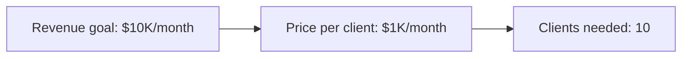
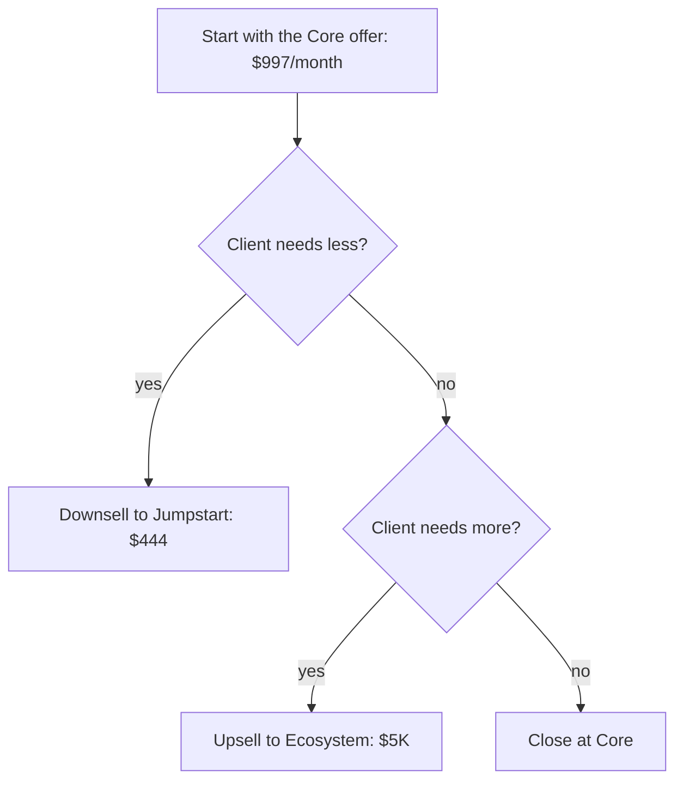
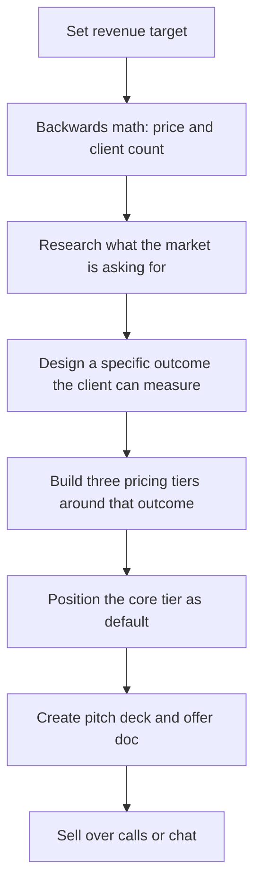

# Productized AI Service Offers: From Trading Time to Selling Outcomes

https://youtu.be/19QYlpGvcLo

Most people who sell AI services make the same mistake. They say "I do AI, do you need AI, give me $1,000 a month." Then every conversation with the client turns into custom work. That describes about 90% of AI service businesses. The economics are bad: when you net out actual revenue per hour, many of these people earn less than minimum wage.

This video is a live coaching session where a business consultant walks someone through designing a productized AI service offer from scratch. The person being coached was previously doing fitness and mindset coaching for a couple thousand dollars a month. The goal: get to $10K/month selling AI services. The entire session covers backwards math, market research, offer design, pricing tiers, and sales materials.[^1]

## The productized service idea

A productized service is the opposite of "I do AI for you." You still get paid to do a thing, but you sell a specific outcome rather than your time. The distinction matters because outcomes are repeatable. You build a method once and deliver it to each client, instead of reinventing the process every engagement.

The consultant frames it simply: there are a thousand people who say they can automate workflows with AI. A productized service is what makes yours different. You have a specific method for how you do it. You explain why it's different. That's the offer.

## Backwards math

The first step is working backwards from the revenue target.

$1,000 per month is the minimum the consultant recommends. Below that, there isn't enough margin to invest in delivery. And since the service targets business owners, a single new client that the AI workflows help them acquire is probably worth at least $1,000. That makes the offer easy to justify on a call.

## Finding what the market wants

The consultant uses a "hungry crowd" analogy. You don't need the best burger in town. You need a crowd of people who are hungry. Most people spend too much time trying to invent something creative and unique. The real problem is getting the right offer in front of people and presenting it in a way that sounds distinct, even if the underlying service is common.

For AI services, the current market demand comes down to three things:

- Business owners aren't using AI yet
- If they did use it, they'd want it to save time
- Saving time means automating workflows

The consultant suggests a concrete offer: a calendar audit that identifies three workflows you can automate, buying the client back 10 hours per week. That's not a vague "I do AI." It's a specific outcome a business owner can picture and measure.

## Three-tier pricing

The person being coached already had three offers drafted (with help from AI). The consultant reviews them and refines the positioning.

| Tier | Price | What the client gets |
|------|-------|---------------------|
| AI Jumpstart | $444 one-time | 90-minute session, one workflow built by the end or you don't pay |
| Core | $997/month | One workflow per month, a dashboard, a personalized AI agent |
| AI Ecosystem | $5,000/month | Full business automation, training sessions with the team |

The consultant says to always start the conversation around the core offer. It's easier to move down or up from there than to start at the bottom and try to climb.

## Never sell your time

A specific correction came up during the session. The person being coached described the $5K tier as "3 hours per month with me." The consultant immediately stopped him.

Never say "3 hours per month with me" on a sales call. Say "3 hours of training with my team." If you're the one who delivers it, that's a bonus. If someone else on your team does it, the client isn't upset because that's what they signed up for.

The reason: people don't buy your time. They buy your standards. If you promise "you get me" and then they don't get you, they feel cheated. If you promise "you get my team" and they happen to get you, they feel like they got more than expected.

This is what makes a service productized. Clients are buying your methodology, not your calendar. The method is the product.

## Sales materials: decks and docs

Once the core offer is defined, the consultant recommends creating two assets:

- A pitch deck for sales calls where you walk someone through the offer live
- An offer doc for chat-based selling where you send the details in a message

The consultant makes a point about chat-based sales. Most people don't realize how fatigued the market is with sales calls. Buyers today often know more about what you're selling than you expect. A discovery call feels like a chore when the buyer already understands the service. Sending a clear offer doc over chat can close deals without a call.

## The full offer design process

The whole process from "I want to sell AI services" to "here is a priced, positioned, repeatable offer" took about nine minutes in the video. The consultant used AI (ChatGPT or Claude) live to help generate the offer structure, making the point that everyone has access to the same tools now. In the past, you'd pay a consultant to sit down and build this with you. Today, the AI can do the first draft and you refine from there.

## Sources

[^1]: https://youtu.be/19QYlpGvcLo
