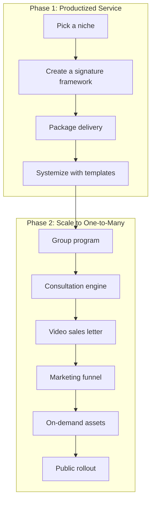
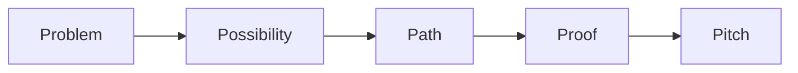
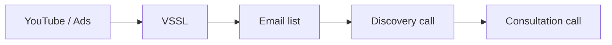

# Productizing Services: A Ten-Step Blueprint to $100K/Month

https://youtu.be/V6kAreDT62Q

Custom service work hits a ceiling. Every new client means a new proposal, a shifting scope, and more hours on your calendar. This video walks through a ten-step process for turning a service-based business into a productized, scalable offer - going from custom agency work to $100K/month without building a large team.[^1]

The process splits into two phases. Phase one (steps 1 through 4) turns a custom service into a repeatable, fixed-scope product. Phase two (steps 5 through 10) repackages that product into a one-to-many model and builds a sales engine around it.

## The starting point

The speaker ran a marketing and sales automation agency. Every project felt different - one client wanted webinars, another wanted a lead magnet campaign, a third wanted just the tech setup. Each project required custom scoping. Capacity was unpredictable.

The shift started with a productized done-for-you service. Fixed scope, fixed price, one-week delivery. The price started at $7,500 and eventually reached $15,000. Three to six clients per month produced $25K to $50K/month without burnout. No custom proposals, no scope creep.

That service became the foundation for everything that followed. The goal was never to scale done-for-you work all the way to $100K - it was to build a stable base and then add a leveraged layer on top.

## Step 1: Pick a niche

The turning point came from getting specific. Instead of offering automation help to everyone, the agency focused on one platform (Keap, formerly Infusionsoft) and one result (a fully automated evergreen sales system).

The formula: "I help [avatar] achieve [result]."

The speaker's version: "I help Infusionsoft users sell more courses and services using evergreen sales funnels."

Three sub-steps to find yours:

1. Pick your best-fit client - someone you already get results for, and ideally enjoy working with
2. Define the result they want - more revenue, less stress, faster outcomes
3. Plug both into the formula

That one sentence shapes everything: your offer, your marketing, and your business model.

## Step 2: Create a signature framework

Even with a clear outcome, sales calls were inconsistent. Every time a prospect asked "How does this actually work?", the answer came out differently. That created two problems:

- On the sales side, prospects asked more questions, took longer to decide, and often felt uncertain
- On the delivery side, clients assumed the scope was unlimited because nobody had shown them boundaries

The fix was a named, visual framework that made the process concrete. The speaker's framework had three phases:

1. Gather - collect client assets, clarify the customer journey, identify gaps
2. Assemble - build the automations, set timing logic, connect landing pages
3. Launch - test everything, go live, optimize based on results

How to build your own:

1. List every step you take to get a client to the result
2. Group those steps into three phases
3. Break each phase into specific actions and deliverables
4. Give the framework a name - named processes get remembered

The shift: from "I offer help" to "I deliver outcomes through this specific system."

## Step 3: Package delivery like Chipotle

A framework alone doesn't prevent scope creep. Without a fixed container, the speaker's team was still customizing scope, changing prices, and bending the process for every new client.

The Chipotle analogy: when you walk into Chipotle, you don't ask for a cheeseburger. You pick a container (burrito, bowl, tacos), then move left to right choosing from preset ingredients. The price is always the same. But it feels custom to the person ordering.

Your signature framework is the ingredients. Your packaging is the burrito. You decide what goes in, what doesn't, and how it gets delivered.

Steps to package your service:

1. List your delivery milestones - what needs to happen to reach the result
2. Group those into four to six stages (onboarding, delivery, offboarding)
3. Assign a realistic timeline to each stage

Adding a time constraint also works as a selling point. The speaker's team built automations in seven days - that constraint communicated speed and professionalism.

## Step 4: Systemize delivery

A polished package still falls apart if delivery depends on ad hoc Slack messages and last-minute file exchanges. The speaker's team asked: "What are we doing over and over for every client?" Then they templatized it.

The systems they built:

- A single intake form that replaced five back-and-forth emails
- Pre-built opt-in pages clients could customize in minutes
- Plug-and-play email sequences so nobody rewrote copy from scratch
- Standardized automation campaigns that delivered 80% of the value with 20% of the effort

Onboarding and delivery went from weeks to days. Fewer mistakes, fewer questions from the team. Clients didn't see the system - they just felt the difference: fast, clear, smooth.

How to build your own delivery systems:

1. Create a master intake form - collect everything you need once
2. Build delivery templates - opt-in pages, email copy, checklists for recurring tasks
3. Automate communications - use tools like Zapier for confirmations, reminders, and status updates

Start with whatever you repeat most often and make it zero-click simple.

## Step 5: Shift to one-to-many

Done-for-you work was producing $35K to $50K/month reliably. But the calendar was full. Every new client meant more hours, and the only way to grow was to add people.

Instead of building a course or disappearing for three months to build curriculum, the speaker pre-sold a small group program called "Funnels that Scale." It was a group version of the done-for-you service using the exact same framework.

The format was simple:

- Mondays: teach the steps, hand out all the assets and tools
- Thursdays: live Q&A
- Between sessions: clients worked with support via Slack or a community tool

No reinvention. No fancy platform. A live call, a slide deck, and the process they had already been running for done-for-you clients.

The first cohort was $2,000 per person. The next round was $5,000. Eventually it reached $7,800, plus $500/month for ongoing support.

<!-- illustration: revenue stack showing done-for-you base plus group program filling the gap to 100K -->

The math: done-for-you clients provided $35K to $50K/month. That left a $50K to $65K gap to reach $100K. The group offer filled that gap - not by doing more work, but by repackaging expertise into a model that scaled with time rather than against it.

## Step 6: Build a consultation engine

Pre-selling proved the group offer worked. The next problem was selling it consistently without duct-taping deals together.

The consultation engine has two parts:

1. A 15-minute discovery/fit call - a short calendar slot with qualifying questions on the booking form. The goal is to screen for intent and fit, not to pitch
2. A 45-minute consultation call - serious prospects walk through where they are now, where they want to go, and how the framework gets them there

No pitch decks, no pressure. The conversation felt natural. Close rates went up.

The system also made sales measurable. The team tracked who booked, who showed, what questions stalled the sale, and why people said yes or no. Recording calls created instant sales training material.

How to build yours:

1. Set up a 15-minute discovery slot with a qualifying intake form
2. Invite qualified prospects to a longer consultation focused on three questions: where are they now, where do they want to go, how does your framework get them there
3. Track and learn from every call - note every objection, watch replays

## Step 7: Create a video sales letter

Too many consultation calls still felt like convincing rather than qualifying. The fix: a video that does the selling before the call starts.

A video sales letter (VSSL) runs on autopilot. Prospects who watch it arrive at the call already bought in. Objections drop, conversion rates climb.

The VSSL script follows five sections:

1. Problem - address why what the prospect is currently doing isn't working
2. Possibility - show that a better way exists
3. Path - walk through how your framework gets them to the result
4. Proof - share how it worked for you and/or your clients with concrete examples
5. Pitch - tell them what to do next (book a call)

How to create yours:

1. Script it using the five-section structure above
2. Record it Loom-style - slides with a face cam in the corner
3. Add the link to your calendar page, your emails, and wherever your audience is

Keep it between 15 and 30 minutes. Short enough to watch, strong enough to convert.

## Step 8: Build a marketing funnel

A VSSL that runs 24/7 doesn't help if nobody watches it. The speaker built a simple funnel to drive consistent traffic.

YouTube brought in warm organic leads. Ads gave faster reach. The VSSL handled the heavy lifting. Email kept the business top of mind. Calls did the converting.

How to build your version:

1. Pick a traffic source - YouTube, Instagram, or paid ads
2. Point traffic to the VSSL
3. Add the VSSL link to your bio, your calendar page, and the PS of your emails
4. Follow up with two to three value emails per week (insights, client wins)
5. Include a clear call to action - book a discovery call or reply with questions
6. Use trackable links so you know which assets are actually converting

## Step 9: Turn live sessions into on-demand assets

When the group program launched, every session was live. The same questions came up repeatedly. The same lessons got repeated week after week.

But running it live also revealed what worked. The team tracked what clients rewatched, where they got stuck, and which assets actually helped them make progress.

They took what worked, cut what didn't, and built a clean on-demand version organized by milestones. Not a course - a performance engine designed to help clients get results with minimal handholding. On-demand videos plus pre-built templates and tools that sped up implementation.

That move gave the business margin, scale, and better outcomes at the same time.

How to build yours:

1. Review your live sessions - look for common questions and replays
2. Script tighter, clearer lessons (5 to 15 minutes each)
3. Organize by phase or milestone, aligned with your framework
4. Add lightweight assets - templates, checklists, worksheets, swipe copy
5. Host it somewhere simple - a community platform, Notion, or even Google Drive folders with videos and PDFs

Keep version one lean. The goal is results, not polish.

## Step 10: Roll it out

After running the group program live a few times, the speaker had a framework that delivered results, a handful of success stories, and systems that didn't depend on one person showing up every hour.

The rollout was simple:

- Updated the video sales letter
- Tweaked the sales call script
- Sent a few emails to the list: "Here's what we've built. It works. We're opening the doors."

No big launch, no complicated funnel, no 57-email sequence. A clear invitation to a proven offer.

How to do yours:

1. Email your list - tell the story of how you built the program and what results it produced
2. Update your VSSL and sales call flow to reflect the group format and early wins
3. Simplify the path to join - a calendar link, an application form, or a landing page
4. Run a light promo - two to three emails, a strong value post, or a short info session

## The full arc

The ten steps form two distinct phases that build on each other.

Phase one creates a stable, profitable base. You pick a niche, name your process, package it at a fixed scope and price, and systemize delivery with templates. That alone can produce $25K to $50K/month with three to six clients.

Phase two adds leverage. You take the same framework and deliver it to groups instead of individuals. You build a sales engine (consultation calls, a VSSL, a funnel) so clients come in pre-sold. You turn live sessions into on-demand assets so delivery doesn't depend on your calendar. Then you open it up.

The two phases don't replace each other. The done-for-you service keeps running alongside the group program. Together they fill the gap to $100K/month.

## Sources

[^1]: https://youtu.be/V6kAreDT62Q
