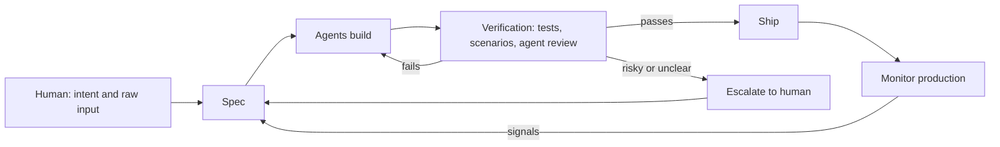
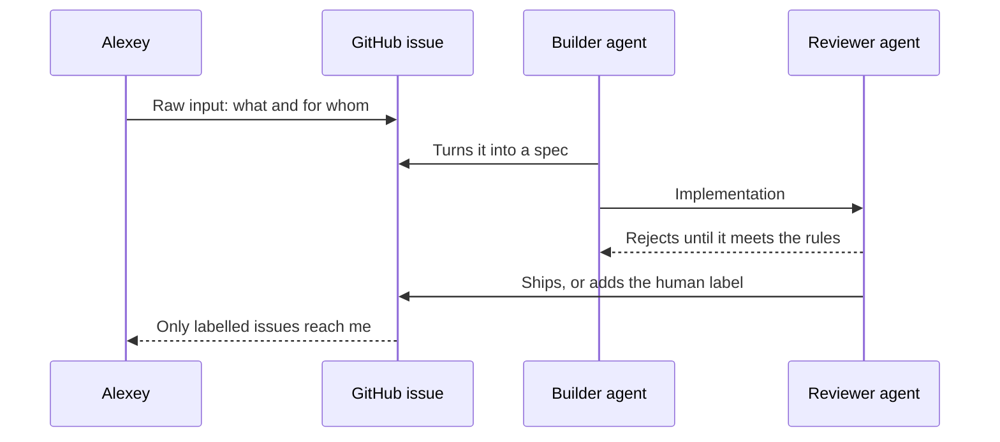

# Dark Software Factories

I work much more slowly when I read code and check every diff. That's why around six months ago I stopped doing it routinely. Now I write code myself or read agent-generated code occasionally, when I prepare a workshop or course.

I started hearing the term "software factories" a month or two ago and realized I already had one. I described my agent team on [April 3, 2026](https://aishippingblog.com/p/i-built-an-ai-agent-team-for-software), before I called it a factory.

Back then I was still looking at the code. It was terrible, and I thought the tests were absolute slop. I wanted the code to look as if I'd written it myself. I'd dictate review notes with Google Recorder and give them to my agent teams.

They'd spend a couple of days rewriting it. When I reviewed it again, some comments still weren't addressed, so I'd record another note. At some point I realized I was spending time making code match my preferences without improving the product.

The code worked, and the tests I disliked caught problems in the code the agents wrote. When I removed some of those tests, things stopped working. So I left the agents to write what they needed and focused on architecture, modularity, checks, and recovery when something broke.

Recently I started hearing another term: "dark software factory". In this setup, people give agents specifications and have them write, test, and ship code without human code review. People still decide what to build and how to check it. They evaluate the results through tests, demos, and monitoring.

I now make more decisions about architecture. If two projects need the same functionality, I ask for a shared library. If they need common authentication, I ask for single sign-on instead of maintaining an authentication layer in every application.

I also want to share code across devices. Instead of separate Kotlin, desktop, and web implementations, I can ask for a common TypeScript codebase and fix a bug once.

When agents take days to fix a bug, I ask how large the codebase has become. In one project, patch after patch had made it difficult to change. I asked the agents to reimplement the same behavior with a target of 20% of the code. I used the existing behavior as the specification for the rewrite.

I'm still making technical decisions, but I do it by setting direction and checking behavior. I wanted to understand how that compares with what other people call a dark factory.

In this article, I'll cover:

- Where the factory terminology came from
- What recent practitioners say they're running
- How to verify software without reading every change
- The costs and operational problems that still need human judgment

## Origins of the Term

The phrase "dark software factory" combines lights-out manufacturing with the older idea of a software factory.

In lights-out manufacturing, machines can run without people on the factory floor. [FANUC describes factories](https://www.fanuc.co.jp/en/profile/production/factory1.html) where robots load machining cells for unattended operation, including nights and weekends.

The software-factory idea is older than coding agents. People wanted to make development repeatable through shared tools, reusable components, standards, and quality checks. Humans still designed, wrote, and reviewed the software. [Addy Osmani traces that ambition to 1968](https://addyosmani.com/blog/software-factories/).

With agents, people are trying to automate more of those steps, including implementation and review.

The earliest explicit software use I found was [Dan Shapiro's January 23, 2026 post](https://www.danshapiro.com/blog/2026/01/the-five-levels-from-spicy-autocomplete-to-the-software-factory/). That's the earliest I found, rather than proof that nobody used it earlier.

He used driving automation as an analogy and described levels 0 through 5:

- Level 0: you write the code and occasionally use AI for search or suggestions.
- Level 1: you delegate small tasks such as tests and docstrings.
- Level 2: you pair with an agent while staying involved in implementation.
- Level 3: you mainly review the code agents produce.
- Level 4: you prepare specifications and checks, then let agents work for hours.
- Level 5: you operate a system that turns specifications into software without routine human code review.

Shapiro placed himself at level 4 and borrowed the dark-factory name from FANUC for level 5.

[Simon Willison summarized the levels on January 28](https://simonwillison.net/2026/Jan/28/the-five-levels/) and described a small team whose agents demonstrated correctness without human code review. He later identified them as StrongDM's AI team.

My own early experiments were in January 2026, as I described in [Six Projects That Didn't Make It](https://aishippingblog.com/p/six-projects-that-didnt-make-it). Opus 4.5 was available then, following [its November 24, 2025 release](https://www.anthropic.com/news/claude-opus-4-5). [Opus 4.6 arrived on February 5, 2026](https://www.anthropic.com/news/claude-opus-4-6), so it couldn't have powered my January experiments.

The agents could already keep working for hours, but my metabolism simulator showed why that wasn't enough. I got more features while basic logging remained broken. I needed clearer requirements, tests, and acceptance checks.

## The Discussion on Reddit and X

In a [July 30 Reddit discussion](https://www.reddit.com/r/ycombinator/comments/1vamsls/has_anyone_here_actually_set_up_a_software/), developers described several different meanings of "factory". Some had automated tasks through pull requests, while others still handled scheduling, exceptions, and final approval. One commenter explicitly said their system wasn't lights-out.

On September 12, [Pieter Levels argued on X](https://x.com/levelsio/status/2098861287413268889) that one coding agent was sufficient and could start more agents when needed. On September 25, [Geoffrey Huntley described a software factory on X](https://x.com/GeoffreyHuntley/status/2103470149450022989) as automation built into the product.

Those posts show an active disagreement about how much machinery to build. They don't tell us what fraction of developers run factories. I couldn't find representative adoption data for the stricter definition of unattended delivery.

## Teams Running a Factory

I looked for practitioner accounts from June 2026 onward, rather than treating vendor descriptions as proof of adoption. Automatic code generation, automatic merging, and automatic production deployment are separate claims.

On June 1, [Brian McQuay described adding ticket-to-merge automation to Sandstorm](https://brianmcquay.com/blog/going-dark/). After ticket refinement, he wanted agents to implement the change and review it automatically. They'd fix problems, run tests, and create a PR, then resolve conflicts and merge it. He described per-project automation settings and kept human application QA. He was still implementing the option when he wrote the post, so it doesn't establish a sustained production record.

On July 26, [John Wilger described building an SSH proxy called Lanyard](https://johnwilger.com/blog/somebody-has-to-design-the-factory/). He required isolated worktrees, verification that a live deployment answered, and fresh reviews tied to the exact code changes. When the code changed, earlier review approvals no longer counted. He also required agents to stop and escalate when they couldn't meet a required check.

In the July Reddit thread, [a developer described a Linear-to-PR setup](https://www.reddit.com/r/ycombinator/comments/1vamsls/has_anyone_here_actually_set_up_a_software/). They started agent sessions for ready user stories, followed repository instructions, and produced preview URLs. They also described automated releasing with end-to-end tests. The account doesn't specify whether a human approves each merge, so I wouldn't classify it as fully dark.

I didn't verify a non-vendor example from this period that established sustained production delivery with no human intervention.

## My Personal Projects

For my active projects, I now leave routine code reading to the agents.

That includes:

- [AI Shipping Labs](https://github.com/AI-Shipping-Labs/website), my workshop and community platform.
- [The DataTalks.Club website](https://github.com/DataTalksClub/datatalksclub.github.io), where I check the published pages and behavior.
- [PocketShell](https://github.com/PocketShell-io/pocketshell), my Android SSH client for working with agents from my phone.

These are examples of how I work today, not a claim that the repositories prove nobody ever reviewed their code. I still check the products, set architectural direction, and handle decisions the agents escalate. I also read code when preparing educational material.

## Enabling Practices

A conveyor belt still needs quality checks. In a dark software factory, we ask agents to check other agents and use automated tests to check their output.

I organize that work around implementation, verification, and escalation:

I provide the intent at the start and handle escalations. Between those points, I have agents turn the request into specifications, implement changes, and verify them.

## Specifications

StrongDM calls the input a seed, which can be a specification, a screenshot, or a short request. They have agents develop it into software through repeated verification. ([StrongDM's principles](https://factory.strongdm.ai/principles))

Hugo and I discussed the same division of responsibility. I decide what to build and who it's for, then ask agents to develop the detailed specifications.

## Holdout Scenarios

StrongDM found that agents could satisfy tests by weakening them or taking shortcuts. They use end-to-end scenarios stored separately from the implementation. ([StrongDM Software Factory](https://factory.strongdm.ai/))

A holdout set in machine learning contains examples the model doesn't see during training. Here, we keep evaluation scenarios out of the coding agent's working materials. That makes it harder to change the evaluation to match the implementation.

They evaluate how often the software satisfies the scenarios, rather than relying only on whether repository tests pass. They use a model to judge the observed sequences of actions. We still need to check whether that judge can recognize a wrong result.

## Digital Twins of External Services

StrongDM also built behavioral replicas of external services, including Okta, Jira, and Slack. They test against these replicas without using live-service quotas or changing production data. ([StrongDM's account](https://factory.strongdm.ai/))

They used agents to build the replicas. Jay Taylor explained that they tested compatibility against popular public SDK clients. That gives them concrete behavior to reproduce, rather than asking a model to invent what an API should do. ([Willison's report and Taylor's explanation](https://simonwillison.net/2026/Feb/7/software-factory/))

## Agentic Review and Cleanup

OpenAI describes asking Codex to review changes, requesting additional agent reviews, and iterating until the reviewers accept the work. They also run background agents to find violations of repository rules and propose small refactors. ([OpenAI's engineering account](https://openai.com/index/harness-engineering/))

I use an implementer and a reviewer in a similar way. For design, I assign a designer and senior designer. Hugo uses three parallel verification agents for writing.

## Escalation to Humans

People remain responsible for goals and exceptions when agents produce code unattended. I use a `human` label on GitHub issues to identify decisions that need me.

I ask the agents to follow this escalation process:

I had to tune what they escalate. If the agents escalate too often, I review everything. If they escalate too rarely, I miss decisions I need to make.

In [his agentic data science playbook](https://hugobowne.substack.com/p/the-agentic-data-science-playbook), Hugo recommends stating what an agent must return for human review. That includes trade-offs requiring an operational decision.

## Continuous Learning

Hugo also recommends preserving evidence and converting reviewed lessons into reusable instructions and evaluations. He describes an overnight fraud-model experiment in which agents tried 41 changes and retained seven that improved validation loss.

I do something similar when I add a rule after seeing the agents make a mistake. The agents should use what I learned while reviewing their previous work.

I also need to account for the tokens I spend on repeated reviews and experiments.

## Economics

In February, StrongDM proposed spending at least $1,000 in tokens per engineer per day. Willison calculated roughly $20,000 per working month and questioned the economics. He contrasted that with his own experiments on a $200/month Claude Max plan. These were February 2026 figures, not a minimum budget for every factory. ([Willison's cost discussion](https://simonwillison.net/2026/Feb/7/software-factory/))

Shapiro argues that falling generation costs change the economics of automation. But cheaper implementation doesn't remove the cost of repeated checks, failed attempts, and production recovery.

When I estimate the cost, I need to include:

- Tokens spent implementing and reviewing each change
- Retries and work that fails acceptance checks
- Test environments, monitoring, and recovery
- My time specifying the work and checking outcomes

For a solo founder, the token budget limits how many agents I can run. I also need to know whether extra reviewers catch more defects or repeat the same judgments.

## Maintainability and Failed Experiments

Dex Horthy describes HumanLayer trying lights-off development in July 2025 and later returning to human review. In [his account of why software factories fail](https://github.com/humanlayer/advanced-context-engineering-for-coding-agents/blob/main/wsff.md), he argues that maintainability can deteriorate even while tests pass.

He separates passing a short coding task from keeping a codebase easy to change over several months. A model can get rewarded for a patch that passes tests without accounting for the future cost of that design.

[Nash Borges notes the limits of this evidence](https://nashborg.es/the-dark-factory-floods-what-happens-when-agents-write-code-no-one-reads/). Horthy sells tools for human-agent collaboration, and the account isn't a controlled comparison. It gives us a concrete maintenance concern without proving that every dark factory will fail.

## Comprehension Debt

Addy Osmani calls the growing amount of code that people no longer understand comprehension debt. He argues that passing tests doesn't tell us how much of that debt we're accumulating. ([Software Factories, Light and Dark](https://addyosmani.com/blog/software-factories/))

He favors giving agents autonomy where people can verify outcomes cheaply and reliably. Human judgment still matters for architecture and decisions where a wrong answer is expensive.

I recognize the practical problem: if I stop reading code, I need another way to understand behavior and recover from incidents. Monitoring alone won't help if nobody can diagnose what the monitoring finds.

## Reward Hacking and Correlated Judges

Reward hacking means an agent optimizes the score instead of the goal. Returning a fixed answer to pass a narrow test is one example.

The Stanford CodeX authors question how much trust we should place in agents that both write and judge software. A separate judge can still share the builder's blind spots. Keeping test scenarios separate doesn't automatically make the judge independent. ([Stanford CodeX's analysis](https://law.stanford.edu/2026/02/08/built-by-agents-tested-by-agents-trusted-by-whom/))

I therefore want deterministic checks alongside agent opinions. A type checker or a test against a known result can reject an answer that several agents accept.

## Security

The Cloud Security Alliance summarizes a Veracode study in which 45% of AI-generated samples failed security tests. That measures generated code samples, rather than the output of a complete factory with verification. It still illustrates the defects the checks must catch. ([CSA's research note](https://labs.cloudsecurityalliance.org/research/csa-research-note-ai-codegen-vulnerability-debt-20260406-csa/))

A history of successful deployments doesn't prove that the next change is secure. I still need explicit checks for access control, secret handling, and dependencies.

## Accountability

The Stanford authors also ask how accountability works when agents create the implementation and its evaluation. People still have to explain what they authorized and what evidence they accepted.

Their concerns include:

- Responsibility when unreviewed code causes harm
- Evidence that customers and auditors can evaluate
- Contracts written around assumptions of human development and review

These are questions raised by the authors, rather than a statement that one legal rule applies to every factory.

## Comparing Positions

The authors agree that people still choose goals and define checks.

They disagree about how far we can trust automated verification:

- Shapiro describes unattended specification-to-software work as the highest level of automation.
- StrongDM describes an implementation and verification workflow without human code review.
- Osmani ties autonomy to how reliably people can verify the output.
- Horthy argues that today's tests don't adequately measure maintainability over time.
- The Stanford authors question the independence of agent judges and who remains accountable.

Hugo expects it to become economically viable to focus on business outcomes without reading code. He compares that with trusting compilers without reading machine code. I agree with the direction, but we still have to establish what checks justify that trust for agents.

In my projects, I already leave routine code reading to the agents. For interfaces, I check the rendered product and give feedback, then ask agents to implement and review the changes. That's human involvement in product and design decisions, even when I don't read the frontend code.

I still care about readable code because an incident may eventually require someone to investigate it. When I leave the implementation to agents, I'm still responsible for architecture and recovery.

## Open Questions

These are the questions I'd like to explore next:

- Escalation calibration. I want to document issues that need my attention and issues agents should resolve themselves.
- Holdout scenarios for small teams. I want an evaluation setup that the coding agents can't change to suit their implementation.
- Digital twins on a budget. I want to test how much effort it takes to reproduce one external service faithfully.
- Deterministic checks. I want to move more reviewer rules into linters and tests with known expected results.
- Long-term maintenance. I want evidence from systems maintained this way for a year, including incidents and the cost of later changes.
- Design and frontend. I want to test whether an independent design reviewer can catch the problems I currently find by looking at the interface.
- Token economics. I want to compare the full cost per accepted change, including failed attempts and verification.
- Accountability. I want to understand what evidence customers need when agents produce software that nobody routinely reads.
