# Dark Software Factories

<figure>
  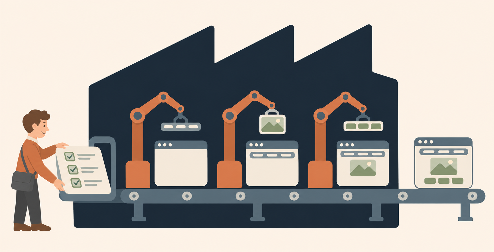
</figure>

Reading code slows me down and makes me a bottleneck. That's why, around six months ago, I stopped doing it routinely. Now I read agent-generated code only when I prepare a workshop or course.

A few months ago I started hearing the term "software factories" and realized I already had one. In April 2026, I published [I Built an AI Agent Team for Software Development and Tested on 5 Real Projects](https://aishippingblog.com/p/i-built-an-ai-agent-team-for-software). I described my agent team before I knew it was called "a factory".

But more recently I started hearing another term: "dark software factory". It's a factory where humans aren't allowed. We give agents specifications and check that they follow them, but we don't look at how it's implemented. We still decide what to build and evaluate the results through tests, demos, and constant monitoring.

I've been doing it for some time too. But I also wanted to understand what people mean by "dark software factory" and how others implement it. That's why I did some research, and I'll describe what I found in this article.

In this article, I'll cover:

- Why I stopped reading agent-generated code
- Where the idea of a dark software factory comes from
- How teams run software factories
- The practices that keep factories running
- The technical and comprehension debt factories create
- Where agent factories still need humans

## Not Reading Code

When I first started working with agents, I was looking at the code. It was terrible. Especially the tests - they were absolute 100% slop. I wanted the code to look as if I had written it myself.

I'd dictate review notes with Google Recorder and give the transcript to my agent teams to correct it. They'd spend one or two days rewriting the code. Then I'd review the project again, only to find that some comments were still not addressed. So I'd record another note, and then another one, and then another one.

<figure>
  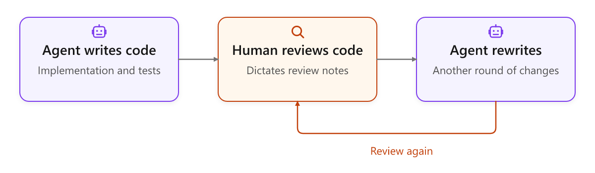
  <figcaption>The repeated code-review and rewrite loop.</figcaption>
</figure>

At some point I realized I was spending too much time (and tokens) on it without making any meaningful progress.

And I realized another thing: the actual problem was me, not the code. The original code worked fine, and the tests I disliked were able to catch problems in the code the agents wrote. When I removed some of those tests, things started to break apart.

Instead of helping, I was making things worse. Yes, the code looked terrible, but I had to either accept it or go back to writing code myself.

Eventually I left the agents to write whatever they needed, and I focused on the bigger picture:

- If two projects need the same functionality, I ask for a shared library.
- If they need authentication, I ask for single sign-on instead of maintaining an authentication layer in every application.
- If I want to use the same project across devices, I ask for a common TypeScript codebase instead of a separate Kotlin, desktop, and web implementation. If we catch a bug, we fix it only once.
- If adding new features or fixing bugs starts taking a long time, I ask to split the code into multiple modules.
- If the codebase grows too large, I ask for a reimplementation that reduces its size by two to three times. I also specifically ask to remove all the backwards-compatibility layers that agents like to create.
- If running tests takes too long, I ask to review the tests and/or split the library into multiple modules.

When I work with agents, I'm still making technical decisions, but I do it by setting the direction and checking the behavior, not by controlling the code.

<figure>
  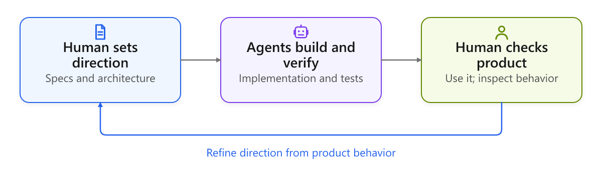
  <figcaption>Setting direction and checking the product.</figcaption>
</figure>

It was a gradual process, but eventually I arrived at what people now call "dark software factories".

And since the term keeps appearing, I wanted to understand where it comes from and how people do it.

## Lights-Out Manufacturing

The term "dark software factory" is a combination of two ideas:

- dark factories, also known as "lights-out manufacturing"
- software factories

In lights-out manufacturing, machines can run without people on the factory floor. [FANUC describes factories](https://www.fanuc.co.jp/en/profile/production/factory1.html) where robots put parts into machines so production can continue without people, including nights and weekends.

<figure>
  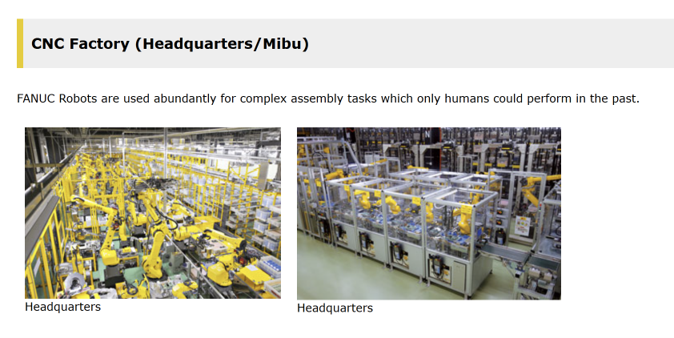
  <figcaption>FANUC's CNC factory. Source: <a href="https://www.fanuc.co.jp/en/profile/production/factory1.html">FANUC</a>.</figcaption>
</figure>

## Software Factories

The "software factory" idea is way older than coding agents.

[Addy Osmani traces it back to 1968](https://addyosmani.com/blog/software-factories/). People wanted to make development repeatable through shared tools, reusable components, standards, and quality checks. Writing code wasn't automated, but the idea was to have a standard process to ensure good quality. With agents, we're now automating these steps, including implementation and review.

For a pre-agent example, Jack Greenfield's 2007 article "Mass Customizing Solutions" includes a [software factory schema diagram on page 31](https://www.methodsandtools.com/PDF/mt200703.pdf#page=31). It connects roles, tasks, and workstreams to reusable assets. The factory was a structured environment that helped people build related applications from shared components.

When it comes to agents, the earliest mention I found was [Dan Shapiro's post](https://www.danshapiro.com/blog/2026/01/the-five-levels-from-spicy-autocomplete-to-the-software-factory/) (January 2026).

Dan described levels 0 through 5 of a code factory:

- Level 0: you write the code and occasionally use AI for search or suggestions.
- Level 1: you delegate small tasks such as tests and docstrings.
- Level 2: you pair with an agent while staying involved in implementation.
- Level 3: you mainly review the code agents produce.
- Level 4: you prepare specifications and checks, then let agents work for hours.
- Level 5: you operate a system that turns specifications into software without routine human code review.

As the levels increase, people move from implementation to defining the work and checking its results:

<figure>
  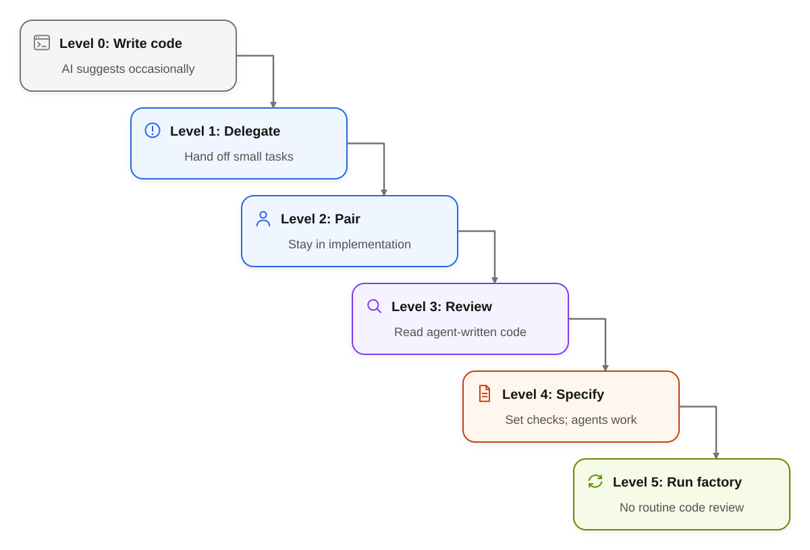
  <figcaption>The six stages in Dan Shapiro's levels 0 through 5. Source: <a href="https://www.danshapiro.com/blog/2026/01/the-five-levels-from-spicy-autocomplete-to-the-software-factory/">The Five Levels</a>.</figcaption>
</figure>

Shapiro placed himself at level 4 and borrowed the dark-factory name from FANUC for level 5.

[Simon Willison wrote a follow-up post about it](https://simonwillison.net/2026/Jan/28/the-five-levels/) in January 2026 and described a small team whose agents demonstrated correctness without human code review. (Every time I do term archeology, Simon's blog comes up!)

I was already experimenting with it in January and February with Claude. When it comes to coding, Opus 4.5 was a decent model, but most of us didn't have the proper tooling and processes to make it work at Level 5.

I described some of my earlier experiments and what I learned from them in [Six Projects That Didn't Make It](https://aishippingblog.com/p/six-projects-that-didnt-make-it).

Things have changed since January. The tooling is now a lot better, plus we figured out how to organize the work so it actually works: we now create specifications, have agents with different roles, and have an automated way of verifying the results.

I cover this in [my article about AI-native development](https://aishippingblog.com/p/ai-native-development-specifications), which is the first module of AI Dev Tools Zoomcamp.

## Teams Running Factories

In my courses I teach how I approach agentic engineering. I learned it by trial and error across many projects. But for this article I also wanted to see what other people are doing.

In my research, I focused on developers sharing their experience and excluded vendors and companies that consult in this area. I also wanted to check recent articles, so I restricted my search to June 2026 onwards.
Here's what I found:

### Sandstorm

[Brian McQuay describes Sandstorm](https://brianmcquay.com/blog/going-dark/), a system he uses for his software factory.

It's a Kanban-driven pipeline:

- a human refines a ticket and marks it ready
- the system prepares an isolated environment for the task to run
- the task is implemented and reviewed
- if any problems are identified, they are fixed
- it opens a PR
- the PR is merged and conflicts are resolved

Then he uses it for each project.

<figure>
  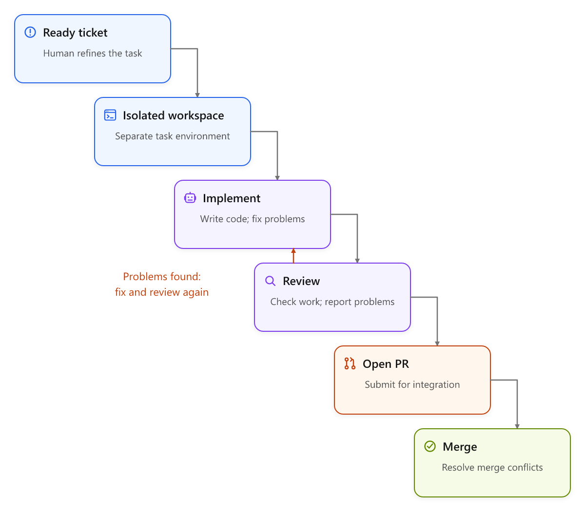
  <figcaption>A simplified view of Sandstorm's ticket-driven workflow. Source: <a href="https://brianmcquay.com/blog/going-dark/">Brian McQuay</a>.</figcaption>
</figure>

It reminded me of my earlier attempt to create the factory - I called it "litehive" (described in [Six Projects That Didn't Make It](https://aishippingblog.com/p/six-projects-that-didnt-make-it)). I didn't manage to make it work, but Brian did.

### Checks in Lanyard

While building an SSH proxy called Lanyard, [John Wilger found several ways his agents could appear to finish a task without actually finishing it](https://johnwilger.com/blog/somebody-has-to-design-the-factory/).

He added rules to prevent that:

- Each task gets its own copy of the code, so agents working on different tasks do not interfere with one another.
- A deployment is complete only when he can open the live URL and get a response.
- A command reporting success is not enough. The agent must check that the intended result actually happened.

He also makes agents repeat checks after every code change. Another agent reviews the work in a fresh session and cannot change the code while reviewing it. If the agents cannot pass a required check, they stop and ask John for help instead of skipping it.

<figure>
  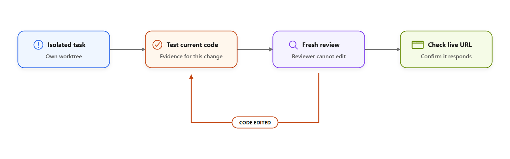
  <figcaption>Checks apply to the current version of the code. If an agent cannot pass one, it stops and asks Wilger. Source: <a href="https://johnwilger.com/blog/somebody-has-to-design-the-factory/">John Wilger</a>.</figcaption>
</figure>

### Linear-to-PR

I also found an interesting [Reddit discussion](https://www.reddit.com/r/ycombinator/comments/1vamsls/has_anyone_here_actually_set_up_a_software/) where people share what they used. 

One of the comments:

- prepare stories in Linear
- launch agent sessions for prepared stories
- make them follow repository instructions
- run end-to-end tests
- produce a PR with a preview URL

<figure>
  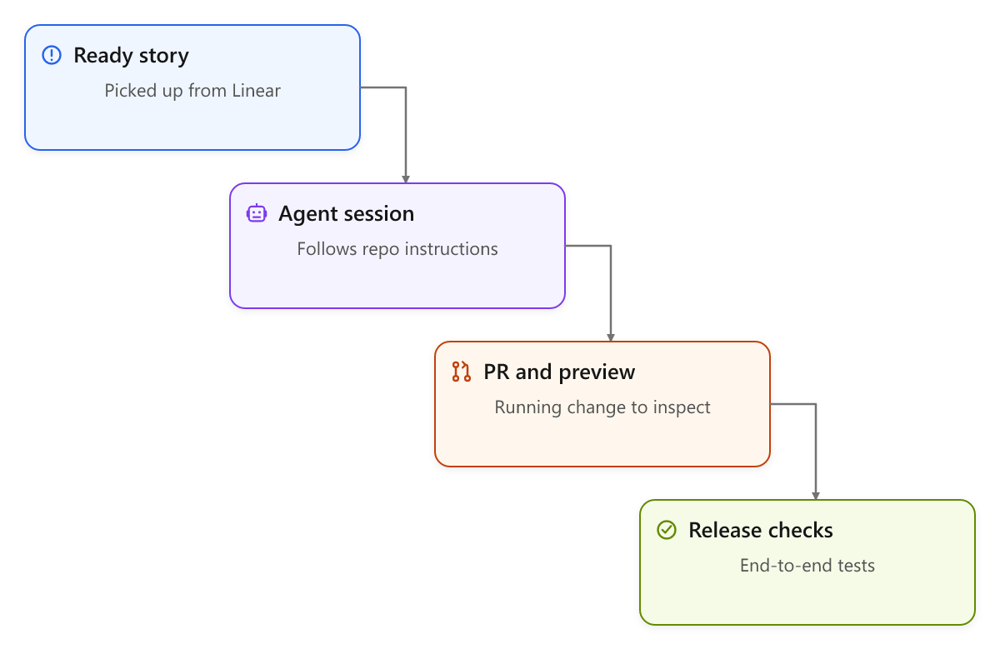
  <figcaption>The Linear-to-PR workflow described by a developer in a <a href="https://www.reddit.com/r/ycombinator/comments/1vamsls/has_anyone_here_actually_set_up_a_software/">Reddit discussion</a>.</figcaption>
</figure>

## Enabling Practices

All these stories follow more or less the same flow:

- Have a task backlog 
- Use spec-driven development to refine tasks 
- Have agents verify other agents 

Having a backlog is important because agents don't have long-term memory. Even within one session they can forget that you asked something. So it's really important to capture the tasks in any way, be it GitHub issues, Linear, or even plain text files.

We also need to have clearly defined tasks. Agents are good at writing code. But they are also good at filling the gaps in the specifications. If we ask an agent to implement a feature, it will work. But if we don't provide enough details, it won't be what we need.

To address this problem, we follow specification-driven development and turn each task into a spec with clear acceptance criteria.

Once the feature is implemented, we have another agent that checks the implementation against these criteria. If some of the boxes aren't checked, the implementer has to fix it.

This is the loop I show in [module 1 of AI Dev Tools Zoomcamp](https://aishippingblog.com/p/ai-native-development-specifications):

- a product manager agent grooms the issue
- an engineer implements it
- a QA agent checks each acceptance criterion
- on failure, the engineer has to do it again
- QA only reports what it observed and does not edit the code

<figure>
  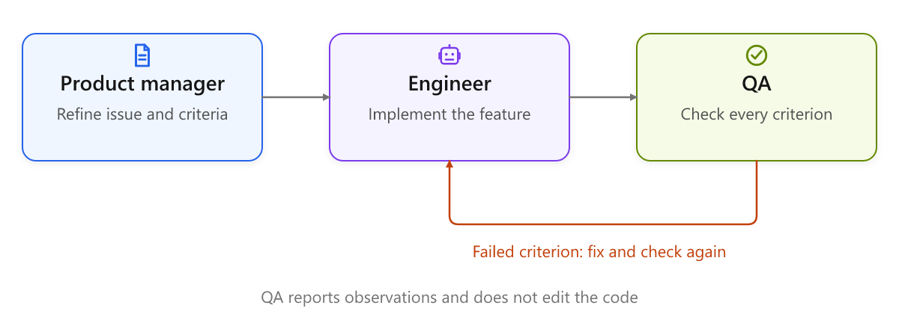
  <figcaption>The product manager grooms the issue, the engineer implements it, and QA checks the result. Source: <a href="https://aishippingblog.com/p/ai-native-development-specifications">AI-Native Development</a>.</figcaption>
</figure>

There are some other techniques that we need. One of them is being able to ask questions when the agents aren't sure about something.

## Escalation to Humans

We still need to involve humans. 

Agents need to have a way to escalate to humans but only when it's absolutely needed. I want to be involved as little as possible - but I also don't want to miss important checks and decisions.

In [Brian's Sandstorm](https://brianmcquay.com/blog/going-dark/), higher-risk or ambiguous work requires approval. Lower-risk work can merge automatically and receive application-level QA.

[In John's Lanyard workflow](https://johnwilger.com/blog/somebody-has-to-design-the-factory/), agents must stop and ask him for help if they cannot complete a required check. For example, if they cannot confirm that the deployed app responds, they cannot simply mark the task as done.

Brian and John decide ahead of time when an agent needs to involve a person.

<figure>
  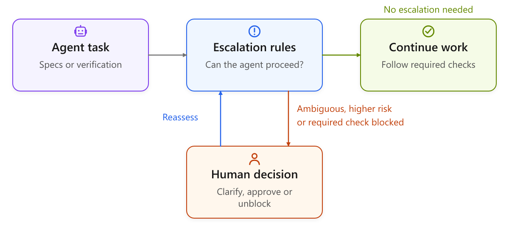
  <figcaption>Define when agents can proceed and when they need a human decision.</figcaption>
</figure>

In my projects, agents use the `human` tag for GitHub issues. They may decide that it's needed when turning a task into a spec, or later when verifying the results.

Of course, I also need to tune the process. If agents want to involve me when I'm not needed, I ask them to update the escalation rules. If something wasn't escalated but should have been, I do the same. Eventually it becomes clear what should be escalated and what shouldn't be.

## Problems with Factories 

In the [Reddit discussion](https://www.reddit.com/r/ycombinator/comments/1vamsls/has_anyone_here_actually_set_up_a_software/) that I already mentioned, I found another interesting link - a post on [why software factories fail](https://github.com/humanlayer/advanced-context-engineering-for-coding-agents/blob/main/wsff.md).

It's very long, but the main point I got from there was that maintainability deteriorates with time even when tests pass.

<figure>
  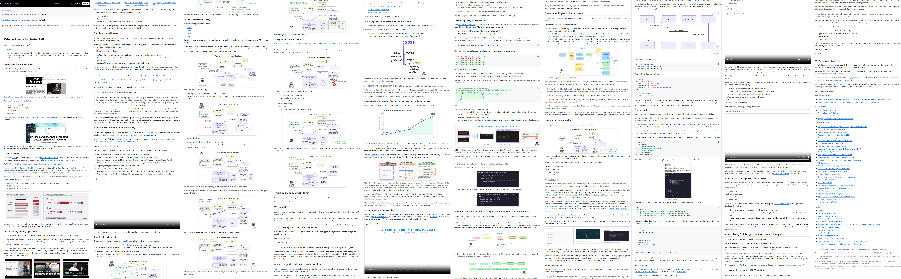
  <figcaption>Software factories will fail - the length of the article should surely convince you.</figcaption>
</figure>

That's true. Tests may pass, but as your codebase grows, adding functionality becomes more and more difficult. Models get rewarded for a quick patch without accounting for the future cost of that design. And since we don't look at the code (it's a dark factory, after all), the technical debt accumulates. 

It's certainly a problem. Agents create code fast and often completely disregard best engineering practices. They write duplicated code and don't really care about modularity.

In some cases it's okay. If we're only starting a project, it's too early to worry about it.

But if the project doesn't get abandoned, over time you will start noticing that adding a feature takes 1 hour instead of 5 minutes. On top of that, some bugs keep coming back, even though you thought you asked to fix them 5 times already.

When it starts happening, it's time to do maintenance work. I ask agents to analyze what slows them down and then find a way to fix it. Sometimes I can also ask them to describe the architecture and see if they can improve it.

Maintainability is not the only problem. Even with specifications, agents still make a lot of decisions for us.

I must admit that I sometimes find myself surprised when I discover some features in my own projects. And often the surprise is not a positive one.

[Addy Osmani calls it "comprehension debt"](https://addyosmani.com/blog/comprehension-debt/).

If I have a clear picture of how each feature works, my comprehension debt is low. But if I can't predict what happens when I click somewhere or change something, the debt is high.

<figure>
  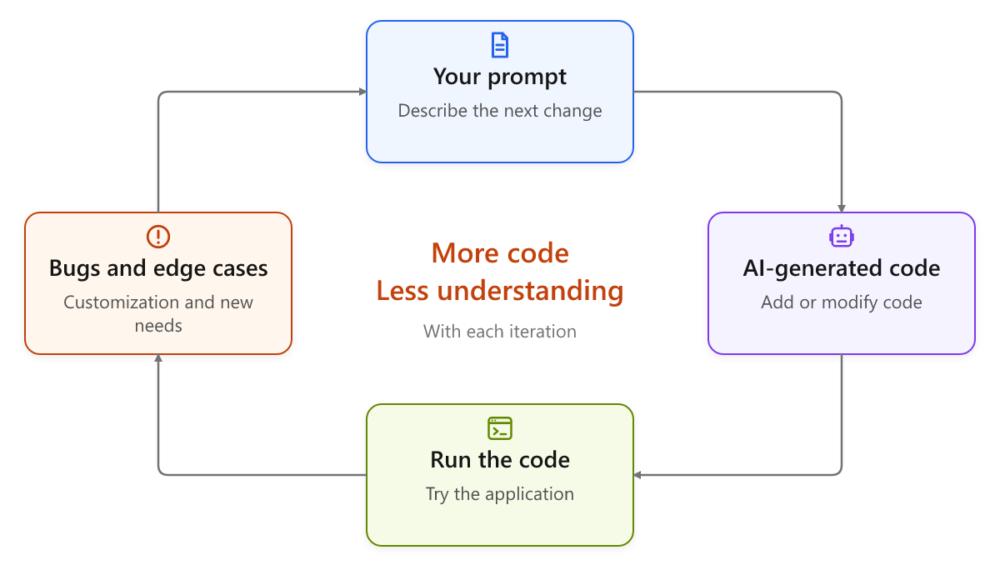
  <figcaption>Adapted from <a href="https://www.linkedin.com/pulse/comprehension-debt-hidden-cost-ai-generated-code-amir-mohajerani-phd-nb5be/">Comprehension Debt: The Hidden Cost of AI-Generated Code</a>.</figcaption>
</figure>

And there's no shortcut to fixing it. I need to spend time using the product, checking its behavior, and asking agents to explain all the surprising decisions. 

Later I fix the surprising behaviour. For important features, it often means staying away from the factory format and hand-holding the agent session for the important UX and UI details.

## Keeping the Factory Useful

Yes, there are downsides when it comes to software factories - including the technical debt and comprehension debt that they produce.

To me, knowing the level of your comprehension debt is way more important than the level of technical debt. That's why we can't easily scale the factories - otherwise we end up with absolute slop. So you have to spend quality time doing the product work.

Which is actually good news - we, humans, are still needed. 

But I certainly don't want to return to writing or reading code. I want to understand the product well enough to decide what it should do and notice when it goes wrong. That means writing better specifications, having better verifications, and actually using what you create.

The factory itself also needs maintenance. We need to monitor it to make sure it doesn't slow down. And when it does, we try to figure out how to fix it - like changing the process, fixing the code, or splitting projects into smaller ones.

So going "dark" doesn't mean just offloading everything to agents. The more work I delegate, the more carefully I have to design the specifications, checks, and escalation paths around it.

<figure>
  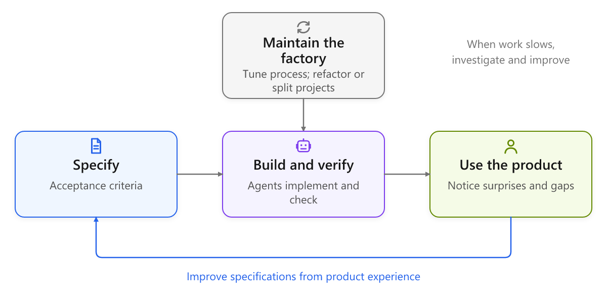
  <figcaption>Product experience improves specifications; maintenance improves the factory.</figcaption>
</figure>
