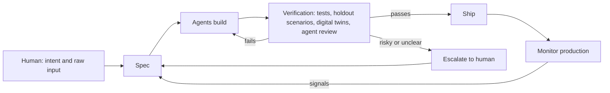
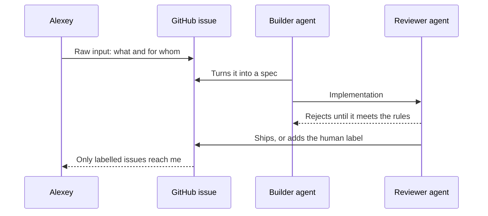

# Dark Software Factories

Reading code and checking all the diffs singnificanly slows me down. That's why around 6 months ago I stopped doing it. Now I write code myself or look at the code that agents wrote only occassionally - when I prepare for a workshop or a course. 

I started hearing the term "software factries" 1-2 months ago. Turned out I already had one - I described my approach in April (TODO double check)

Back then I was still looking at the code. It was terrible, and the tests were absolute total slop. I wanted it to be beautiful - as if I wrote it. So I woudl use google recorder to dictate code review notes, and then give it to my agent teams. Then for a copule of days they would be busy rewriting it, fixing my suggestions. And when I was reviering it next time, only to discovr that some of my comments were not addressed, so I would record anote note. 

At some point I realized that its' not productive, it's just biy work. The agents will never write the code the way I do. But I also discovered that the code they write actually works well. And the tets that I considered absolute slop (and I still do) were helpful against the code that agents write. WHen I was removing tests that I conisdered slop, the code actually stopped working. SO I decided to leave them alone and do whatever they need. I only guide architecturally, make sure the sustem is modular, and the process are sound and reliable. If something breask, there's a process that helps it recover. ANd the processes help eevrything stay under control.

And recently I startard herign another term - "dark software factory". 

A dark software factory is a development setup where agents write, test, and ship code, and human don't look at it at all. People decide what to build and how to check it, but they look at artifacts and outcomes, not PRs and code diffs.

My decisiosn now are more architectural. Like we have these two projects, let's have a common library that both these projects share. Or all of my projects need a common way of authenticating, let's create a SSO library adn remove the auth layer from the applications completely. Or I want to have the same codebase across different devices, so indead of having a Kotlin app for android, a desktop app as vs code fork, and a web app in typescript, let's implement eveythign in TypeScript, so if there's a bug, we fix it once and it works for all the platforms. 

Or if I see that agents take too much time fixing things, I can ask "how large is the code base". On one f my projects it was taking multiple days to fix a bug, and when I was testing it, it wsa fully fixed. Turned out the code grew too much and there was a patch on patch on patch. So I asked the agents to recreate the same beahviour but use only 20% of the code usign the "clean room" (TODO checj term) appeach - so like a distillation. 

In these cases i'm still involved in tehcnical decisions, but it's more directional, and I don't really look at the code. 

So when I came across the term, it looked to me that I was already doing it for some time. But I also wanted to check what people actually mean by this term, so I decided to do some research about it and write an article. 

In this article, you will:

## Origins of the Term

The phrase "dark software factory" joins two older ideas: lights-out manufacturing and the software factory. 

[Lights-out manufacturing](https://en.wikipedia.org/wiki/Lights_out_(manufacturing)) means a plant that runs without people on the floor, so nobody needs the lights on. 

- FANUC uses robots to build other robots, and they can run unsupervised for up to 30 days
- Philips makes electric razors with 128 robots and nine human quality assurance workers
- Xiaomi has a fully automated smartphone factory

The concept of a software factory has been around for some time. TODO: create a short summary of the idea - is it with humans? NO need for names dropping. is an old dream. R. W. Bemer proposed in 1968 that General Electric build a software factory with standardized tools and historical data for management control. Hitachi was the first company to call a software organization a factory, in 1969, and NEC, Toshiba, and Fujitsu followed in the 1970s ([Aaen, Bøttcher, Mathiassen, "Software Factories"](https://cin.ufpe.br/~if722/2006.2/readings/03/Software_Factories_17.pdf), summarizing Michael Cusumano's history).

Addy Osmani points to Bemer's 1968 paper as the origin and notes that the dream "has generally (although not universally) fallen flat, in part because of the difficulty of stamping out ideas" ([Addy Osmani, "Software Factories, Light and Dark"](https://addyosmani.com/blog/software-factories/)). Agents revived it because the stamping-out part became cheap.

I asked AI to do some archeology to find out where it came from.

The first use of "dark factory" for software that I could find was Dan Shapiro's post in  January 2026 post, "The Five Levels: from Spicy Autocomplete to the Dark Factory" ([Dan Shapiro's blog](https://www.danshapiro.com/blog/2026/01/the-five-levels-from-spicy-autocomplete-to-the-software-factory/)).

TODO: use list: He modelled it on the NHTSA levels of driving automation, so it's zero-indexed and has six steps:

| Level | Driving analogy | What you do |
|-------|-----------------|-------------|
| 0 | Your parents' Volvo | Write code yourself, use AI as search |
| 1 | Lanekeeping and cruise control | Hand off discrete tasks like a unit test or docstring |
| 2 | Highway autopilot | Pair with the AI; "where 90% of AI-native developers are living right now" |
| 3 | Waymo with a safety driver | Review diffs all day; "almost everyone tops out here" |
| 4 | Robotaxi | Write specs, craft skills, leave for 12 hours, check if tests pass |
| 5 | Not a car any more | "A black box that turns specs into software" |

Shapiro wrote that level 5 is named after "the FANUC Dark Factory", which is dark "because it's a place where humans are neither needed nor welcome". 

Then there was a post from ([Simon Willison, "The Five Levels"](https://simonwillison.net/2026/Jan/28/the-five-levels/)). (Every time I do research on some AI engineering terminology, ther's an article from Simon) where he (TODO 1 short sentence)

I rememebr my first experiements with letting agents work on code (TODO: link article about projects that didn't make it). I think the agents were actaully already capable of running unsupervised - claude opus 4.6 (Todo check which model was around back then) was a capable model and the limits were extremeny generous on the $200 plans. but most popele didn't have the xperince doing these things and the tooling was very rudimentary compared to what we have today. 

Many things changed over the last 9 months, so more and more developrs focus more on processes and stop looking at the code. 

(TODO add some reserach from X + reddit = how popular )

## Teams Running a Factory

TODO: find different examples, not from vendors. I removed strongDM's examples. Use reddit and X

TODO: describe a bit in more detailsl. I want fully dark factory examples from june and later of 2026

Johnny Butler, a head of engineering at a company with a Rails monolith, built his personal site as a "dark factory" project ([Johnny Butler, "Dark Factory: No Humans Should Write Code"](https://world.hey.com/johnnybutler/dark-factory-no-humans-should-write-code-and-what-it-taught-me-3f1a06f0)). He gets to "Level 3-ish" in the monolith and closer to Level 4 in greenfield areas. His takeaway is to carve out "micro-factories" with narrow scope and clean contracts, like a dedicated API namespace.

BCG Platinion uses "Agentic Software Factory" in a March 2026 report ([BCG Platinion, "The Agentic Software Factory"](https://www.bcgplatinion.com/insights/the-dark-software-factory)). It reports 3 to 5x productivity gains for organizations "operating at this level" and says Spotify engineers "have not written a single line of code since December 2025", with 650 AI-generated PRs merged per month. These are consultancy claims with footnoted secondary sources, not audited numbers.

### My personal projects

For all the projects that I currently actively run I never look at the code. These projects are: 

## Enabling Practices

A conveyor belt cannot run fully unattended - we still need quality checks. In case of dark factoies, it's agents that cehck other agents. 

The human appears at the start (intent) and at the escalation edge. Everything else is agents. The subsections below cover each box.

### Specifications

StrongDM calls the input a "seed": historically a PRD or spec, but now possibly "a few sentences, a screenshot, or an existing codebase" ([StrongDM, "The Principles"](https://factory.strongdm.ai/principles)). BCG Platinion calls the human skill "intent thinking" - turning business needs into "precise, testable descriptions of desired outcomes".

This matches what Hugo and I said in the lesson: the human owns what to build and who it's for, and agents turn that into detailed specs.

### Holdout Scenarios

StrongDM found that tests in the codebase weren't enough. The agent took shortcuts: "return true is a great way to pass narrowly written tests". A test stored in the repo "can be lazily rewritten to match the code" ([StrongDM Software Factory](https://factory.strongdm.ai/)).

Their fix was the scenario: an end-to-end user story "often stored outside the codebase (similar to a 'holdout' set in model training)". A holdout set in ML is data the model never sees during training, so it gives an honest score. Here the coding agents can't see the scenarios, so they can't game them.

They replaced "the test suite is green" with satisfaction: "of all the observed trajectories through all the scenarios, what fraction of them likely satisfy the user?" An LLM judges each trajectory. Willison compared this to "aggressive testing by an external QA team".

### Digital Twins of External Services

StrongDM's software integrates with third-party services, so they built a "Digital Twin Universe": behavioral clones of Okta, Jira, Slack, Google Docs, Google Drive, and Google Sheets. With the twins, they run "thousands of scenarios per hour without hitting rate limits, triggering abuse detection, or accumulating API costs" ([StrongDM Software Factory](https://factory.strongdm.ai/)).

Agents built the twins too. Jay Taylor shared the prompting strategy on Hacker News: use the most popular public SDK client libraries as compatibility targets, "with the goal always being 100% compatibility" ([Simon Willison's write-up](https://simonwillison.net/2026/Feb/7/software-factory/)). StrongDM's argument is that a full replica of a SaaS API "was always possible, but never economically feasible" before agents.

### Agentic Review and Cleanup

OpenAI's team asks Codex to review its own changes, requests more agent reviews, and loops "until all agent reviewers are satisfied". Background agents scan for deviations from the golden principles and open small refactoring PRs, most of which "can be reviewed in under a minute and automerged" ([OpenAI, "Harness engineering"](https://openai.com/index/harness-engineering/)).

This is the same shape as my implementer-reviewer and designer-senior-designer pairs, and as Hugo's three parallel verification agents for writing.

### Escalation to Humans

No public example is completely dark. Something always routes back to people. My `human` label on GitHub issues is one form of this. Here's how that loop works:

The hard part is calibration. Escalate too much, and you're back to reviewing everything. Escalate too little, and you miss the things that matter.

Hugo's playbook makes escalation part of the task prompt. The brief has a "Return to me" line listing what the agent must bring back, such as "a trade-off that requires an operational decision" ([Hugo Bowne-Anderson, "The Agentic Data Science Playbook", republished on O'Reilly Radar](https://www.oreilly.com/radar/?p=19847); original on [Vanishing Gradients](https://hugobowne.substack.com/p/the-agentic-data-science-playbook)).

### Continuous Learning

The same playbook ends with "Preserve evidence and turn reviewed lessons into reusable expertise". Lessons from a reviewed run become skills and evals for the next run. In one example, an agent ran 41 experiments "while the team slept" on a fraud model and kept seven changes that reduced validation loss.

This is the "works while you're away" part Hugo described in the lesson. StrongDM's principles say something similar: feed a sample of the output back into the inputs so the system can "compound correctness".

These practices cost money to run. That's the next topic.

## Economics

StrongDM's benchmark is $1,000 in tokens per engineer per day. Willison did the math: that's about $20,000 per engineer per month. He wrote that at that price "this becomes more of a business model exercise" and that he hopes the patterns work "with a much lower spend". He said the $200/month Claude Max plan is enough for his own experiments ([Simon Willison](https://simonwillison.net/2026/Feb/7/software-factory/)).

Dan Shapiro frames the economics as "technical deflation": code gets cheaper so fast that teams defer human work today and pay it back later with cheaper AI hours ([Dan Shapiro](https://www.danshapiro.com/blog/2026/01/the-five-levels-from-spicy-autocomplete-to-the-software-factory/)).

From these sources, the setup looks viable for:

- Small, senior teams on greenfield products, like StrongDM's three people
- Large companies that can absorb the token bill, like OpenAI
- Bounded areas with cheap, hard-to-fake checks, like Butler's micro-factories

For a solo founder, the token budget is the limit. That's part of why I keep a human in the escalation path rather than adding more parallel reviewer agents.

Cost is only one objection. The critiques below are about whether it works at all.

## Critiques and Failure Modes

The strongest critiques come from people who tried it, and from lawyers.

### The HumanLayer Reversal

Dex Horthy, CEO of HumanLayer, tried full lights-off development in July 2025, according to the write-up of his AI Engineer World's Fair 2026 talk ([AI Engineer, "Why Software Factories Fail"](https://www.ai.engineer/talks/Ib5GBkD555M-harness-engineering-is-not-enough-why-software)). On the High Leverage podcast he described the end: "in November, December, we basically took our open source, chucked it, and basically rebuilt it from scratch. Basically, this was the end of my 'don't read the code' cycle." ([Heavybit, High Leverage Ep. 12](https://www.heavybit.com/library/podcasts/high-leverage/ep-12-the-limits-of-lights-out-coding-with-dexter-horthy))

His summary: "If you give it five features a day for the next six weeks, you will wake up to a ball of spaghetti." His diagnosis is that models don't know what well-factored code is, because "the penalty function of bad architecture is measured in months and years", which makes it hard to train for.

Nash Borges points out that Horthy runs a company that sells human-in-the-loop tooling, and that the evidence is one experiment with no control group on models that are now outdated ([Nash Borges, "The Dark Factory Floods"](https://nashborg.es/the-dark-factory-floods-what-happens-when-agents-write-code-no-one-reads/)). The story is still the most detailed public account of a dark factory failing.

### Comprehension Debt

Addy Osmani defines comprehension debt as "the widening gap between how much code exists and how much any human still understands". He writes that a dark factory "takes it on as fast as it can, with the tests green the whole way" ([Addy Osmani](https://addyosmani.com/blog/software-factories/)).

His alternative is the "lit factory": agents still build, but human judgment moves upstream to product, design, and architecture. His rule for which loops can run dark is "back pressure": "you can only hand a loop as much autonomy as you can cheaply and reliably verify". A loop earns the dark when its check is cheap, frequent, and hard to fake, like type gates or property tests. It stays lit when a wrong answer is expensive and only a person can catch it, like auth, billing, or a public API contract.

Borges connects this to Lisanne Bainbridge's 1983 "Ironies of Automation": automate what you can, and the human is left with monitoring, which humans do worst, while the skills needed to take over decay.

### Reward Hacking and Correlated Judges

Reward hacking means an agent optimizes the score instead of the goal - `return true` is the crude version. StrongDM's holdout scenarios exist to resist it.

The Stanford CodeX essay argues that holdout scenarios don't remove the deeper problem. Satisfaction is measured by an LLM judge, so "the same class of technology that writes the code also decides whether the code works". When a human writes a test, they bring different blind spots than the code's author, and that mismatch is what makes testing useful ([Stanford Law, "Built by Agents, Tested by Agents, Trusted by Whom?"](https://law.stanford.edu/2026/02/08/built-by-agents-tested-by-agents-trusted-by-whom/)).

Borges makes the same point with Birgitta Böckeler's distinction: deterministic checks such as tests, linters, and type checks are independent of the model, while model-judges-model checks are correlated with it. Stacking more of the second kind "raises confidence faster than it raises correctness".

### Security

The flagship example is security software, which the Stanford essay calls the part to "pause on". Industry studies of AI-generated code report high vulnerability rates. The Cloud Security Alliance summarizes Veracode's 2025 finding that 45% of AI-generated samples failed security tests against the OWASP Top 10 ([CSA research note](https://labs.cloudsecurityalliance.org/research/csa-research-note-ai-codegen-vulnerability-debt-2026)). These studies test single generations without a verification harness, so they don't measure a factory directly. They show what a harness has to catch.

Simon Willison has written about the "normalization of deviance" in AI: teams get used to treating unreliable model output as safe because nothing has gone wrong yet, the dynamic blamed for the Challenger disaster ([Simon Willison, "Normalization of deviance"](https://simonwillison.net/2025/Dec/10/normalization-of-deviance)). A factory that ships unread code for months without incident is exactly that setting.

### Accountability and Regulation

The Stanford essay argues that existing liability frameworks "assume someone, somewhere, looked at the work". In a factory, nobody wrote the code, the test, or the replica it was tested against. It names three gaps:

- Liability: it's unclear who is responsible when unreviewed code fails
- Disclosure: auditors and procurement have no standard for judging "satisfaction scores exceeded our threshold"
- Contracts: warranty disclaimers written for human-built software now cover software no human looked at

It ends with: "The risk is that when it fails, nobody will know why. Nobody will know how to fix it."

With the critiques laid out, I can compare them to what Hugo and I said.

## Comparing Positions

Here's where each voice stands:

| Who | Position | Where humans stay |
|-----|----------|-------------------|
| Dan Shapiro | Level 5 is likely "our future"; he's at level 4 | Specs, skills, plans |
| StrongDM | No human writes or reviews code | Specs, scenarios, scores |
| OpenAI harness team | No manual code; review optional | Steering, QA, taste encoded as rules |
| Addy Osmani | Lit factory by default; dark only for cheap-to-verify loops | Design, architecture, high-stakes review |
| Dex Horthy | Tried dark, rebuilt from scratch; read plans and much of the code | Planning and code reading |
| Stanford CodeX | Accountability gap is unsolved | Unclear, which is the problem |
| Hugo | Not today, but economically viable soon; trust from tests, verification, specs | Business decisions via artifacts, high-risk items surfaced |
| Me | Backend close to dark, frontend not yet | Raw input, escalations via `human` label |

Hugo's position is close to Shapiro's and StrongDM's on direction, but more careful on timing. His abstraction-layer argument - we don't read machine code - is the same bet StrongDM makes. The difference is that compilers are deterministic and well-tested, while agents are neither. That's the gap the Stanford and Borges critiques point at.

My position is close to Osmani's lit factory with selective darkness. The backend has cheap, deterministic checks, so it can run dark. Design and frontend have no cheap oracle, so I'm in the loop there. My readability rules for agent code are a hedge against the HumanLayer failure: when something escalates, I can still read the code.

Hugo's "different kind of hard" matches what everyone says, from StrongDM's "creative, frontier engineering" to Horthy's warning about burning out senior engineers with "a mountain of PRs".

## Open Questions

These are the threads I'd like to follow next:

- Escalation calibration. How do you tune agents to escalate only what matters? Nobody publishes their escalation rules. A write-up of my `human` label setup, with examples of good and bad escalations, could fill that gap.
- Holdout scenarios for small teams. StrongDM's approach needs a place to store scenarios that agents can't see. What's the minimal version for a solo developer with one repository?
- Digital twins on a budget. Cloning a third-party API with agents and SDK compatibility targets sounds like a weekend project. It would be good to try it on one service and report.
- Deterministic vs LLM checks. Which parts of my reviewer rules can become linters or type checks, so the reviewer agent isn't the only gate?
- Long-term maintenance. Every positive example is under a year old and greenfield. HumanLayer's failure appeared after about four months. What does a dark backend look like after a year?
- Design and frontend. There's no public example of a dark factory for UI. Adversarial design review is my attempt. Is there a design equivalent of a holdout scenario?
- Token economics for individuals. What does a factory cost at $200 a month instead of $1,000 a day, and what do you give up?
- Accountability. If a company ships factory-built software to customers, what should it disclose?

## Sources

Web sources:

- Dan Shapiro, "The Five Levels: from Spicy Autocomplete to the Dark Factory" - https://www.danshapiro.com/blog/2026/01/the-five-levels-from-spicy-autocomplete-to-the-software-factory/
- Simon Willison, "The Five Levels" (link post) - https://simonwillison.net/2026/Jan/28/the-five-levels/
- Simon Willison, "How StrongDM's AI team build serious software without even looking at the code" - https://simonwillison.net/2026/Feb/7/software-factory/
- Simon Willison, "Normalization of deviance" - https://simonwillison.net/2025/Dec/10/normalization-of-deviance
- StrongDM, "Software Factories and the Agentic Moment" - https://factory.strongdm.ai/
- StrongDM, "The Principles" - https://factory.strongdm.ai/principles
- StrongDM Attractor - https://github.com/strongdm/attractor
- StrongDM cxdb - https://github.com/strongdm/cxdb
- OpenAI, "Harness engineering" - https://openai.com/index/harness-engineering/
- Addy Osmani, "Software Factories, Light and Dark" - https://addyosmani.com/blog/software-factories/
- AI Engineer World's Fair 2026, Dex Horthy, "Why Software Factories Fail" - https://www.ai.engineer/talks/Ib5GBkD555M-harness-engineering-is-not-enough-why-software
- Heavybit, High Leverage Ep. 12, "The Limits of Lights-Out Coding with Dexter Horthy" - https://www.heavybit.com/library/podcasts/high-leverage/ep-12-the-limits-of-lights-out-coding-with-dexter-horthy
- Nash Borges, "The Dark Factory Floods" - https://nashborg.es/the-dark-factory-floods-what-happens-when-agents-write-code-no-one-reads/
- Stanford Law CodeX, "Built by Agents, Tested by Agents, Trusted by Whom?" - https://law.stanford.edu/2026/02/08/built-by-agents-tested-by-agents-trusted-by-whom/
- BCG Platinion, "The Agentic Software Factory" - https://www.bcgplatinion.com/insights/the-dark-software-factory
- Johnny Butler, "Dark Factory: No Humans Should Write Code (and what it taught me)" - https://world.hey.com/johnnybutler/dark-factory-no-humans-should-write-code-and-what-it-taught-me-3f1a06f0
- Commoncog, "Software Dark Factory Q&A" - https://commoncog.com/software-dark-factory-q-a/
- Wikipedia, "Lights out (manufacturing)" - https://en.wikipedia.org/wiki/Lights_out_(manufacturing)
- Aaen, Bøttcher, Mathiassen, "Software Factories" (history incl. Bemer 1968, Hitachi 1969) - https://cin.ufpe.br/~if722/2006.2/readings/03/Software_Factories_17.pdf
- Cloud Security Alliance, "Vibe Coding Security Debt" - https://labs.cloudsecurityalliance.org/research/csa-research-note-ai-codegen-vulnerability-debt-2026
- Lenny's Podcast with Simon Willison, "An AI state of the union" - https://www.lennysnewsletter.com/p/an-ai-state-of-the-union
