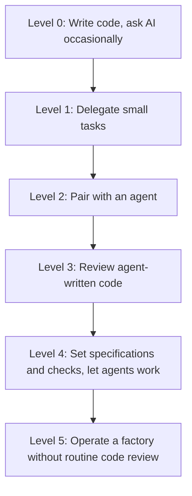

# Dark Software Factories

Reading code slows me down and makes me a bottleneck. That's why around six months ago I stopped doing it routinely. Now I read agent-generated code only when I prepare a workshop or course.

A few months ago I started hearing the term "software factories" and realized I already had one. In April 2026, I published [I Built an AI Agent Team for Software Development and Tested on 5 Real Projects](https://aishippingblog.com/p/i-built-an-ai-agent-team-for-software). I described my agent team before I knew it was called "a factory".

But more recently I started hearing another term: "dark software factory". It's a factory where humans aren't allowed. We give agents specifications and check that they follow them, but we don't look at how it's implemented. We still decide what to build and evaluate the results through tests, demos, and constant monitoring.

I've been doing it for some time too. But I also wanted to understand what people mean by "dark software factory" and how others implement it. That's why I did some research and I'll describe what I found in this article.

Here I'll cover:

- Why I stopped routinely reviewing agent-generated code
- Where the factory terminology comes from
- How other teams build, verify, and ship software with agents
- The costs and the problems that still need human judgment

## Not Reading Code

When I first started working with agents, I was looking at the code. It was terrible. Especially the tests - they were absolute 100% slop. I wanted the code to look as if I had written it myself.

I'd dictate review notes with Google Recorder and give the transcript to my agent teams to correct it. They'd spend one or two days rewriting the code. Then I'd review the project again, only to find that some comments were still not addressed. So I'd record another note, and then another one, and then another one.

At some point I realized I was spending too much time (and tokens) on it without making any meaningful progress.

And I realized another thing: the actual problem was me, not the code. The original code actually worked fine. And that the tests I disliked were actually able to catch problems in the code the agents wrote. When I removed some of those tests, things started to break apart.

Instead of helping, I was making things worse. Yes, the code looked terrible, but I had to either accept it or go back to writing code myself.

Eventually I left the agents to write whatever they needed and instead I focused on the bigger picture:

- If two projects need the same functionality, I ask for a shared library.
- If they need authentication, I ask for single sign-on instead of maintaining an authentication layer in every application.
- If I want to use the same project across devices, I ask for a common TypeScript codebase instead of a separate Kotlin, desktop, and web implementation. If we catch a bug, we fix it only once.
- If adding new features or fixing bugs starts taking a long time, I ask to split the code into multiple modules.
- If the codebase grows too large, I ask for a reimplementation that reduces the codebase 2-3 times. I also specifically ask to remove all the backwards-compatibility layers that agents like to create.
- If running tests takes too long, I ask to review the tests and/or split the library into multiple modules.

When I work with agents, I'm still making technical decisions, but I do it by setting the direction and checking the behavior, not by controlling the code.

It was a gradual process, but eventually I arrived at what people now call "dark software factories".

And since the term keeps appearing, I wanted to undestand where it comes from and how people do it. 

## Lights-Out Manufacturing

The term "dark software factory" is a combination of two ideas:

- dark factories, also known as "lights-out manufacturing"
- software factories

In lights-out manufacturing, machines can run without people on the factory floor. [FANUC describes factories](https://www.fanuc.co.jp/en/profile/production/factory1.html) where robots put parts into machines so production can continue without people, including nights and weekends.

TODO: image of FANUC factory

## Software Factories

The "software factory" idea is way older than coding agents.

[Addy Osmani traces it back to 1968](https://addyosmani.com/blog/software-factories/). People wanted to make development repeatable through shared tools, reusable components, standards, and quality checks. Writing code wasn't automated, but the idea was to have a standard process to ensure good quality. With agents, we're now automating these steps, including implementation and review.

TODO put the actual diagram from there
For a pre-agent example, Jack Greenfield's 2007 article "Mass Customizing Solutions" includes a [software factory schema diagram on page 31](https://www.methodsandtools.com/PDF/mt200703.pdf#page=31). It connects roles, tasks, and workstreams to reusable assets. The factory was a structured environment that helped people build related applications from shared components.

When it comes to agents, the earliest mention was [Dan Shapiro's post](https://www.danshapiro.com/blog/2026/01/the-five-levels-from-spicy-autocomplete-to-the-software-factory/) (January 2026).

Dan described levels 0 through 5 of a code factory:

- Level 0: you write the code and occasionally use AI for search or suggestions.
- Level 1: you delegate small tasks such as tests and docstrings.
- Level 2: you pair with an agent while staying involved in implementation.
- Level 3: you mainly review the code agents produce.
- Level 4: you prepare specifications and checks, then let agents work for hours.
- Level 5: you operate a system that turns specifications into software without routine human code review.

As the levels increase, people move from implementation to defining the work and checking its results:

TODO: use diagram-creator skill like a vertial diagram 

Shapiro placed himself at level 4 and borrowed the dark-factory name from FANUC for level 5.

[Simon Willison wrote a follow-up post about it](https://simonwillison.net/2026/Jan/28/the-five-levels/) in January 2026 and described a small team with agents demonstrated correctness without human code review. (Every time I do term archeology, Simon's blog comes up!)

I was already experimenting with it in January and February with Claude. When it comes to coding, Opus 4.5 was a decent model, but most of us didn't have the proper tooling and processes to make it work at Level 5. I described some of my experiments and what I learned from them in [Six Projects That Didn't Make It](https://aishippingblog.com/p/six-projects-that-didnt-make-it).

Things have changed since January. The tooling is now a lot better, plus we figured out how to organize the work so it actually works: we now create specifications, have agents with different roles, and have an automated way of verifying the results.

I cover this in [my article about AI-native development](https://aishippingblog.com/p/ai-native-development-specifications), which is the first module of AI Dev Tools Zoomcamp.

## Teams Running Factories

In my courses I teach my way of approaching. I learned it by trial and error across many projects. But for this article I also wanted to see what other people are doing.

In my research, I focused on developers sharing their experience and exluded vendors and companies that consult in this area. I also wanted to check fresh articles, so I restricted my search to June 2026 onwards.
Here's what I found:

- [Brian McQuay described adding ticket-to-merge automation to Sandstorm](https://brianmcquay.com/blog/going-dark/). After ticket refinement, agents implement the change automatically and also review it. They'd fix problems, run tests, and create a PR, then resolve conflicts and merge it.
- [John Wilger described building an SSH proxy called Lanyard](https://johnwilger.com/blog/somebody-has-to-design-the-factory/). He required isolated worktrees, verification that a live deployment answered, and fresh reviews tied to the exact code changes. When the code changed, earlier review approvals no longer counted. He also required agents to stop and escalate when they couldn't meet a required check.
- In a Reddit thread, [a developer described a Linear-to-PR setup](https://www.reddit.com/r/ycombinator/comments/1vamsls/has_anyone_here_actually_set_up_a_software/). They started agent sessions for ready user stories, followed repository instructions, and produced preview URLs. They also described automated releasing with end-to-end tests. The account doesn't specify whether a human approves each merge, so I wouldn't classify it as fully dark.

TODO: let's describe their approach in more detail - each article should get a separate small section + illustration

## Enabling Practices

All the approaches that work have two core components:

- Specification-driven development
- Agentic verification

Agents are good at writing code. They are also good at filling the gaps in the specifications. If we ask an agent to implement a feature, it will work. But don't provide enough details, it won't be what we need.

To address this problem, we follow speficication-driven development (or a variation of it), and turn each task into a spec with clear acceptance critera. 

Once the feature is implemented, we have another agent that checks the imlementation against these criteria. If some fo the boxes aren't checked, the implementer has to fix it.

TODO: include a picture from my module 1 ai dev tools article.

## Escalation to Humans

We still need to involve humans, but not on every single step. This means, agents need to have a way to escalate to humans only when it's absolutely needed. I want to be involved as little as possible - but not miss important checks and decisions.

In my projects, agents use the `human` tag for GitHub issues. They may decide that it's needed when turning a task into a spec, or later when verifying the results.

Every time when agents involve me, but I think I wasn't actually needed there, I tune the process:

- If I think I'm not really needed there, I tell the agent to make a decision and not involve me next time.
- Or I can tell them what to do, but remember this decision, and repeat it next time without my invovement. 

If something wasn't escalated, I discover it later when using the application. In this case, I ask why it was done this way, and ask to involve me next time a similar decision is needed.

In all cases, I make sure this gets documented, so it's clear what should be escalated, and what shouldn't be.  

TODO describe what other practicioners do

## Technical Debt and Comprehension Debt

Dex Horthy describes HumanLayer trying lights-off development in July 2025 and later returning to human review. In [his account of why software factories fail](https://github.com/humanlayer/advanced-context-engineering-for-coding-agents/blob/main/wsff.md), he argues that maintainability can deteriorate even while tests pass.

He separates passing a short coding task from keeping a codebase easy to change over several months. A model can get rewarded for a patch that passes tests without accounting for the future cost of that design.

It's certainly a problem - agents create code fast and often disregard best engineering practices. They write duplicated code and don't really care about modularity. In some cases it's okay - it's too early to need it. But as the project grows, you will see adding a feature or a bug now takes 1 hour instead of 5 minutes, and some bugs keep coming back - then it's time to do some maintanance work. You just ask agents to analyze what the problems are, what slows them down (they are agood at this too) and find a way to fix it.

Maintainability is not the only problem. Even with specifications, agents still make a lot of decisions for us. 

I must admit that I sometimes find myself surprized when I dicover some features in my own projects - but usually not in the positive way. 

If I have a very clear picture of how each feature works, then my compresension debt is low. If I have no idea what happens when .. (TOdo expand)

[Addy Osmani calls it comprehension debt](https://addyosmani.com/blog/software-factories/). I like the name. 

## ...

Final words

