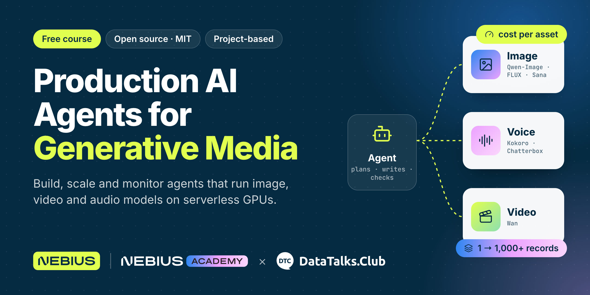
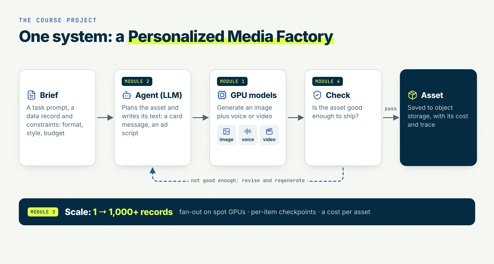
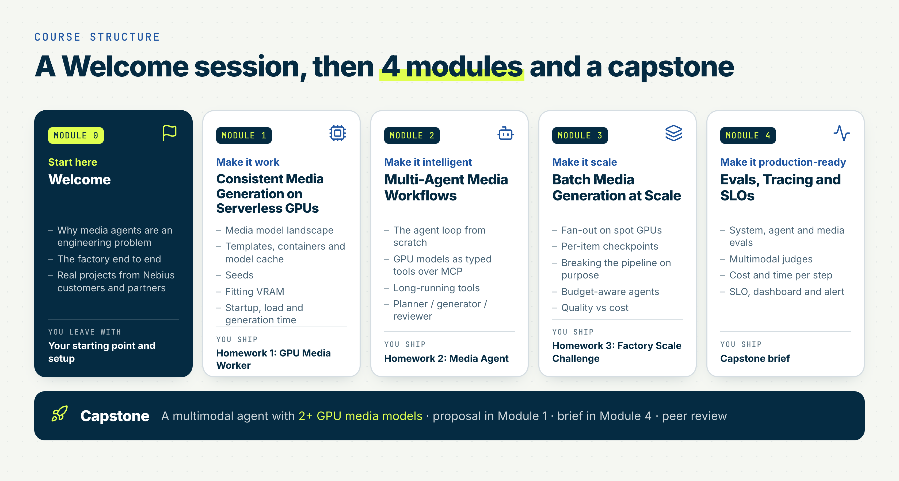
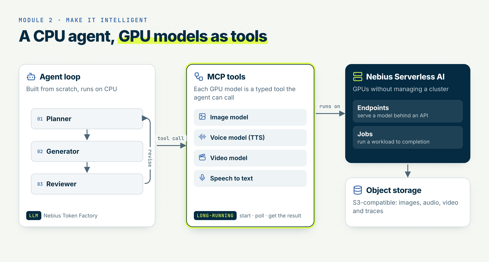
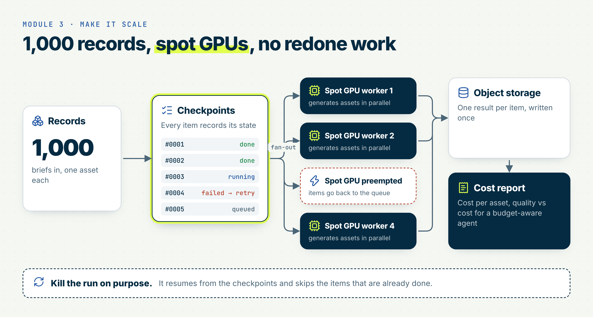
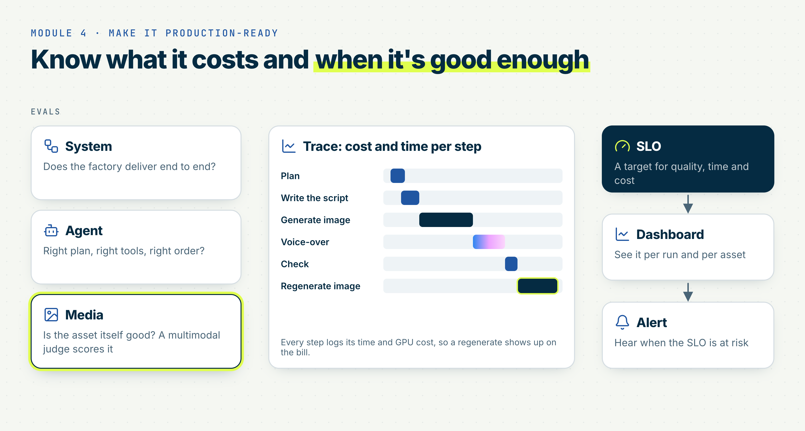
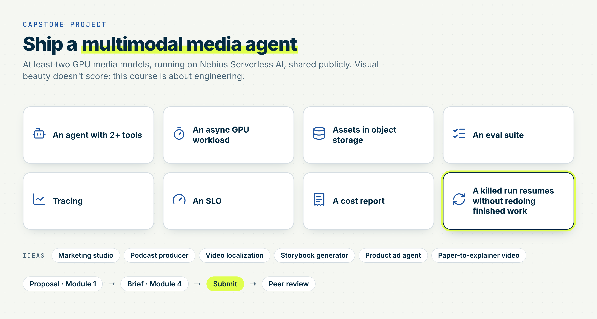
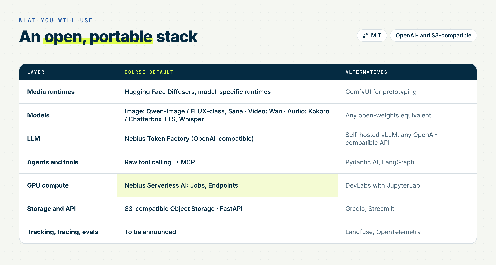

# A Free Course on Production AI Agents for Generative Media Starts Monday

<!-- Unpublished draft for AI Shipping Blog / Substack. When you paste this into Substack, upload the images from assets/images/production-ai-agents-generative-media/. -->

<figure>
  
</figure>

Generating one image is easy. Generating 1,000, with a known cost per asset, is the hard part.

On Monday, 16 November, I start a free course with DataTalks.Club and Nebius: Production AI Agents for Generative Media. You build a Personalized Media Factory: agents that run GPU image, video, and audio models in production.

In this post, I'll walk through:

- The system you build
- The four modules and the capstone
- The stack, the prerequisites, and how to join
- The dates and the launch stream

All of the materials are in the [course repository](https://github.com/DataTalksClub/production-ai-agents-for-media-generation). The course is free, and the materials are public under the MIT licence.

## The system you build

The usual demo for generative media is one image, one clip, one happy path. The thing that actually breaks in production is everything around that call: long-running GPU jobs, retries, large files, and the cost of doing it a thousand times.

In this course you build one system, a Personalized Media Factory.

A brief goes in: a task, a data record, and constraints such as format, style, and budget. An agent plans the asset and writes its text, for example a card message or an ad script. GPU models generate an image plus voice or video. A check regenerates the asset when it isn't good enough. Then you scale from 1 to 1,000+ records with a cost line per asset.

<figure>
  
  <figcaption>The Personalized Media Factory, the project that runs through the whole course.</figcaption>
</figure>

Media agents are an engineering problem, not a prompting problem. You don't need to manage a cluster: the models run as Jobs and Endpoints on Nebius Serverless AI.

## Course structure

The course is project based. After a welcome session, there are four modules over five weeks, then a capstone.

<figure>
  
  <figcaption>A welcome session, four modules, and a capstone.</figcaption>
</figure>

The pre-course live Q&A was on Tuesday, 10 November. The course launch is on Monday, 16 November, from 17:00 to 18:00 CET.

## Module 1: Consistent Media Generation on Serverless GPUs

Monday 16 to Sunday 29 November (two weeks). This is the "make it work" module, and it runs longer so you can still apply after we start.

You compare image, video, and audio models (size, VRAM, latency, quality, and licence) and see why video is expensive. You generate your first asset in a few minutes, through an Endpoint or in JupyterLab on a GPU. You look at what belongs in a container for generative AI and what stays out of it: weights, secrets, and outputs. You run the same generation for serving (an Endpoint) and for batch inference (a Job), and you measure startup, readiness, and generation time, then turn those numbers into cost per asset.

Homework 1, GPU Media Worker: you generate one media asset, report the model, generation time, and cost per asset, and compute your self-host breakeven against a per-call API. You also write a one-page capstone proposal: the problem, the records, two GPU media models, and a budget estimate.

## Module 2: Multi-Agent Media Workflows

Monday 30 November to Sunday 6 December. This is the "make it intelligent" module.

You keep the agent on CPU and give it GPU workloads as tools. You look at the agent loop and step through it with PydanticAI. You design typed tools with validation, retries, timeouts, and idempotency, and wrap inference on an Endpoint or a Job, called directly or over MCP. You handle long-running tools: submit, poll, and resume, without paying for the same GPU work twice. Then you build a planner, generator, and reviewer loop, with a versioned rubric, so the agent regenerates an asset instead of accepting the first output.

<figure>
  
  <figcaption>A CPU agent, with GPU models as tools.</figcaption>
</figure>

Homework 2, Media Agent: you build an agent for a short coffee ad, about 10 seconds. The flow is plan, keyframe, judge, regenerate, then video, with a full trace of every step. You report the cost per video, split by step.

## Module 3: Batch Media Generation at Scale

Monday 7 to Sunday 13 December. This is the "make it scale" module.

You fan out records over parallel Jobs and fan the results back in. You run the batch on spot (preemptible) GPUs, checkpoint every item, and prove that a killed run resumes without regenerating finished work. You lower the cost per asset by working on cold start, generation time, and the GPU you actually need. You also break the pipeline on purpose, including budget and quality thresholds, and fix each failure with a named pattern. There is an optional lesson on fine-tuning an image model on a new style as a Job.

<figure>
  
  <figcaption>Fan-out on spot GPUs, with per-item checkpoints and a cost report.</figcaption>
</figure>

The factory is designed to go from 1 to 1,000+ records. In Homework 3, the Factory Scale Challenge, you scale it to 200 records over 10 Jobs in parallel: card text, image, and voice for every record, and video for a 10-record sample. You compete on a public leaderboard. The cheapest reliable run at acceptable quality wins.

## Module 4: Evaluation, Observability and Production

Monday 14 to Sunday 20 December. This is the "make it production-ready" module. There is no homework this week. You apply it in the capstone.

You measure the system, the agent, and the media, with cheap deterministic checks first, then a multimodal judge. You calibrate the judge against your own labels, and you block a change to a model, prompt, or configuration with a golden set and a regression gate. You answer "why did this record cost this much and take this long?" from one trace. You set an SLO with a dashboard and an alert, and you make a go or no-go call. You also turn auth, quotas, abuse, prompt injection, content safety, licensing, and provenance into stated controls in your capstone brief.

<figure>
  
  <figcaption>Evals, a trace with cost and time per step, and an SLO.</figcaption>
</figure>

## The capstone

You ship a multimodal agent that uses at least two GPU media models, runs on Nebius Serverless AI, and is shared publicly. Visual beauty doesn't score. This course is about engineering.

Your project needs:

- An agent with 2 or more tools
- An async GPU workload
- Assets in object storage
- An eval suite
- Tracing
- An SLO
- A cost report
- Proof that a killed run resumes without redoing finished work

You write the proposal in Module 1 and the brief in Module 4. The first submission is due Friday, 15 January 2027, with peer review by Friday, 22 January. There is a second attempt: submit by Friday, 29 January, and finish peer reviews by Friday, 5 February.

Ideas from the course materials include a marketing studio, a podcast producer, video localization, a storybook generator, a product ad agent, or a paper-to-explainer video. You bring your own records: a CSV or JSONL file with an id column. Records go in, generated media comes out.

<figure>
  
  <figcaption>What the capstone has to include.</figcaption>
</figure>

## The stack

The reference platform is Nebius Serverless AI (Jobs and Endpoints) and Nebius Token Factory. The code is MIT-licensed, and it is OpenAI- and S3-compatible, so you can run it elsewhere.

<figure>
  
  <figcaption>The default stack, with alternatives for each layer.</figcaption>
</figure>

The defaults are:

- Media runtimes: Hugging Face Diffusers, plus model-specific runtimes. ComfyUI is there for prototyping.
- Models: Qwen-Image, FLUX-class, and Sana for images, Wan for video, Kokoro or Chatterbox for speech, and Whisper. You can use any open-weights equivalent.
- LLM: Nebius Token Factory, which is OpenAI-compatible. You can also use self-hosted vLLM or any OpenAI-compatible API.
- Agents and tools: raw tool calling, then MCP. Alternatives include Pydantic AI and LangGraph.
- GPU compute: Nebius Serverless AI Jobs and Endpoints. DevLabs with JupyterLab is an alternative.
- Storage and API: S3-compatible object storage and FastAPI. Gradio or Streamlit if you want a simple UI.
- Tracking, tracing, and evals: still to be announced. Langfuse and OpenTelemetry are listed as alternatives.

Open-weights models come with their own licences. Check each model's licence before commercial use.

## Who it's for, and how to join

The level is intermediate to advanced. It's for working builders who run open or custom GPU media models:

- AI and ML engineers adding image, video, or audio generation to real systems
- MLOps and ML platform engineers who own the batch pipeline, scheduling, and the cost line
- Technical founders and small teams paying for per-call media APIs who need to know when self-hosting wins

You need Python, Docker basics, HTTP APIs, and the command line. Prior LLM or MLOps course experience helps, but it isn't required.

The course does not cover diffusion maths, training foundation models, deep fine-tuning, CUDA, Kubernetes, RAG, or LLM fundamentals.

The course itself is free. Seats in the live cohort are limited, so that part is application only. We review every application, usually within 2 business days. Approved applicants join the live cohort: shared deadlines, peer-reviewed homework, and the capstone. They also get GPU credits through the [Nebius AI Builder Program](https://dev.nebius.com/builders), which is free to join. Usage beyond the credits is billed to your account.

"Live cohort" means shared deadlines and peer-reviewed homework, not mandatory live classes. Lectures are pre-recorded, and there is a weekly live office hour.

If you don't apply, or if you're not approved, all materials stay public in the repository. You'll need your own GPU access to run the code.

More than 1,160 people have already applied.

## Dates and the launch stream

All times are CET. Modules run Monday to Sunday.

- Monday, 16 November, 17:00 to 18:00: course launch stream
- Monday 16 to Sunday 29 November: Module 1 (two weeks). Homework 1 and the capstone proposal
- Monday 30 November to Sunday 6 December: Module 2. Homework 2 is due Sunday, 6 December
- Monday 7 to Sunday 13 December: Module 3. Homework 3 (leaderboard) is due Sunday, 13 December
- Monday 14 to Sunday 20 December: Module 4 and the capstone brief. Teaching ends on Sunday, 20 December
- Friday, 15 January 2027: capstone, attempt 1
- Friday, 22 January 2027: peer review, attempt 1
- Friday, 29 January 2027: capstone, attempt 2
- Friday, 5 February 2027: final peer review, attempt 2

Materials and dates may change. Because Module 1 runs until 29 November, you can still apply after we start.

I put this course together with DataTalks.Club and the Nebius team: Mikhail Rozhkov, Marouane Khoukh, and Aleksandr Iziumov. The Nebius DevRel team creates and teaches the course, with content and expert support from Nebius Academy.

The launch stream is Monday, 16 November, at 17:00 CET: [luma.com/xey7h50c](https://luma.com/xey7h50c).

Apply here: [courses.datatalks.club/register/production-ai-agents-generative-media](https://courses.datatalks.club/register/production-ai-agents-generative-media/)

The materials are here: [github.com/DataTalksClub/production-ai-agents-for-media-generation](https://github.com/DataTalksClub/production-ai-agents-for-media-generation)

If you have questions, ask in the [DataTalks.Club Slack](https://datatalks.club/slack.html) or bring them to the weekly office hour.
