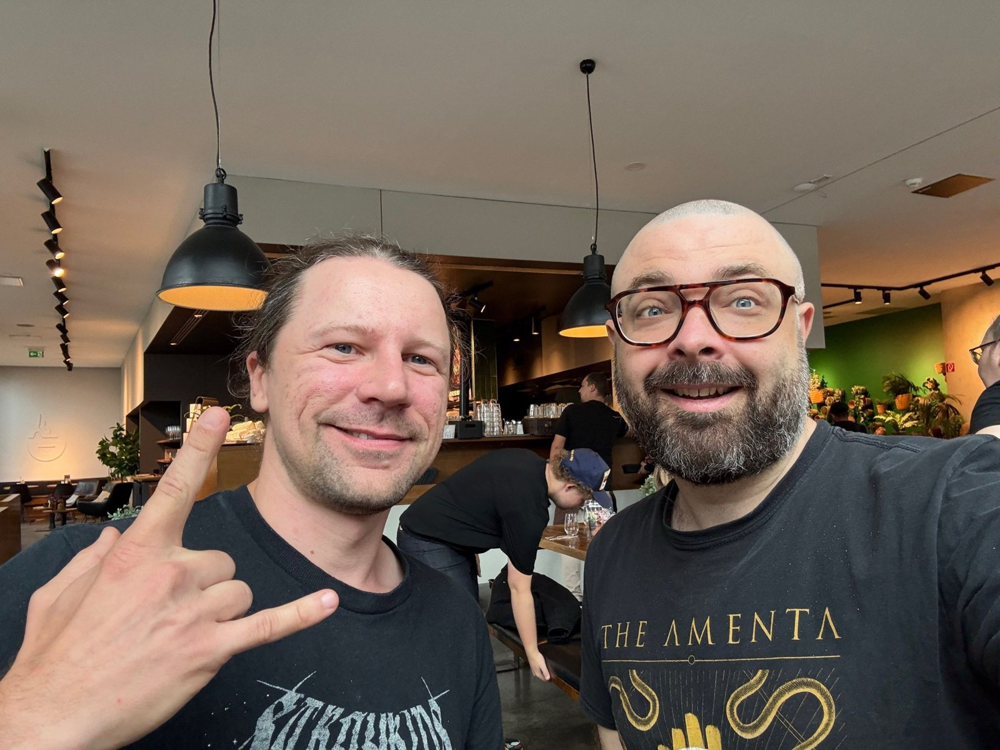
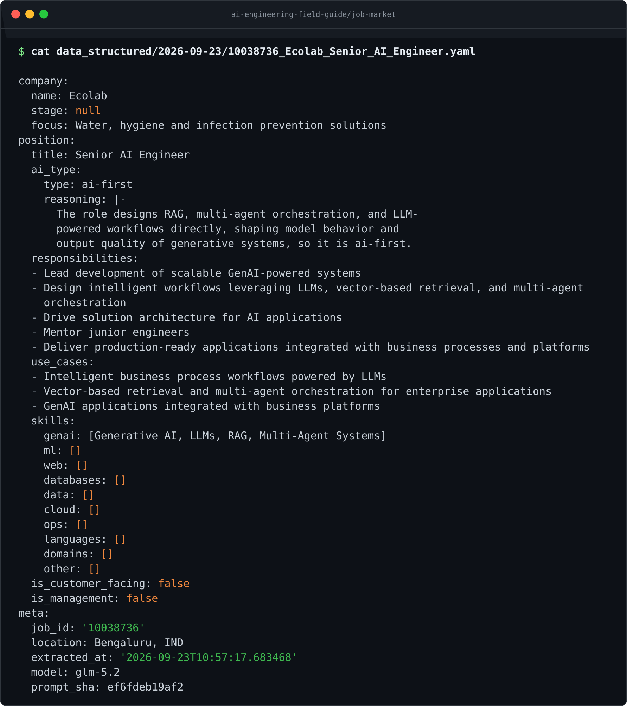
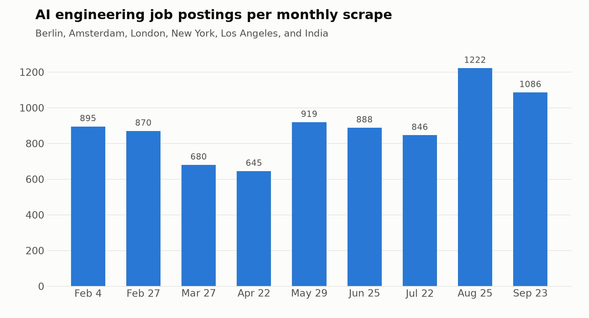
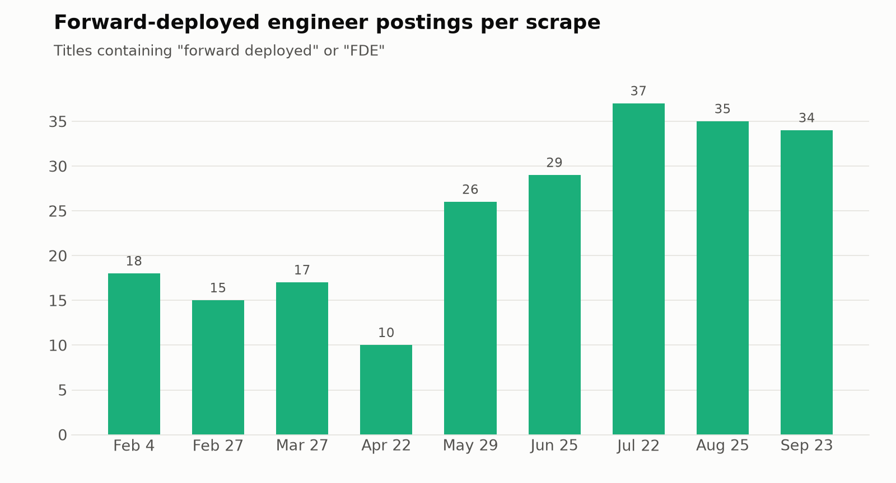
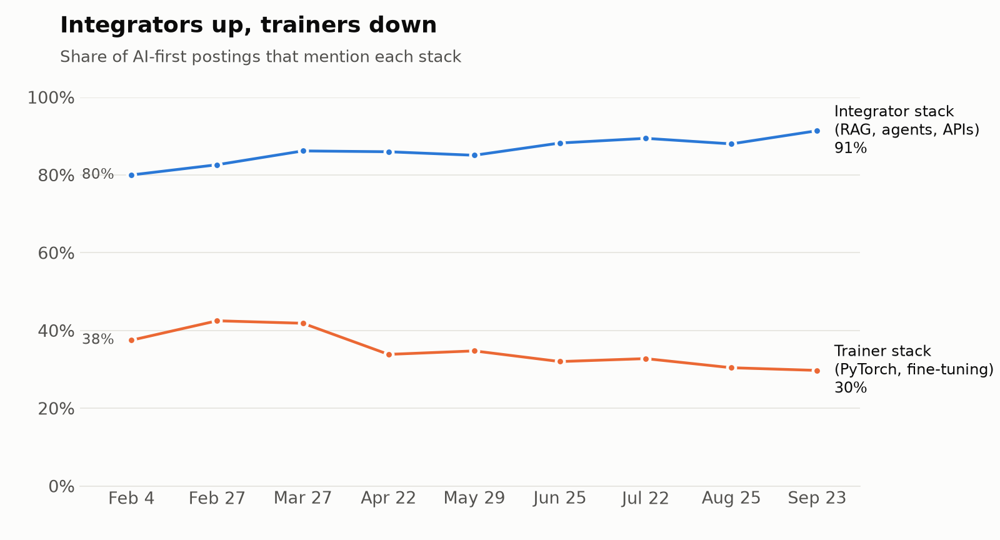
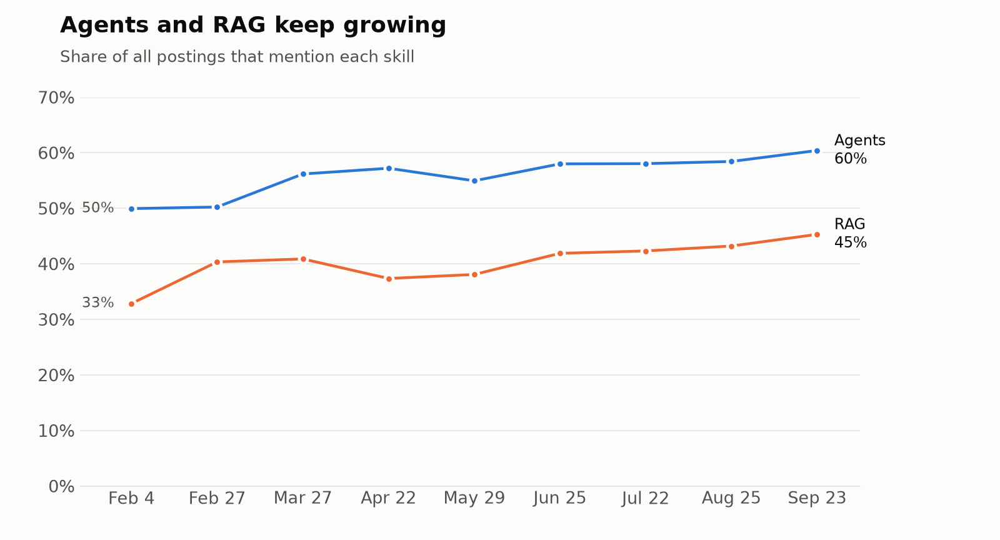
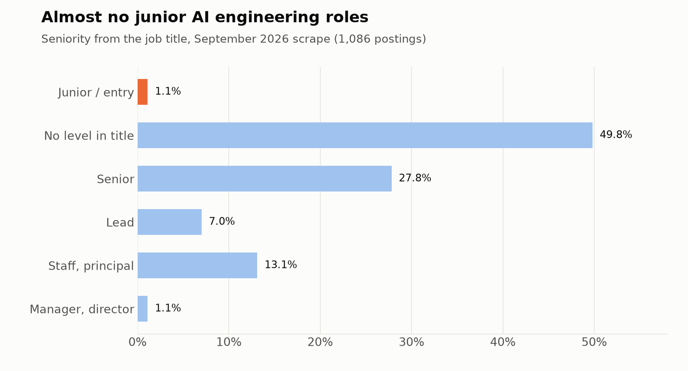

# Trends in AI Engineering
## Webinar with Hugo Bowne-Anderson

Last week I ran a webinar with Hugo Bowne-Anderson. Hugo and I met in Berlin about a month before, had a great breakfast, and decided to do something together.

<figure>
  
  <figcaption>Hugo and I at our breakfast in Berlin</figcaption>
</figure>

The first step was an open ask-us-anything session - which was the webinar.

We had two goals for it:

- help the people who came to the webinar
- understand what we could create together for you longer term

At the end of the session Hugo and I talked about turning this recap into a shared Substack article - this article.

Most questions in the session came back to one theme. Agents now write more and more of the code, and people want to know where the human engineer still adds value. Our answer: at the two ends of the work - deciding what to build, and checking that what got built is right.

In this article, I'll cover:

- What we can see in nine months of AI engineering job postings
- How agents changed the way we write code
- Why verification is now the bottleneck, and how to deal with sloppy agent code
- Dark software factories, where humans don't look at the code at all
- Which skills stay human
- What to focus on if you want to become an AI engineer

## Hugo and Me

I've been an educator for about six years. I started with [machine learning engineering](https://github.com/DataTalksClub/machine-learning-zoomcamp) and then did [data engineering](https://github.com/DataTalksClub/data-engineering-zoomcamp). In the last few years I've focused on [AI Engineering](https://maven.com/alexey-grigorev/from-rag-to-agents). Before that I was a hands-on data scientist, machine learning engineer and data engineer - a full-stack data scientist doing whatever needed to be done to work with machine learning and AI.

I like calling myself a product AI engineer: I do whatever it takes to integrate AI from the user's perspective. This is what I teach in my courses.

Hugo's background is in mathematics, physics, and biology. He researched cell biology at the Max Planck Institute in Dresden and then at Yale. About 15 years ago he moved to industry, but he stayed in education. He worked at DataCamp, taught in the SciPy and PyData ecosystems, and did developer relations at startups such as Coiled and Outerbounds. He hosts podcasts, and that's how we first met - we've done a bunch of podcasts together.

## The Job Market

I maintain the [AI Engineering Field Guide](https://github.com/alexeygrigorev/ai-engineering-field-guide) repository.

Every month since February 2026 I scrape job postings for the query "AI engineering" in six locations: Berlin, Amsterdam, London, New York, Los Angeles, and India. Then I use LLMs to extract skills, responsibilities, and use cases from each posting.

This is what one processed job posting looks like:

<figure>
  
  <figcaption>A Senior AI Engineer posting from the September 2026 scrape after LLM extraction</figcaption>
</figure>

Nine months of data isn't enough to build models that predict the future. But it already shows where the market is going.

The overall market is growing. Everyone asks "where are all the jobs?" For now, at least, the data says we shouldn't worry. The number of postings dipped in spring, but the last two scrapes are the biggest so far.

<figure>
  
  <figcaption>AI engineering postings per monthly scrape</figcaption>
</figure>

Forward-deployed engineers are the fastest growing part. FDE roles grow even faster than the market overall. The number of FDE postings roughly doubled since February. I have a separate analysis of the FDE market: [What AI Forward-Deployed Engineers Do](https://aishippingblog.com/p/what-ai-forward-deployed-engineers).

<figure>
  
  <figcaption>Forward-deployed engineer postings per scrape</figcaption>
</figure>

Model training roles are shrinking. Before, companies hired people to train LLMs with PyTorch-style skills. The number of these positions is decreasing, and so is inference and serving. The industry is converging on a meaning for "AI engineer": mostly invoking models through API calls and building things around them.

<figure>
  
  <figcaption>Share of AI-first postings that mention the integrator stack (RAG, agents, LLM APIs) vs the trainer stack (PyTorch, fine-tuning, CUDA)</figcaption>
</figure>

Agents and RAG are what companies build around these models, and both keep growing. Agents went from 50% to 60% of all postings, RAG from 33% to 45%.

<figure>
  
  <figcaption>Share of all postings that mention agents and RAG</figcaption>
</figure>

There are almost no junior positions - only about 1%. AI engineers are usually more experienced people, so starting your career as an AI engineer is hard.

<figure>
  
  <figcaption>Seniority from the job title, September 2026 scrape</figcaption>
</figure>

So the job isn't about the model. It's about everything around it, and a big part of that is evaluation. Knowing evals is the difference between getting hired and not getting hired. Without evals, the conversation with the hiring manager will likely end once they find out.

## Agents Write the Code Now

At the same time, the way we write that code has changed. The way we coded one year ago is different from how we code now.

I talk to more and more companies whose policy is "no handwritten code". You aren't allowed to write code yourself, only through an agent. At one such company, many engineers resisted and said they still wanted to write code by hand. The answer was: nobody is keeping you here, go find a different place.

I was surprised they were that adamant about it. But it's their choice - they know how to run their business better.

Even when it isn't enforced, it's hard to go back to manual coding. You're still the bottleneck when you work with agents, but if you write code directly, you're just so much slower.

Hugo separated two terms that often get confused:

- In agentic engineering (a term coined by Simon Willison), you build software with agents. The agent is part of the dev team. Your job is specification, delegation, review, and orchestration.
- In AI engineering, you build agentic search, RAG, or an agent. AI is part of the product. You think about models, prompts, evals, harness engineering, and agentic loops.

In practice, you do both. AI-powered products get built with agents. And agentic engineering means building up your own harness - skills in your AGENTS.md, MCP servers, sandboxes, and guardrails.

I see this confusion among people who join my courses: they join a course about AI engineering wanting to learn how to use AI for coding. There's a lot of overlap, but the work is different. If you write code with AI, someone else takes care of evaluating and monitoring that tool. You focus on creating the proper specification, making sure the agent follows it, and enforcing the development lifecycle rules.

## Verification Is the Bottleneck

If agents write the code, the next problem is knowing that the code is right.

Hugo ran a survey on how people do agentic data science. Many people said AI changes their workflow significantly: 34 said "fundamentally" and 39 said "significantly". Hugo wanted to see what made the difference, so he built a heat map of how much AI changed people's workflow against how they verify AI-generated code.

Agentic verification means using agents to verify the work of other agents. 59% of the people whose workflow changed fundamentally use it and write tests. The share of tests and verification drops as the reported impact drops. It isn't causal, but there's a correlation: the more tests you write and the more agentic verification you use, the more value you get from agents.

Hugo isn't saying "don't read code manually". He's saying "probably don't read all of your code manually".

This changes the whole development lifecycle. A reductive version is: spec it out, build it, verify it, and if it works, ship and maintain it.

With agents, every step changes:

1. Speccing is agent-assisted.
2. The build is agent-driven - agents write most of the code.
3. Verification has several layers:
   - Automated tests, as before - unit, integration, end-to-end, regression
   - LLM as a judge for correctness, quality, and adherence
   - Agentic review, where agents review code and design
   - Human review for context, UX, and similar things
4. Once you get sophisticated enough, agents monitor, operate, and suggest changes in production.

## Sloppy Agent Code

An attendee asked whether coding agents, even frontier ones, make sloppy design and code - and whether only a technical human can fix that.

They make sloppy design, absolutely. They spew tokens at you - pages and pages of design that are absolute slop. When you design with them, you need to be in the loop and in control. Hugo asks them to respond in three sentences, or to give him 10 ideas of three sentences each, so he can choose the best one.

My approach is what I call adversarial design. I set up two agents: a designer and a senior designer. The designer designs, and the senior designer tries to find a reason to reject the design. They share a design system document that describes how the design should look, and they bounce the design between each other until the senior designer is satisfied.

The same works for code. There's an implementer and a tester. The tester's goal is to find holes in the implementation and bounce it back to the implementer. A feature may take 4-5 hours instead of 20 minutes because of the back and forth, but it's still faster than doing it manually, and the quality at the end is better.

Both agents need rules to check against, and the good books are a shortcut. My favorite is Clean Code by Robert Martin. If you just say "follow the principles from the Clean Code book by Robert Martin", the code improves.

Sometimes I make it more specific:

- Functions no longer than 30 lines
- Files no longer than 300 lines
- Follow the SOLID principles
- Follow the don't-repeat-yourself principle

Of course it burns more tokens, but I don't want to cry when I look at the code.

Hugo does the same for writing with Strunk and White's The Elements of Style. Its rules include "omit needless words" and "use the active voice". He has these rules in the AGENTS.md of a bunch of repos. The agents don't always follow them, so he runs a trio of verify agents in parallel, because each one messes something up. Then a final agent performs the edit.

I developed my own rules empirically, by looking at what went wrong and correcting it. Referencing a book is much more convenient: Clean Code for code, The Elements of Style for text.

It's the same as leading a team of juniors. You don't look at every line, but you share the design principles and check from time to time: "No, this isn't good, I said no ternary operator". When you see something that isn't in the rules yet, you add a rule.

For example, agents like defensive coding. In Python, they check if an attribute exists before accessing it. This makes the code hard to read, and the solution is a type checker.

I tested this on a fairly large and relatively old codebase. I developed it with AI, first by copy-pasting from ChatGPT and then fully with coding agents. When I noticed a lot of slop, I asked the agent to refactor the entire codebase using these rules. It took two Codex resets, but the result was code I didn't cry reading.

Hugo pushed back on the last part of the question, "only a technical human can fix it". It can be an agent with the correct instructions and the correct verification processes. Parallelize with a few of them because some will mess up, and surface the high-risk, important things to a human. That doesn't have to mean looking at code - it can be dashboards, information graphics, or cards.

## Evals Are the Same Skill

In AI engineering, this is evaluation. Systems built on LLMs aren't deterministic, so we can't simply trust them. We need a framework to make sure they can be trusted - for example, an agent that evaluates another agent.

For that framework to be sound, data science skills help a lot. Data scientists have done this kind of evaluation for a long time, because machine learning is non-deterministic too.

## Dark Software Factories

Hugo took the idea further, and admitted it may sound radical. A dark factory is one where humans aren't present at all - there isn't even light inside. There are several in Japan where robots build robots.

In a dark software factory, humans aren't allowed to look at the code. They get artifacts that let them make business decisions and verify that everything is correct, but they're separated from the generated code.

Hugo doesn't suggest anyone build one today. But he thinks there's a not-so-distant future where they're economically viable. If that sounds out there, remember that we don't read machine code anymore. Abstraction layers make us confident software works, and for agents it comes down to good tests, verification, and specification.

I think it's a good point. Whether you're a solo founder or a software engineer, your time is limited. If you check everything your agents write, you become the bottleneck. Once you let the agents run without your involvement, you're only the final gatekeeper who accepts or rejects.

In my setup, agents escalate things that need human verification. They add a human tag to a GitHub issue, and then I look. I had to tune them so they escalate only what I need to see. Most of the time I'm out of the loop. I give them specifications or raw input, and they turn it into specifications, build features, and ship them.

Often I'm involved more than I want, because agents create slop, especially in design. For the backend, it can be a dark factory already. For the frontend, not yet. But with new models like Opus 5.5 I feel I can be involved less and less.

Hugo added that this is still hard work. We haven't evolved to make that many decisions and read that much text. Agents didn't make software engineering easy - they made it a different kind of hard.

## The Human Side

An attendee asked which roles will exist a year or two from now. Nobody can see what roles, hiring processes, or even tools will look like then. But we can name the skills that matter at the other end of the work - deciding what to build and for whom.

Hugo listed the data scientist skills that will always be useful:

- A hacker mentality: when a new model comes out, play with it, explore what you can do with it, and use it to deliver business value or help people
- Knowing some statistics, how to analyze data, and how to use data to improve products
- Domain expertise in something - SRE, DevOps, marketing, or anything else

I would add problem discovery. There are so many problems around us waiting to be discovered and solved. Look at your own everyday life. You repeat many things, and many things are mildly annoying, but you aren't doing anything about them yet.

With AI, I can finally approach these problems. Every week there's a new model available for free, and you can test how it solves your particular problem. AI can't find these problems for you, and finding them is how you as a human can stand out.

Then there's everything about people. Hugo prefers to call these human skills rather than soft skills. We use agents to write code, and we write code to solve problems for our customers. Our customers are people, not agents. We still need the human connection, the user interviews, and everything product managers and product designers have done for a long time.

As a solo founder, I can go far with AI. But my background is engineering, and I don't have marketing or sales skills. It hurts most here: I can't reliably sell what I build.

Freelancers have the same problem. You need to convince clients why you charge $2,000 per day when a Claude subscription costs $200 per month - agents won't give you money. And at work, you still need to convince your manager to give you that promotion.

Hugo agreed. It comes down to speaking with people, understanding their problems, and solving them in a way that gives them more value than they pay. Even this session exists because we met in Berlin and had breakfast.

Organizing work is a human skill too. When OpenAI made its announcement about the Navier-Stokes problem, what interested me was that it was a team of 10,000 agents. I ran a thought experiment: how would I organize the work of 10,000 agents on a problem I don't know?

You can't just tell them to go solve it. You need a hierarchy - for example, a chief scientist who says "you try this, you try that". It all comes from the leadership world.

That's why I think product managers are uniquely equipped to run agents. They already know how to organize work in a team, set up processes, define specifications, and check work.

## Becoming an AI Engineer

One attendee wrote: "My goal is to become an AI engineer and get hired in the next three months. Do I need to focus on training and serving, or should I spend my time elsewhere?"

Hugo compared training models to working on an internal combustion engine. If you're a Formula One driver, it's good to know how it works, but most people who use a car don't need to. An AI engineer works on a product.

Instead, Hugo would focus on the data science mentality and the lifecycle of AI products. Unlike the traditional spec, build, deploy, maintain cycle, it's iterative and experimental.

The lifecycle looks like this:

1. You build.
2. You add observability and traces.
3. You look at your data and build an evaluation set from it.
4. You pull levers based on the problems you see in the data.
5. You iterate in production with domain experts.

The way to learn it is by building a project: an agent or an AI-powered application with real users.

People often ask me whether they need to know LLM internals to work as an AI engineer. I usually say no. You need to know how to send a request to an LLM provider, build everything around it, and have the data science mindset. Some companies do lower-level work and may ask for it, but in my data it's less than 10%.

I recently read [Inference Engineering](https://aishippinglabs.com/books/inference-engineering) by Philip Kiely, who spent several years at Baseten working on high-performance inference at scale. It's a wonderful book if you want to know what happens after you send a request. But if your goal is to become an AI engineer, read it later and focus on building projects now. If your goal is to become an inference engineer, that's the book to read.

## Our Next Course

Hugo and I want to run a paid course together, like the ones we already run on Maven. There are infinitely many ideas, so we want to understand what you actually want.

Tell us where you stand, what you want to build, where you're stuck, and what format you prefer. We want to hear both what pains you and what excites you about AI.

If you want to help us decide, fill in [this questionnaire](https://forms.gle/EjtBzfmZft15dCvY9). It isn't a short form and needs some focus time. As a thank you, people who fill it in will get a discount on the future course once we decide what to build.
