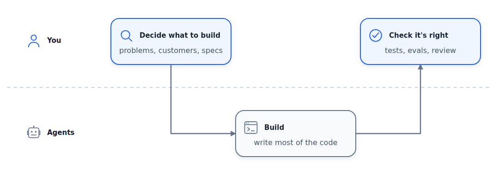
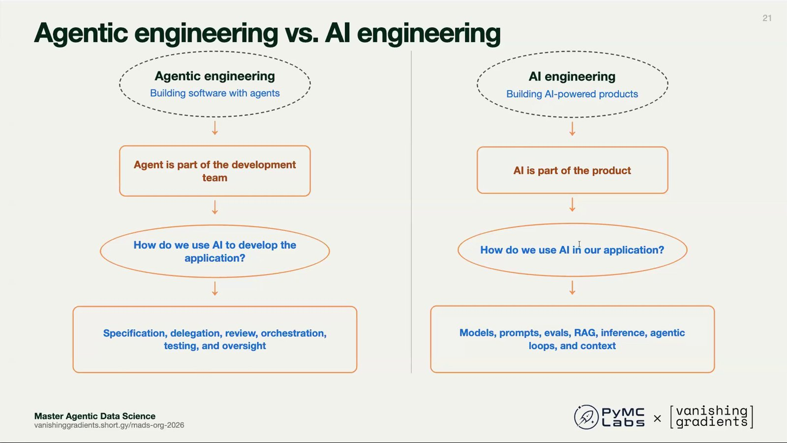
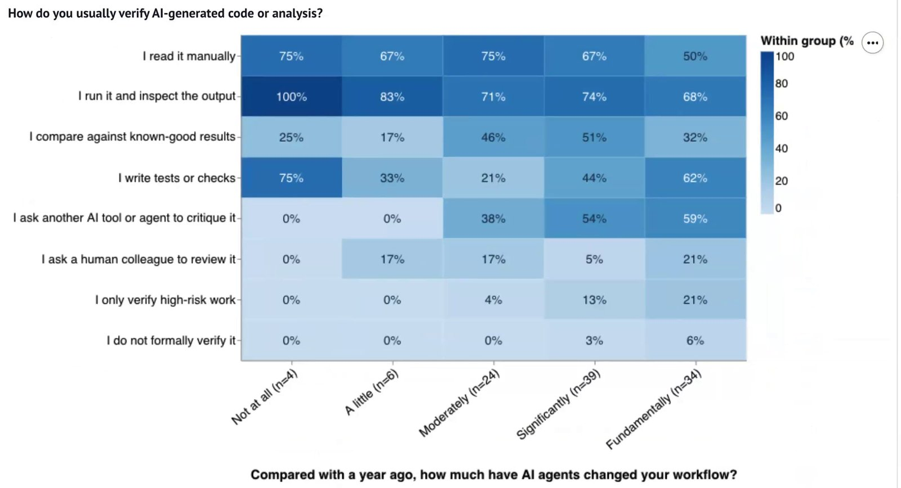
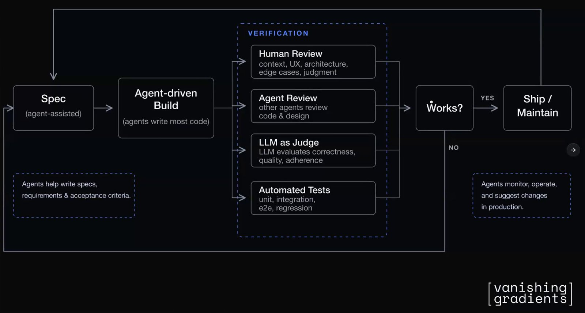
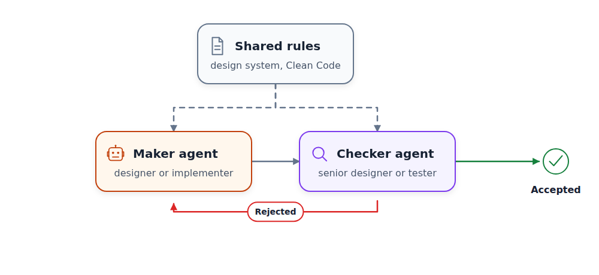
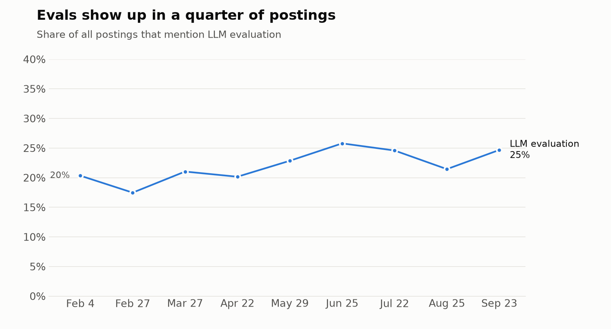
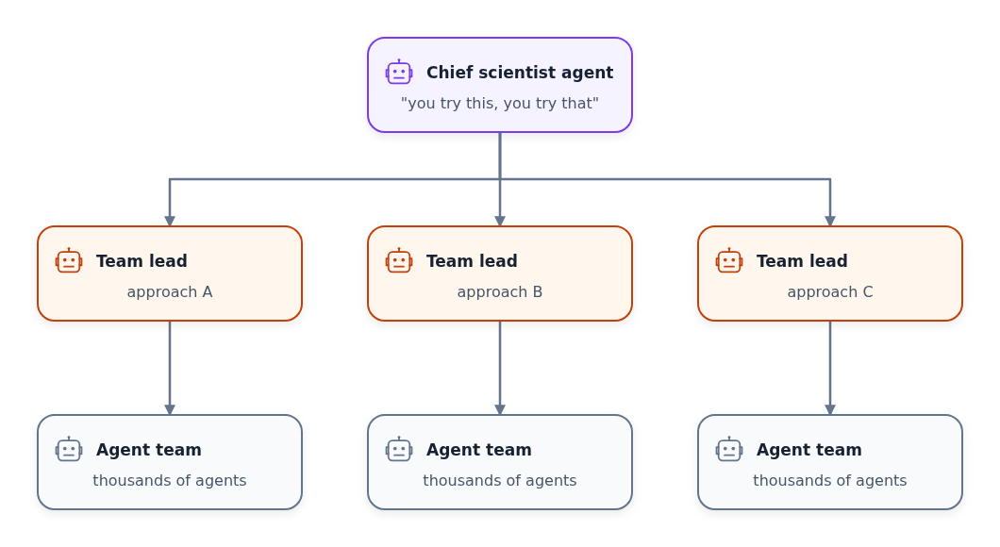
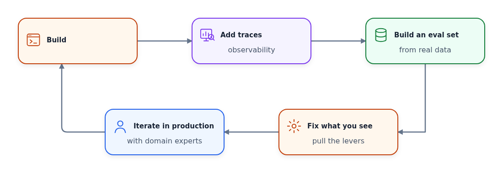
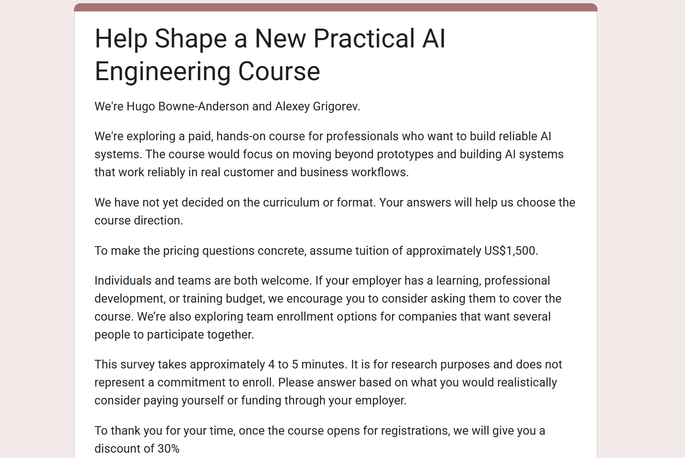

# Trends in AI Engineering
## Webinar with Hugo Bowne-Anderson

Last week I ran a webinar with [Hugo Bowne-Anderson](https://substack.com/@hugobowne). Hugo and I met in Berlin about a month before, had a great breakfast, and decided to do something together.

<figure>
  
  <figcaption>Hugo and I at our breakfast in Berlin</figcaption>
</figure>

The first step we decided on was an open ask-us-anything session - which was the webinar.

We had two goals for it:

- help the people who came to the webinar
- understand what we could create together for you longer term

At the end of the session Hugo and I talked about turning this recap into a shared Substack article. This article.

If you prefer video, here's the recording:

https://youtu.be/whIdxTQsU0A

Agents now write more and more of the code. Hugo and I think the human engineer still adds value at the two ends of the work - deciding what to build, and checking that what got built is right.

<figure>
  
  <figcaption>Agents write most of the code, and you work at both ends</figcaption>
</figure>

In this article, I'll cover:

- What we can see in nine months of AI engineering job postings
- How agents changed the way we write code
- Why verification is now the bottleneck, and how to deal with sloppy agent code
- Dark software factories, where humans don't look at the code at all
- Which skills stay human
- What to focus on if you want to become an AI engineer

## Hugo and Me

Since you're reading this newsletter, I hope you already know a few things about me. I like calling myself a product AI engineer: I do whatever it takes to integrate AI from the user's perspective. I teach this in my courses.

Hugo's background is in mathematics, physics, and biology. He researched cell biology at the Max Planck Institute in Dresden and then at Yale. About 15 years ago he moved to industry, but he stayed in education. He worked at DataCamp, taught in the SciPy and PyData ecosystems, and did developer relations at startups such as Coiled and Outerbounds. He hosts the [Vanishing Gradients](https://vanishinggradients.fireside.fm/) podcast, and that's how we first met - we've done a bunch of podcasts together.

## The Job Market

I maintain the [AI Engineering Field Guide](https://github.com/alexeygrigorev/ai-engineering-field-guide) repository.

Every month since February 2026 I scrape job postings for the query "AI engineering" in six locations: Berlin, Amsterdam, London, New York, Los Angeles, and entire India. Then I use LLMs to extract skills, responsibilities, and use cases from each posting.

This is what one processed job posting looks like:

```yaml
company:
  name: Ecolab
  focus: Water, hygiene and infection prevention solutions
position:
  title: Senior AI Engineer
  ai_type:
    type: ai-first
  responsibilities:
  - Lead development of scalable GenAI-powered systems
  - Design intelligent workflows leveraging LLMs, vector-based retrieval, and multi-agent
    orchestration
  - Drive solution architecture for AI applications
  - Mentor junior engineers
  - Deliver production-ready applications integrated with business processes and platforms
  use_cases:
  - Intelligent business process workflows powered by LLMs
  - Vector-based retrieval and multi-agent orchestration for enterprise applications
  - GenAI applications integrated with business platforms
  skills:
    genai: [Generative AI, LLMs, RAG, Multi-Agent Systems]
# ...
```

Nine months of data isn't enough to build models that predict the future. But I can already see where the market is going.

The overall market is growing. Everyone asks "where are all the jobs?" For now, at least, I don't see a reason to worry in the data. The number of postings dipped in spring, but the last two scrapes are the biggest so far.

<figure>
  
  <figcaption>AI engineering postings per monthly scrape</figcaption>
</figure>

Forward-deployed engineer (FDE) roles grow faster than the market overall. The number of FDE postings roughly doubled since February. I have a separate analysis of the FDE market: [What AI Forward-Deployed Engineers Do](https://aishippingblog.com/p/what-ai-forward-deployed-engineers).

<figure>
  
  <figcaption>Forward-deployed engineer postings per scrape</figcaption>
</figure>

Roles that focus on training models are shrinking. Before, companies wanted more people with PyTorch-style skills. Now they post fewer of these roles. Also, fewer inference and serving roles.

So it looks like now companies mostly use "AI engineer" to mean someone who calls models through APIs and builds things around them.

<figure>
  
  <figcaption>Share of AI-first postings that mention the integrator stack (RAG, agents, LLM APIs) vs the trainer stack (PyTorch, fine-tuning, CUDA)</figcaption>
</figure>

Companies build agents and RAG around these models, and both keep growing. Agents went from 50% to 60% of all postings, RAG from 33% to 45%.

<figure>
  
  <figcaption>Share of all postings that mention agents and RAG</figcaption>
</figure>

There are almost no junior positions - only about 1%. AI engineers are usually more experienced people, so starting your career as an AI engineer is hard.

<figure>
  
  <figcaption>Seniority from the job title, September 2026 scrape</figcaption>
</figure>

Most of the job is the work around hosted LLMs, and a big part of that is evaluation. Knowing evals is the difference between getting hired and not getting hired. If a hiring manager finds out you don't know evals, the interview will likely end there.

## Agents Write the Code Now

At the same time, we write code very differently than we did a year ago.

I talk to more and more companies whose policy is "no handwritten code". You aren't allowed to write code yourself, only through an agent. At one such company, many engineers resisted and said they still wanted to write code by hand. The company told them: nobody is keeping you here, go find a different place.

I was surprised they were that adamant about it. But it's their choice - they know their business better than I do.

Even when a company doesn't require agents, it's hard to go back to writing code by hand. You're still the bottleneck when you work with agents, but if you write code directly, you're just so much slower.

Hugo separated two terms that often get confused:

- In agentic engineering (a term coined by Simon Willison), you build software with agents. The agent is part of the dev team. Your job is specification, delegation, review, and orchestration.
- In AI engineering, you build agentic search, RAG, or an agent. AI is part of the product. You think about models, prompts, evals, harness engineering, and agentic loops.

<figure>
  
  <figcaption>Hugo's slide comparing agentic engineering and AI engineering</figcaption>
</figure>

In practice, you do both. You build AI-powered products with agents. And for agentic engineering, you build up your own harness - skills in your AGENTS.md, MCP servers, sandboxes, and guardrails.

I see this confusion among people who join my courses: they join a course about AI engineering wanting to learn how to use AI for coding. There's a lot of overlap, but the work is different. If you write code with AI, someone else takes care of evaluating and monitoring that tool. You focus on creating the proper specification, making sure the agent follows it, and enforcing the development lifecycle rules.

## Verification Is the Bottleneck

If agents write the code, you need a way to know that the code is right.

Hugo ran a survey on how people do agentic data science. Many people said AI changes their workflow significantly: 34 said "fundamentally" and 39 said "significantly". Hugo wanted to see what made the difference, so he built a heat map of how much AI changed people's workflow against how they verify AI-generated code.

<figure>
  
  <figcaption>From Hugo's survey: how people verify AI-generated work, grouped by how much agents changed their workflow</figcaption>
</figure>

Agentic verification means using agents to verify the work of other agents. 59% of the people whose workflow changed fundamentally use it and write tests. The less impact people reported, the fewer of them wrote tests or used agentic verification. It isn't causal, but there's a correlation: the more tests you write and the more agentic verification you use, the more value you get from agents.

Hugo doesn't say to stop reading code manually - only that you probably shouldn't read all of it.

Agents change the whole development lifecycle. In a reductive version, you spec it out, build it, verify it, and if it works, ship and maintain it.

With agents, the steps look like this:

1. Creating specifications is agent-assisted
2. Building is agent-driven - agents write most of the code (if not all)
3. Verification has several layers:
   - Automated tests, as before - unit, integration, end-to-end, regression
   - LLM as a judge for correctness, quality, and adherence
   - Agentic review, where agents review code and design
   - Human review for context, UX, and similar things
4. Once you get sophisticated enough, your agents start monitoring, operating and suggesting changes in production

<figure>
  
  <figcaption>Hugo's diagram of the software lifecycle with agents</figcaption>
</figure>

## Sloppy Agent Code

Coding agents, even frontier ones, make sloppy design and code. They give you pages and pages of design that are absolute slop. When you design with them, you need to be in the loop and in control. Hugo asks them to respond in three sentences, or to give him 10 ideas of three sentences each, so he can choose the best one.

I use what I call [adversarial design](https://github.com/alexeygrigorev/.agents/blob/main/skills/adversarial-design-review/SKILL.md). I set up two agents: a designer and a senior designer. The designer designs, and the senior designer tries to find a reason to reject the design. They share a design system document that describes how the design should look, and they bounce the design between each other until the senior designer is satisfied.

I do the same for code, with an implementer and a tester. The tester's goal is to find holes in the implementation and bounce it back to the implementer. A feature may take 4-5 hours instead of 20 minutes because of the back and forth, but it's still faster than doing it manually, and the quality at the end is better.

<figure>
  
  <figcaption>One agent builds, another tries to reject the result</figcaption>
</figure>

Both agents need rules to check against, and the good books are a shortcut. My favorite is Clean Code by Robert Martin. If you just say "follow the principles from the Clean Code book by Robert Martin", the code improves.

Sometimes I make it more specific:

- Functions no longer than 30 lines
- Files no longer than 300 lines
- Follow the SOLID principles
- Follow the don't-repeat-yourself principle

Of course it burns more tokens, but I don't want to cry when I look at the code.

Hugo does the same for writing with Strunk and White's The Elements of Style. Its rules include "omit needless words" and "use the active voice". He has these rules in the AGENTS.md of a bunch of repos. The agents don't always follow them, so he runs three verification agents in parallel, because each one misses something. Then a final agent performs the edit.

I developed my own rules empirically, by looking at what went wrong and correcting it. Referencing a well-known book is much more convenient.

It's the same as leading a team of juniors. You don't look at every line, but you share the design principles and check from time to time: "No, this isn't good, I said no ternary operator". When you see something that isn't in the rules yet, you add a rule.

For example, agents like defensive coding. In Python, they check if an attribute exists before accessing it. These checks make the code hard to read. With a type checker, you don't need them.

I tested this on a fairly large and relatively old codebase. I developed it with AI, first by copy-pasting from ChatGPT and then fully with coding agents. When I noticed a lot of slop, I asked the agent to refactor the entire codebase using these rules. It took two Codex resets, but after that I could read the code without crying.

Many people think only a technical human can fix the slop. Hugo disagrees: the fixer can be an agent with the correct instructions and the correct verification processes. Parallelize with a few of them because some will mess up, and surface the high-risk, important things to a human. That doesn't have to mean looking at code - it can be dashboards, information graphics, or cards.

## Evals Are the Same Skill

In AI engineering, we call the same verification work evaluation. Systems built on LLMs aren't deterministic, so we can't simply trust them. We need a framework to make sure they can be trusted - for example, an agent that evaluates another agent.

Data science skills help a lot when you build that framework. Data scientists have done this kind of evaluation for a long time, because machine learning is non-deterministic too.

<figure>
  
  <figcaption>Share of AI engineering postings that mention LLM evaluation</figcaption>
</figure>

## Dark Software Factories

Hugo then described an idea that he admitted may sound radical: dark software factories. A dark factory is one where humans aren't present at all - there isn't even light inside. There are several in Japan where robots build robots.

In a dark software factory, humans aren't allowed to look at the code. They get artifacts that let them make business decisions and verify that everything is correct, but they're separated from the generated code.

Hugo doesn't suggest anyone build one today. But he thinks there's a not-so-distant future where they're economically viable. If that sounds strange, remember that we don't read machine code anymore. We trust software because of abstraction layers, and with agents, we get that trust from good tests, verification, and specification.

I think it's a good point. Whether you're a solo founder or a software engineer, your time is limited. If you check everything your agents write, you become the bottleneck. Once you let the agents run without your involvement, you're only the final gatekeeper who accepts or rejects.

In my setup, agents escalate things that need human verification. They add a human tag to a GitHub issue, and then I look. I had to tune them so they escalate only what I need to see.

<figure>
  
  <figcaption>Issues my agents escalated to me in the AI Shipping Labs website repository</figcaption>
</figure>

Most of the time I'm out of the loop. I give them specifications or raw input, and they turn it into specifications, build features, and ship them.

Often I'm involved more than I want, because agents create slop, especially in design. For the backend, it can be a dark factory already. For the frontend, not yet. But with new models like Opus 5.5 I feel I can be involved less and less.

Hugo added that this is still hard work. We haven't evolved to make that many decisions and read that much text. Agents didn't make software engineering easy - they made it a different kind of hard.

## The Human Side

Nobody can see what roles, hiring processes, or even tools will look like in a year or two. But we can name the skills that matter at the other end of the work - deciding what to build and for whom.

Hugo listed the data scientist skills that will always be useful:

- A hacker mentality: when a new model comes out, play with it, explore what you can do with it, and use it to deliver business value or help people
- Knowing some statistics, how to analyze data, and how to use data to improve products
- Domain expertise in something - SRE, DevOps, marketing, or anything else

I would add problem discovery. There are so many problems around us waiting to be discovered and solved. Look at your own everyday life. You repeat many things, and many things are mildly annoying, but you aren't doing anything about them yet.

With AI, I can finally approach these problems. Every week there's a new model available for free, and you can test how it solves your particular problem. AI can't find these problems for you, so you can stand out by finding them.

Hugo also talked about what he prefers to call human skills rather than soft skills. We use agents to write code, and we write code to solve problems for our customers. Our customers are people, not agents. We still need the human connection, the user interviews, and everything product managers and product designers have done for a long time.

As a solo founder, I can go far with AI. But my background is engineering, and I don't have marketing or sales skills. So I can't reliably sell what I build.

Freelancers have the same problem. You need to convince clients why you charge $2,000 per day when a Claude subscription costs $200 per month - agents won't give you money. And at work, you still need to convince your manager to give you that promotion.

Hugo agreed. For him, the work is speaking with people, understanding their problems, and solving them in a way that gives them more value than they pay. Even this session exists because we met in Berlin and had breakfast.

Organizing work is a human skill too. When OpenAI announced its Navier-Stokes result, I was most interested in the fact that a team of 10,000 agents worked on it. I tried to imagine how I would organize the work of 10,000 agents on a problem I don't know.

You can't just tell them to go solve it. You need a hierarchy - for example, a chief scientist who says "you try this, you try that". This kind of hierarchy comes from leadership and management.

That's why I think product managers are uniquely equipped to run agents. They already know how to organize work in a team, set up processes, define specifications, and check work.

<figure>
  
  <figcaption>Organizing 10,000 agents takes a hierarchy, not a swarm</figcaption>
</figure>

## Becoming an AI Engineer

If you want to become an AI engineer and get hired in the next three months, you don't need to focus on training and serving models. Hugo compared training models to working on an internal combustion engine. If you're a Formula One driver, it's good to know how it works, but most people who use a car don't need to. An AI engineer works on a product.

Instead, Hugo would focus on the data science mentality and the lifecycle of AI products. Unlike the traditional spec, build, deploy, maintain cycle, it's iterative and experimental.

The lifecycle looks like this:

1. You build.
2. You add observability and traces.
3. You look at your data and build an evaluation set from it.
4. You pull levers based on the problems you see in the data.
5. You iterate in production with domain experts.

<figure>
  
  <figcaption>The AI product lifecycle is a loop, not a straight line</figcaption>
</figure>

You learn it by building a project: an agent or an AI-powered application with real users.

People often ask me whether they need to know LLM internals to work as an AI engineer. I usually say no. You need to know how to send a request to an LLM provider, build everything around it, and have the data science mindset. Some companies do lower-level work and may ask for it, but fewer than 10% of the postings in my data do.

I recently read [Inference Engineering](https://aishippinglabs.com/books/inference-engineering) by Philip Kiely, who spent several years at Baseten working on high-performance inference at scale. It's a wonderful book if you want to know what happens after you send a request. But if your goal is to become an AI engineer, read it later and focus on building projects now. If your goal is to become an inference engineer, that's the book to read.

## Our Next Course

Hugo and I want to run a paid course together, like the ones we already run on Maven. There are infinitely many ideas, so we want to understand what you actually want.

<figure>
  
  <figcaption>The questionnaire we shared at the end of the session</figcaption>
</figure>

Tell us where you stand, what you want to build, where you're stuck, and what format you prefer. We want to hear both what frustrates you and what excites you about AI.

If you want to help us decide, fill in [this questionnaire](https://forms.gle/EjtBzfmZft15dCvY9). It isn't a short form and needs some focus time. As a thank you, people who fill it in will get a discount on the future course once we decide what to build.
