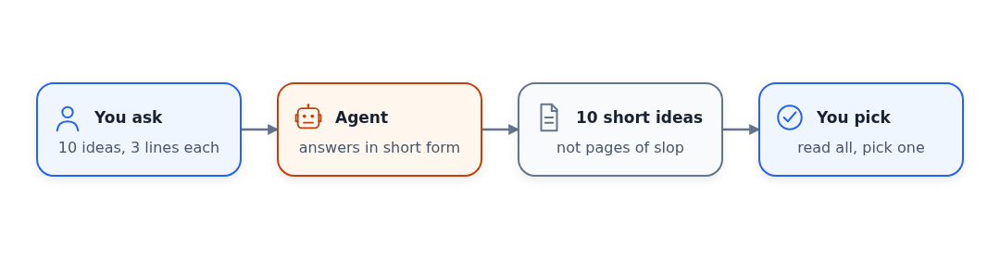
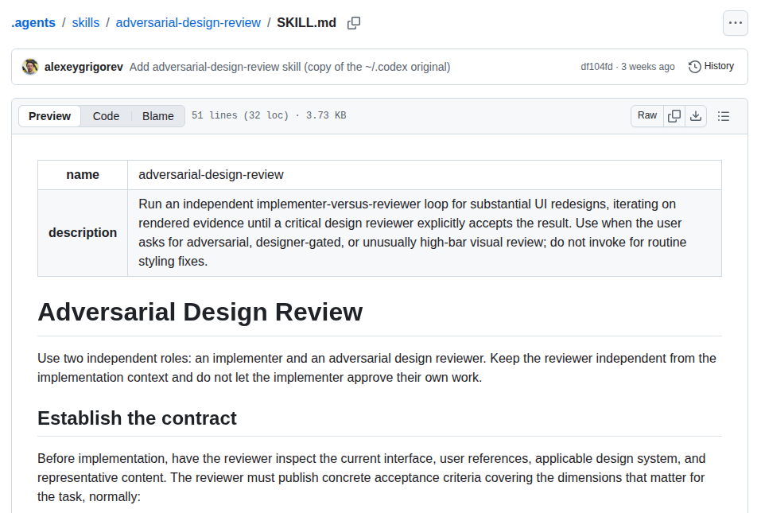
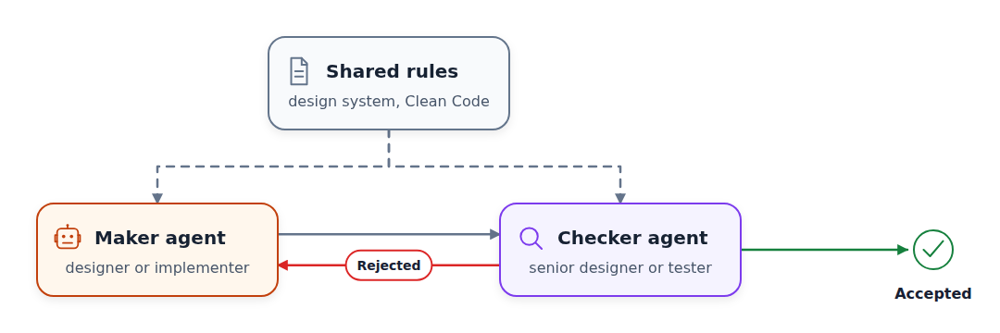
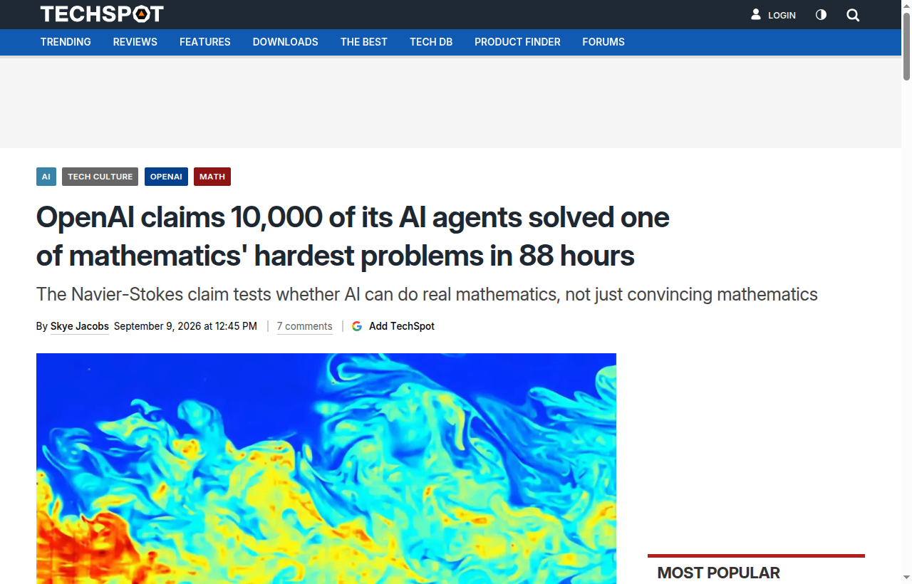
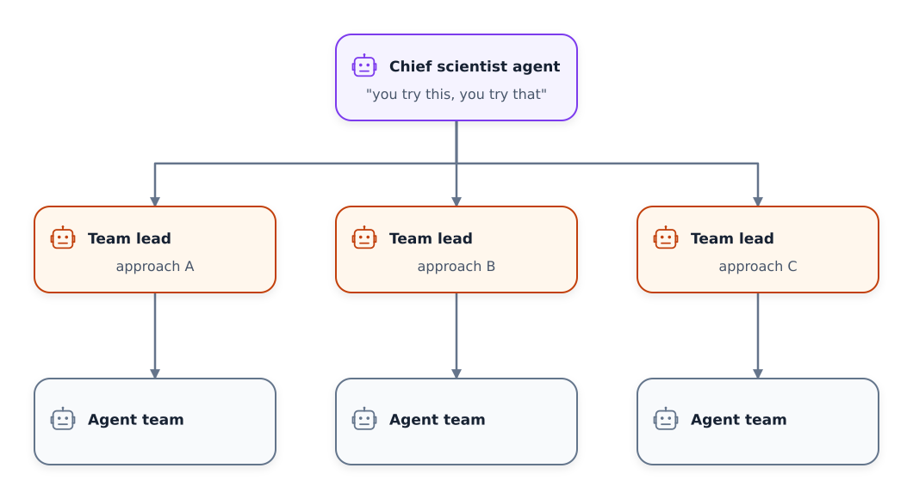
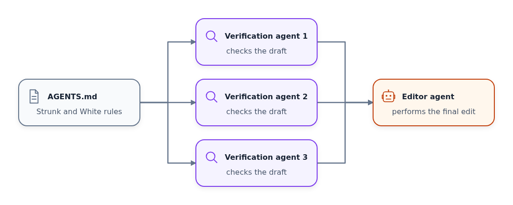
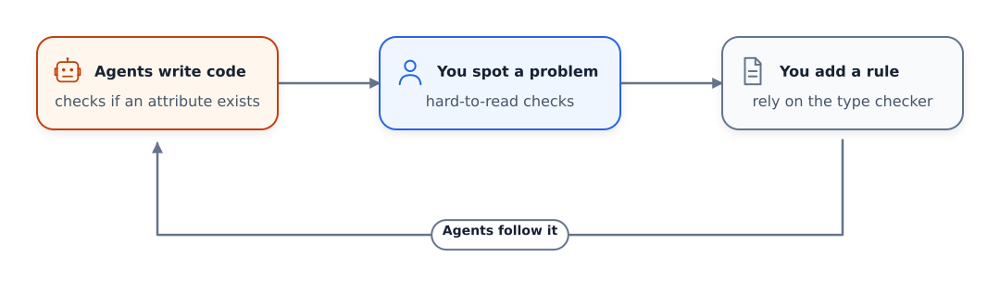
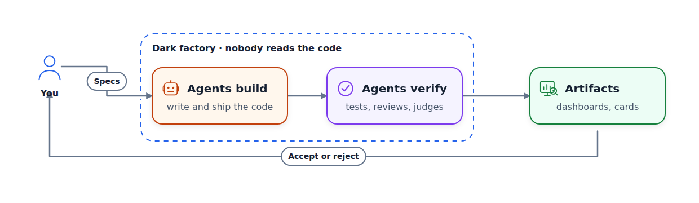
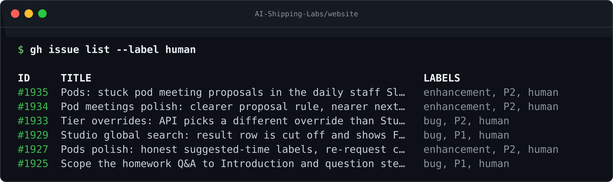

# When Agents Write the Code
## Agentic engineering lessons from a webinar with Hugo Bowne-Anderson

A few weeks ago I ran a webinar with [Hugo Bowne-Anderson](https://substack.com/@hugobowne). During the session, Hugo separated two terms that people often confuse: AI engineering, where AI is part of the product, and agentic engineering, where agents help you build the product. We talked about both, and in the [first article](https://aishippingblog.com/p/trends-in-ai-engineering) I covered AI engineering and the job market. This one is about agentic engineering.

If you prefer video, here's the recording:

https://youtu.be/whIdxTQsU0A

Agents now write more and more of the code. Hugo and I think the human engineer still adds value at the two ends of the work - deciding what to build, and setting up how the result gets checked.

<figure>
  
  <figcaption>Agents write most of the code, and you work at both ends</figcaption>
</figure>

In this article, I'll cover:

- How agents changed the way we write code, and why verification is now the bottleneck
- How to deal with sloppy agent code by letting one agent check another
- How to organize many agents
- The rules agents check against: good books and rules you add as you go
- Dark software factories, where humans don't look at the code at all
- How I stay out of the loop in my own projects

## Agents Write the Code Now

We write code very differently than we did a year ago.

<figure>
  
  <figcaption>Hugo's slide: in agentic engineering the agent is part of the development team</figcaption>
</figure>

I talk to more and more companies whose policy is "no handwritten code". You aren't allowed to write code yourself, only through an agent. At one such company, many engineers resisted and said they still wanted to write code by hand. The company told them: nobody is keeping you here, go find a different place.

I was surprised they were that adamant about it. But it's their choice - they know their business better than I do.

Even when a company doesn't require agents, it's hard to go back to writing code by hand. You're still the bottleneck when you work with agents, but if you write code directly, you're just so much slower.

## Verification Is the Bottleneck

If agents write the code, you need a way to know that the code is right.

Hugo ran a survey on how people do agentic data science. Many people said AI changes their workflow significantly: 34 said "fundamentally" and 39 said "significantly". Hugo wanted to see what made the difference, so he built a heat map of how much AI changed people's workflow against how they verify AI-generated code.

<figure>
  
  <figcaption>From Hugo's survey: how people verify AI-generated work, grouped by how much agents changed their workflow</figcaption>
</figure>

Agentic verification means using agents to verify the work of other agents. Among people whose workflow changed fundamentally, 59% ask another agent to critique the work, and 62% write tests. The less impact people reported, the less common both practices were. It isn't causal, but the people who changed their workflow the most also verify the most.

Hugo doesn't say to stop reading code manually - only that you probably shouldn't read all of it.

Verification isn't the only step that changes - agents change the whole development lifecycle. In a reductive version, you spec it out, build it, verify it, and if it works, ship and maintain it.

With agents, the steps look like this:

1. Creating specifications is agent-assisted
2. Building is agent-driven - agents write most of the code (if not all)
3. Verification has several layers:
   - Automated tests, as before - unit, integration, end-to-end, regression
   - LLM as a judge for correctness, quality, and adherence
   - Agentic review, where agents review code and design
   - Human review for context, UX, and similar things
4. Once you get sophisticated enough, your agents start monitoring, operating and suggesting changes in production

<figure>
  
  <figcaption>Hugo's diagram of the software lifecycle with agents</figcaption>
</figure>

## Sloppy Agent Code

All these layers exist because coding agents, even frontier ones, make sloppy design and code. They give you pages and pages of design that are absolute slop.

When you design with them, you need to control the output.

Hugo does it himself: he asks them to respond in three sentences, or to give him 10 ideas of three sentences each, so he can choose the best one. But controlling the output by hand keeps you in the loop for every response.

<figure>
  
  <figcaption>Hugo's manual way to control the output: short answers, but you read every one</figcaption>
</figure>

## Agents Controlling Agents

Many people think only a technical human can fix the slop. Hugo often does it by hand himself, but he disagrees. The fixer can be an agent with the correct instructions and the correct verification processes. Surface the high-risk, important things to a human. That doesn't have to mean looking at code - it can be dashboards, information graphics, or cards.

That's how I work too. I often let one agent control the output of another:

- For coding, I follow the implementer-reviewer pattern
- For design, I use what I call [adversarial design](https://github.com/alexeygrigorev/.agents/blob/main/skills/adversarial-design-review/SKILL.md).

The second agent acts as the reviewer: until it agrees that the result is good, the first one has to continue.

<figure>
  
  <figcaption>The adversarial design review skill in my .agents repository</figcaption>
</figure>

For design, the implementer is a designer and the reviewer is a senior designer. The designer designs, and the senior designer tries to find a reason to reject the design. They share a design system document that describes how the design should look, and a set of criteria for evaluating the design. They bounce the design between each other until the senior designer is satisfied.

For code, the reviewer's goal is to find holes in the implementation and bounce it back to the implementer. A feature may take 4-5 hours instead of 20 minutes because of the back and forth, but it's still faster than doing it manually, and the quality at the end is better.

<figure>
  
  <figcaption>One agent builds, another tries to reject the result</figcaption>
</figure>

## Organizing Agents Like a Team

The same idea scales up from two agents to many. Organizing work is a human skill. When [OpenAI announced its Navier-Stokes result](https://techspot.com/news/113785-openai-claims-10000-ai-agents-solved-one-mathematics.html), I was most interested in the fact that a team of 10,000 agents worked on it. I tried to imagine how I would organize the work of 10,000 agents on a problem I don't know.

<figure>
  
  <figcaption>TechSpot report on OpenAI using 10,000 agents to tackle the Navier-Stokes problem</figcaption>
</figure>

You can't just tell them to go solve it. You need a hierarchy - for example, a chief scientist who says "you try this, you try that". This kind of hierarchy comes from leadership and management.

That's why I think product managers are uniquely equipped to run agents. They already know how to organize work in a team, set up processes, define specifications, and check work.

<figure>
  
  <figcaption>How I would organize 10,000 agents</figcaption>
</figure>

## Rules From Good Books

The implementer and the reviewer need shared rules to check against. I often refer to books. For coding, I can say "follow the principles from the Clean Code book by Robert Martin", then code improves.

Sometimes I make it more specific:

- Functions no longer than 30 lines
- Files no longer than 300 lines
- Follow the SOLID principles
- Follow the don't-repeat-yourself principle

Of course it burns more tokens, but I don't want to cry when I look at the code.

Hugo does the same for writing with Strunk and White's The Elements of Style. Its rules include "omit needless words" and "use the active voice". He has these rules in the AGENTS.md of a bunch of repos. The agents don't always follow them, so he runs three verification agents in parallel, because each one misses something. Then a final agent performs the edit.

Referencing a well-known book is much more convenient than writing every rule yourself.

<figure>
  
  <figcaption>Hugo's editing setup: three checkers in parallel, then one editor</figcaption>
</figure>

## Adding Rules as You Go

I also add my own rules empirically, by looking at what went wrong and correcting it. It's the same as leading a team of juniors. You don't look at every line, but you share the design principles and check from time to time: "No, this isn't good, I said no ternary operator". When you see something that isn't in the rules yet, you add a rule.

For example, agents like defensive coding. In Python, they check if an attribute exists before accessing it. These checks make the code hard to read. With a type checker, you don't need them.

<figure>
  
  <figcaption>How a rule gets added: you spot the problem once, and the agents follow the rule from then on</figcaption>
</figure>

I tested these rules on a fairly large and relatively old codebase. I developed it with AI, first by copy-pasting from ChatGPT and then fully with coding agents. When I noticed a lot of slop, I asked the agent to refactor the entire codebase using these rules. It took two Codex resets, but after that I could read the code without crying.

## Dark Software Factories

If agents review each other against clear rules, the next question is how much a human needs to look at the code at all. Hugo described an idea that he admitted may sound radical: dark software factories. A dark factory is one where humans aren't present at all - there isn't even light inside. There are several in Japan where robots build robots.

In a dark software factory, humans aren't allowed to look at the code. They get artifacts that let them make business decisions and verify that everything is correct, but they're separated from the generated code.

<figure>
  
  <figcaption>In a dark software factory you work with specs and artifacts, never with the code</figcaption>
</figure>

Hugo doesn't suggest anyone build one today. But he thinks there's a not-so-distant future where they're economically viable. If that sounds strange, remember that we don't read machine code anymore. We trust software because of abstraction layers, and with agents, we get that trust from good tests, verification, and specification.

I think it's a good point. Whether you're a solo founder or a software engineer, your time is limited. If you check everything your agents write, you become the bottleneck. Once you let the agents run without your involvement, you're only the final gatekeeper who accepts or rejects.

## How I Stay Out of the Loop

That's close to how I work now. In my setup, agents escalate things that need human verification. They add a human tag to a GitHub issue, and then I look. I had to tune them so they escalate only what I need to see.

<figure>
  
  <figcaption>Issues my agents escalated to me in the AI Shipping Labs website repository</figcaption>
</figure>

Most of the time I'm out of the loop. I give them specifications or raw input, and they turn it into specifications, build features, and ship them. The raw input is the part I own: what the feature is for and who it's for.

Often I'm involved more than I want, because agents create slop, especially in design. For the backend, it can be a dark factory already. For the frontend, not yet. But with new models like Opus 5.5 I feel I can be involved less and less.

That's also why I still care about readable code, even though I'm out of the loop most of the time. The reviewer agent checks against my rules, and when something gets escalated to me, I can understand it quickly.

Hugo added that this is still hard work. We haven't evolved to make that many decisions and read that much text. Agents didn't make software engineering easy - they made it a different kind of hard.

For me, that hard part sits at the two ends of the work. At the start, I decide what to build and who it's for. At the end, I set up the reviewer agents, the rules they check against, and what they escalate to me. More and more of the middle belongs to the agents.
