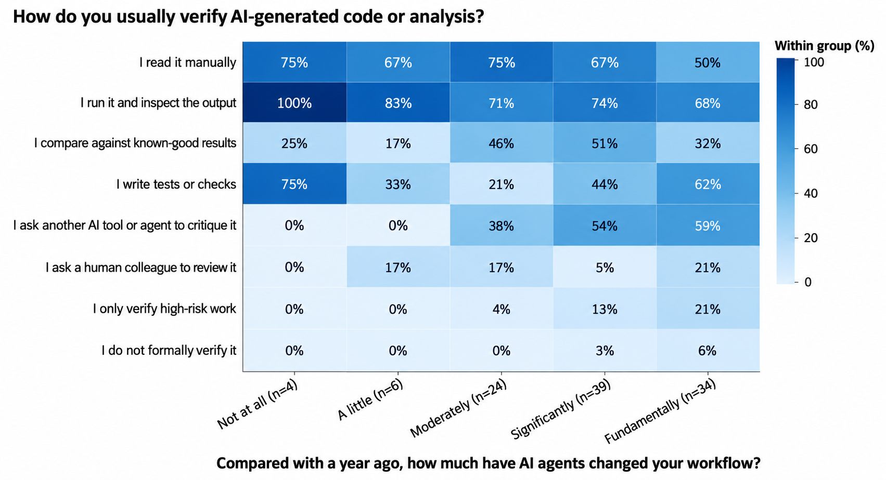
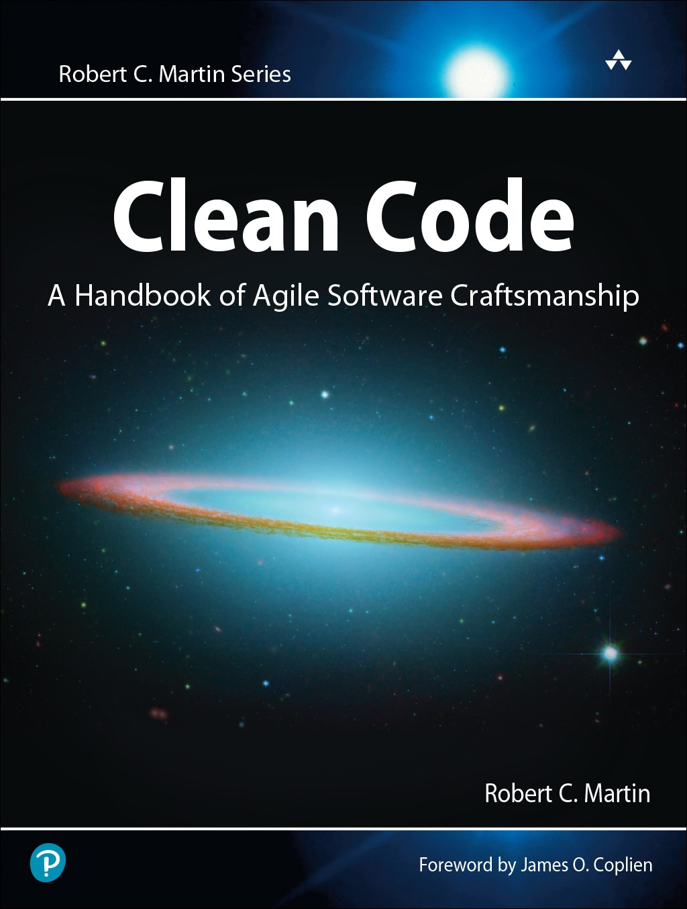
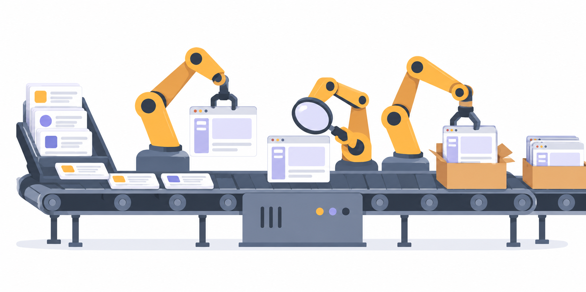
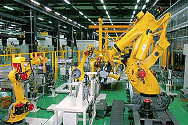

# Agentic Engineering

A few weeks ago [Hugo Bowne-Anderson](https://substack.com/@hugobowne) and I ran a webinar about trends in AI engineering.

[Watch the webinar recording](https://youtu.be/whIdxTQsU0A).

At the beginning, Hugo defined two terms that people nowadays often confuse:

- AI engineering, where AI is part of the product
- Agentic engineering, where agents help you build the product

<figure>
  
  <figcaption>Hugo's slide: in agentic engineering the agent is part of the development team</figcaption>
</figure>

At the end of the session we decided to write about both topics separately. I published [the first article about AI engineering](https://aishippingblog.com/p/trends-in-ai-engineering) earlier. Here, I focus on agentic engineering.

In particular, I'll cover:

- How people verify agent-generated work as their workflows change
- Using one agent to review another's code and designs
- Giving agents shared rules for coding and writing
- Organizing agents into teams and larger hierarchies
- Running software factories where humans focus on outcomes

## Verifying Agent-Generated Work

Hugo ran a survey on how people do agentic engineering in data science. 34 people said that AI changed their workflow "fundamentally", and 39 said "significantly".

Hugo wanted to see what exactly was different, so he followed up and visualized the results with a heatmap.

<figure>
  
  <figcaption>Hugo's survey, redrawn for readability: verification methods grouped by how much agents changed people's workflow</figcaption>
</figure>

Among people whose workflow changed fundamentally, 59% ask another AI tool or agent to critique the work. In the significantly changed group, it's 54%.

The less impact people reported, the less common this practice was. It's not causal, but the people who changed their workflow the most also verify using agents the most.

## Agents Controlling Agents

Even frontier models give you pages and pages of absolute slop. With this amount of output it's hard to review every line of code ourselves, so we use agents to control agents.

I call it the "implementer-reviewer" approach.

I have the implementer do the work and the reviewer validate it. I let them iterate until the second agent accepts the output of the first agent.

For coding, I assign one agent to implement the task as a software engineer. I ask another to act as a tester and find problems in the implementation. A feature may take a few hours instead of 20 minutes, but the quality at the end is better.

<figure>
  
  <figcaption>One agent builds, another tries to reject the result</figcaption>
</figure>

It works outside of coding tasks too.

Agents usually produce terrible and complicated designs, so I use the same implementer-reviewer approach:

- The implementer is a designer, who creates the interface
- The reviewer is a senior designer who tries to find reasons to reject the design

They share a design system and a rubric for evaluating the interface. After each iteration the senior designer scores the interface, and they iterate until the score is 10/10.

I call this [adversarial design](https://github.com/alexeygrigorev/.agents/blob/main/skills/adversarial-design-review/SKILL.md).

<figure>
  
  <figcaption>The skill that defines the designer and reviewer roles</figcaption>
</figure>

I described how I use mockups and design systems as a non-designer in [AI Design for Non-Designers](https://aishippingblog.com/p/ai-design-for-non-designers).

## Rules for Coding

I give the implementer and reviewer a common set of rules. For coding tasks, I give them acceptance criteria and a coding standards document. For design, I give them a design system and an evaluation rubric.

But instead of describing the entire system and listing all the criteria, I often take a shortcut and refer to books.

For coding, I can say "follow the principles from the Clean Code book by Robert Martin", then code improves.

Sometimes I add details to make it more specific:

- Functions no longer than 30 lines
- Files no longer than 300 lines

<figure>
  
  <figcaption>Clean Code by Robert C. Martin. Cover: <a href="https://www.informit.com/store/clean-code-a-handbook-of-agile-software-craftsmanship-9780132350884">Pearson / InformIT</a></figcaption>
</figure>

I tested these rules on a fairly large codebase I started in 2023. I developed it with AI, first by copy-pasting from ChatGPT and then fully with coding agents. When the code turned into a pile of slop, I asked the agent to refactor the entire codebase using this approach.

It took two banked Codex resets, but after that I could read the code without crying.

## Rules for Writing

Hugo does the same for writing with Strunk and White's The Elements of Style. Its rules include "omit needless words" and "use the active voice".

The agents don't always follow them, so he runs three extra verification agents in parallel. Then he has a final agent edit the text.

<figure>
  
  <figcaption>Hugo's editing setup: three checkers in parallel, then one editor</figcaption>
</figure>

## Organizing Agents Like a Team

With an implementer and reviewer we have two agents. But we can scale this idea to a full team by adding a product manager and on-call engineer.

You describe the responsibilities of each team member, and let them work together on a project:

- PM plans the tasks and adds acceptance criteria
- Software engineer implements the task
- QA engineer checks that the code works against the criteria
- PM runs acceptance tests through a browser
- On-call engineer makes sure that CI/CD checks pass

I described this approach in [I Built an AI Agent Team for Software Development](https://aishippingblog.com/p/i-built-an-ai-agent-team-for-software). You can follow the setup in [the first lesson of AI Dev Tools Zoomcamp](https://github.com/DataTalksClub/ai-dev-tools-zoomcamp/blob/main/01-ai-native-workflow/01-ai-native-developer-workflow.md).

When I read [TechSpot's report about OpenAI's claimed Navier-Stokes result](https://techspot.com/news/113785-openai-claims-10000-ai-agents-solved-one-mathematics.html), I was interested in how they organized the work. I don't know much about the mathematics. But the report described 10,000 agents running in parallel, and I tried to imagine how I'd manage that.

It took me quite some time to figure out one team of five agents. I still haven't made a department of teams work reliably, although I think I'm pretty close.

I'd organize them into a hierarchy:

- A chief scientist setting the direction
- Team heads coordinating each part of the work
- Many agents under them exploring different approaches

<figure>
  
  <figcaption>How I would organize 10,000 agents</figcaption>
</figure>

I'll probably never have a problem that requires 10,000 agents, but now I can manage 30-50 across my projects.

I tried scaling beyond one team while working on Cloudflare's Git platform competition. I gave separate teams the Git project, messaging, a dashboard, and an agent launcher. I put a principal agent in charge of coordinating them. Keeping the organization working was harder than defining the roles: failures sometimes left it idle for hours. I'll write more about that experiment separately.

## Dark Software Factories

I recently had a chat with a company that has a policy of "no handwritten code". There, you aren't allowed to write code yourself, only through an agent. When some engineers threatened to resign, the company said "nobody is forcing you to work here, you're welcome to explore other options".

Today we write code differently compared to one year ago. Even half a year ago I was still checking my code from time to time. Now I only do that when I prepare materials for my workshops and courses.

When you have a team of agents work through your backlog, you can imagine a conveyor belt of features. That's a software factory.

<figure>
  
  <figcaption>A software factory: you assign agents features from a backlog. AI-generated illustration</figcaption>
</figure>

Hugo takes this further and describes a dark software factory. The name comes from lights-out manufacturing: when machines work without people on the factory floor, there's no need to keep the lights on. FANUC's factories are a physical example of this kind of automation.

<figure>
  
  <figcaption>FANUC's robot factory. Photo: <a href="https://www.fanuc.co.jp/en/profile/production/factory1.html">FANUC</a>, which describes automatic transport and continuous testing of assembled robots</figcaption>
</figure>

In a dark software factory, humans aren't allowed to look at the code. They get artifacts that let them make business decisions and verify that everything is correct, but they're separated from the generated code.

<figure>
  
  <figcaption>In a dark software factory you work with specs and artifacts, never with the code</figcaption>
</figure>

Hugo doesn't suggest that everyone should start building a dark software factory today. But he thinks it'll soon be economically viable to skip reading code and focus on the business.

He compares this to trusting compilers without reading machine code. With agents, we still need tests, independent checks, and clear specifications before we can trust the result.

I agree with that direction because I'm a solo founder with limited time. If I check everything that agents write, I'll be the bottleneck. Once I let the agents run without my involvement, I can focus on product and architecture decisions.

## My Work at Both Ends

I still need to decide what to build and who it's for. I also need to define what counts as correct, give the reviewers rules, and make sure they bring the important decisions back to me.
