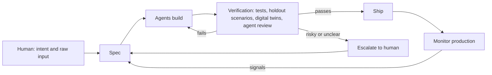
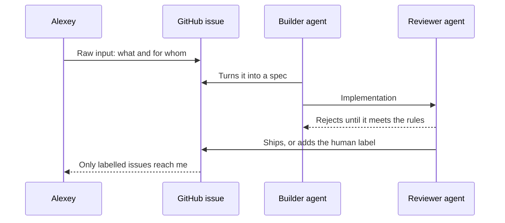

# Dark Software Factories

On 2026-09-29 I ran a lightning lesson, "Trends in AI Engineering", with [Hugo Bowne-Anderson](https://substack.com/@hugobowne), who hosts the Vanishing Gradients podcast. Near the end, Hugo brought up dark software factories - an idea he admitted may sound radical. I liked it enough to go and research where the term comes from, who actually runs one, and where it breaks.[^1][^2]

A dark software factory is a development setup where agents write, test, and ship code, and no human reads that code. People still decide what to build and how to check it, but they look at artifacts and outcomes, not diffs.

This article is for developers and team leads who already use coding agents and want to know how far "out of the loop" is realistic today.

## Map of This Article

The article goes from our conversation to the wider debate and back:

- The conversation that started it: what Hugo said, and how my own setup compares
- Where the terms come from: lights-out manufacturing, the 1960s "software factory", and Dan Shapiro's five levels
- Teams running a factory: StrongDM's Software Factory, OpenAI's harness engineering experiment, and smaller examples
- The practices that make it work: specs, holdout scenarios, digital twins, agentic review, escalation
- Economics: token budgets and who can afford this
- Critiques and failure modes: the HumanLayer reversal, comprehension debt, reward hacking, security, accountability
- How Hugo's and my positions compare with the public ones
- Open questions worth writing about next

The first two parts give you vocabulary. The middle parts show what people built with it. The last parts weigh it.

## The Conversation That Prompted This

The idea came up after we talked about verification and about agents controlling other agents. That context matters, so I start there.

### Verification as the Bottleneck

Hugo ran a survey on agentic data science. Among people who said AI changed their workflow "fundamentally", 59% ask another agent to critique the work and 62% write tests. Both practices were less common among people who reported less impact.[^1]

Hugo also showed his diagram of the agentic software lifecycle:

1. Specification is agent-assisted
2. Building is agent-driven
3. Verification has layers: automated tests, LLM as a judge, agentic review, and human review for context and UX
4. Once you get sophisticated enough, agents monitor and operate production and suggest changes

His point was that the fixer of agent slop doesn't have to be a technical human. It can be an agent with the right instructions and verification process. A human should see the high-risk, important things - and that doesn't have to mean code. It can be dashboards, information graphics, or cards.[^1]

I described my own version of this: an implementer-reviewer pattern for code and an [adversarial design review](https://github.com/alexeygrigorev/.agents/blob/main/skills/adversarial-design-review/SKILL.md) for design, where a second agent tries to reject the first agent's work until it's good. I give both agents rules from well-known books such as Clean Code.[^1]

### Hugo's Definition

Then Hugo described the dark software factory. In a physical dark factory, humans aren't present at all, so there's no need for light inside. He mentioned that there are several in Japan where robots build robots.[^1]

In a dark software factory, humans aren't allowed to look at the generated code. They get artifacts that let them make business decisions and verify that everything is correct, but they're separated from the code itself.[^1]

Hugo didn't suggest anyone build one today. He thinks there's a not-so-distant future where they become economically viable. His argument for why this isn't as strange as it sounds is that we don't read machine code anymore. We trust software because of abstraction layers. With agents, that trust comes from good tests, verification, and specification.[^1]

Hugo also mentioned that he teaches a course on agentic software factories. His framing combines automation with continuous learning: a system that keeps working while you're away and gets better from what it learns. He pointed to his Substack post "The Agentic Data Science Playbook", which has a lifecycle diagram of this process.[^1] The course is "Build Your Agentic Software Factory", co-taught with Eleanor Berger, and its page describes the factory as "a system where agents work continuously in the background to build software for you", with reports on what the agents changed and learned instead of line-by-line review ([Maven course page](https://maven.com/agentic-ventures/agent-factory)).

### My Setup

I said I think it's a good point. If you check everything your agents write, you become the bottleneck. Once the agents run without you, you're only the final gatekeeper who accepts or rejects.[^1]

In my setup, agents escalate what needs human verification. They add a `human` label to a GitHub issue, and then I look. In the [AI-Shipping-Labs/website](https://github.com/AI-Shipping-Labs/website) repository, that label is defined as "Needs manual human verification". I had to tune the agents so they escalate only what I actually need to see.[^1]

Most of the time I'm out of the loop. I give the agents specifications or raw input, and they turn it into specifications, build features, and ship them. The raw input is the part I own: what the feature is for and who it's for.[^1]

I'm still more involved than I want to be, because agents create slop, especially in design. For the backend, my setup is close to a dark factory already. For the frontend, it isn't yet. With models like Opus 5.5, I feel I can be involved less and less.[^1]

Hugo added that this is still hard work. We haven't evolved to make that many decisions and read that much text. Agents didn't make software engineering easy - they made it a different kind of hard.[^1]

With that conversation as the starting point, the next section looks at where the words "dark" and "factory" come from.

## Origins of the Term

The phrase "dark software factory" joins two older ideas: lights-out manufacturing and the software factory. The agentic version is very recent.

### Lights-Out Manufacturing

Lights-out manufacturing means a plant that runs without people on the floor, so nobody needs the lights on. FANUC, the Japanese robotics company, has run a lights-out factory since 2001. Robots build other robots at about 50 per 24-hour shift and can run unsupervised for up to 30 days. A FANUC vice president, Gary Zywiol, said: "Not only is it lights-out, we turn off the air conditioning and heat too." ([Wikipedia: Lights out (manufacturing)](https://en.wikipedia.org/wiki/Lights_out_(manufacturing)), citing a 2003 CNN Money article)

The same page lists other examples: Philips makes electric razors with 128 robots and nine human quality assurance workers, and Xiaomi has a fully automated smartphone factory in Changping, Beijing. FANUC is the example Hugo had in mind with "robots building robots in Japan".

### The Software Factory, 1968

The software factory is an old dream. R. W. Bemer proposed in 1968 that General Electric build a software factory with standardized tools and historical data for management control. Hitachi was the first company to call a software organization a factory, in 1969, and NEC, Toshiba, and Fujitsu followed in the 1970s ([Aaen, Bøttcher, Mathiassen, "Software Factories"](https://cin.ufpe.br/~if722/2006.2/readings/03/Software_Factories_17.pdf), summarizing Michael Cusumano's history).

Addy Osmani points to Bemer's 1968 paper as the origin and notes that the dream "has generally (although not universally) fallen flat, in part because of the difficulty of stamping out ideas" ([Addy Osmani, "Software Factories, Light and Dark"](https://addyosmani.com/blog/software-factories/)). Agents revived it because the stamping-out part became cheap.

### Dan Shapiro's Five Levels

The current use of "dark factory" for software comes from Dan Shapiro's January 2026 post, "The Five Levels: from Spicy Autocomplete to the Dark Factory" ([Dan Shapiro's blog](https://www.danshapiro.com/blog/2026/01/the-five-levels-from-spicy-autocomplete-to-the-software-factory/)). He modelled it on the NHTSA levels of driving automation, so it's zero-indexed and has six steps:

| Level | Driving analogy | What you do |
|-------|-----------------|-------------|
| 0 | Your parents' Volvo | Write code yourself, use AI as search |
| 1 | Lanekeeping and cruise control | Hand off discrete tasks like a unit test or docstring |
| 2 | Highway autopilot | Pair with the AI; "where 90% of AI-native developers are living right now" |
| 3 | Waymo with a safety driver | Review diffs all day; "almost everyone tops out here" |
| 4 | Robotaxi | Write specs, craft skills, leave for 12 hours, check if tests pass |
| 5 | Not a car any more | "A black box that turns specs into software" |

Shapiro wrote that level 5 is named after "the Fanuc Dark Factory", which is dark "because it's a place where humans are neither needed nor welcome". He said he knew "a handful of people" doing it, in teams of fewer than five. He placed himself at level 4.

Simon Willison amplified the post and added what he saw from one such team: nobody reviews the code, ever; most agent work goes into testing, tooling, and simulating related systems; and the humans design that system ([Simon Willison, "The Five Levels"](https://simonwillison.net/2026/Jan/28/the-five-levels/)). He later said that team was StrongDM. He later brought the idea to a wider audience on Lenny's Podcast. The episode summary describes it as the pattern "where nobody writes or reviews code and AI does its own QA" ([Lenny's Newsletter, "An AI state of the union"](https://www.lennysnewsletter.com/p/an-ai-state-of-the-union)).

I didn't find an earlier public use of "dark factory" for agentic coding than Shapiro's post. StrongDM used "Software Factory" internally from July 2025, but published it in February 2026. So Shapiro named the level, and StrongDM published the first detailed example.

The terms are in place. The next section looks at the teams that tried it.

## Teams Running a Factory

Public examples are few. Most come from small teams or from companies that sell tools in this space, so keep that in mind as you read them.

### StrongDM's Software Factory

StrongDM builds access management and security software. Its CTO Justin McCarthy founded an AI team with Jay Taylor and Navan Chauhan on July 14, 2025, and in February 2026 they published "Software Factories and the Agentic Moment" ([StrongDM Software Factory](https://factory.strongdm.ai/)). They describe it as "non-interactive development where specs + scenarios drive agents that write code, run harnesses, and converge without human review".

The charter has two rules:

- Code must not be written by humans
- Code must not be reviewed by humans

Their practical rule is: "If you haven't spent at least $1,000 on tokens today per human engineer, your software factory has room for improvement."

They released two artifacts. [Attractor](https://github.com/strongdm/attractor), their non-interactive coding agent, ships as three markdown spec files and no code - you feed the specs to your own agent. [cxdb](https://github.com/strongdm/cxdb), an "AI Context Store", has about 16,000 lines of Rust, 9,500 of Go, and 6,700 of TypeScript ([Simon Willison, "How StrongDM's AI team build serious software without even looking at the code"](https://simonwillison.net/2026/Feb/7/software-factory/)).

Willison visited the team in October 2025. He described it as "a glimpse of one potential future of software development, where software engineers move from building the code to building and then semi-monitoring the systems that build the code".

Jay Taylor and Navan Chauhan later left to co-found Dark Factory Inc., according to a [Commoncog Q&A announcement](https://commoncog.com/software-dark-factory-q-a/) from May 2026.

### OpenAI's Harness Engineering Experiment

OpenAI published a post in February 2026 about building an internal beta product with "0 lines of manually-written code" ([OpenAI, "Harness engineering"](https://openai.com/index/harness-engineering/)). Over five months, the repository grew to about a million lines. Roughly 1,500 pull requests were merged by a team that started with three engineers and grew to seven, an average of 3.5 PRs per engineer per day. The slogan was "Humans steer. Agents execute."

This isn't fully dark. The post says "Humans may review pull requests, but aren't required to", and most review moved agent-to-agent. Two details from it are worth noting:

- "Our bottleneck became human QA capacity" - so they made the UI, logs, and metrics readable by Codex
- The team "used to spend every Friday (20% of the week) cleaning up AI slop", then encoded "golden principles" into the repository and ran background agents that open refactoring PRs

The golden principles are close to what I do with rules from books: you encode taste once, and a reviewer agent enforces it.

### Smaller Examples

Johnny Butler, a head of engineering at a company with a Rails monolith, built his personal site as a "dark factory" project ([Johnny Butler, "Dark Factory: No Humans Should Write Code"](https://world.hey.com/johnnybutler/dark-factory-no-humans-should-write-code-and-what-it-taught-me-3f1a06f0)). He gets to "Level 3-ish" in the monolith and closer to Level 4 in greenfield areas. His takeaway is to carve out "micro-factories" with narrow scope and clean contracts, like a dedicated API namespace.

BCG Platinion uses "Agentic Software Factory" in a March 2026 report ([BCG Platinion, "The Agentic Software Factory"](https://www.bcgplatinion.com/insights/the-dark-software-factory)). It reports 3 to 5x productivity gains for organizations "operating at this level" and says Spotify engineers "have not written a single line of code since December 2025", with 650 AI-generated PRs merged per month. These are consultancy claims with footnoted secondary sources, not audited numbers.

These examples share a set of practices. The next section goes through them.

## Enabling Practices

Every serious example replaces code review with something else. The overall loop looks like this:

The human appears at the start (intent) and at the escalation edge. Everything else is agents. The subsections below cover each box.

### Specifications

StrongDM calls the input a "seed": historically a PRD or spec, but now possibly "a few sentences, a screenshot, or an existing codebase" ([StrongDM, "The Principles"](https://factory.strongdm.ai/principles)). BCG Platinion calls the human skill "intent thinking" - turning business needs into "precise, testable descriptions of desired outcomes".

This matches what Hugo and I said in the lesson: the human owns what to build and who it's for, and agents turn that into detailed specs.

### Holdout Scenarios

StrongDM found that tests in the codebase weren't enough. The agent took shortcuts: "return true is a great way to pass narrowly written tests". A test stored in the repo "can be lazily rewritten to match the code" ([StrongDM Software Factory](https://factory.strongdm.ai/)).

Their fix was the scenario: an end-to-end user story "often stored outside the codebase (similar to a 'holdout' set in model training)". A holdout set in ML is data the model never sees during training, so it gives an honest score. Here the coding agents can't see the scenarios, so they can't game them.

They replaced "the test suite is green" with satisfaction: "of all the observed trajectories through all the scenarios, what fraction of them likely satisfy the user?" An LLM judges each trajectory. Willison compared this to "aggressive testing by an external QA team".

### Digital Twins of External Services

StrongDM's software integrates with third-party services, so they built a "Digital Twin Universe": behavioral clones of Okta, Jira, Slack, Google Docs, Google Drive, and Google Sheets. With the twins, they run "thousands of scenarios per hour without hitting rate limits, triggering abuse detection, or accumulating API costs" ([StrongDM Software Factory](https://factory.strongdm.ai/)).

Agents built the twins too. Jay Taylor shared the prompting strategy on Hacker News: use the most popular public SDK client libraries as compatibility targets, "with the goal always being 100% compatibility" ([Simon Willison's write-up](https://simonwillison.net/2026/Feb/7/software-factory/)). StrongDM's argument is that a full replica of a SaaS API "was always possible, but never economically feasible" before agents.

### Agentic Review and Cleanup

OpenAI's team asks Codex to review its own changes, requests more agent reviews, and loops "until all agent reviewers are satisfied". Background agents scan for deviations from the golden principles and open small refactoring PRs, most of which "can be reviewed in under a minute and automerged" ([OpenAI, "Harness engineering"](https://openai.com/index/harness-engineering/)).

This is the same shape as my implementer-reviewer and designer-senior-designer pairs, and as Hugo's three parallel verification agents for writing.

### Escalation to Humans

No public example is completely dark. Something always routes back to people. My `human` label on GitHub issues is one form of this. Here's how that loop works:

The hard part is calibration. Escalate too much, and you're back to reviewing everything. Escalate too little, and you miss the things that matter.

Hugo's playbook makes escalation part of the task prompt. The brief has a "Return to me" line listing what the agent must bring back, such as "a trade-off that requires an operational decision" ([Hugo Bowne-Anderson, "The Agentic Data Science Playbook", republished on O'Reilly Radar](https://www.oreilly.com/radar/?p=19847); original on [Vanishing Gradients](https://hugobowne.substack.com/p/the-agentic-data-science-playbook)).

### Continuous Learning

The same playbook ends with "Preserve evidence and turn reviewed lessons into reusable expertise". Lessons from a reviewed run become skills and evals for the next run. In one example, an agent ran 41 experiments "while the team slept" on a fraud model and kept seven changes that reduced validation loss.

This is the "works while you're away" part Hugo described in the lesson. StrongDM's principles say something similar: feed a sample of the output back into the inputs so the system can "compound correctness".

These practices cost money to run. That's the next topic.

## Economics

StrongDM's benchmark is $1,000 in tokens per engineer per day. Willison did the math: that's about $20,000 per engineer per month. He wrote that at that price "this becomes more of a business model exercise" and that he hopes the patterns work "with a much lower spend". He said the $200/month Claude Max plan is enough for his own experiments ([Simon Willison](https://simonwillison.net/2026/Feb/7/software-factory/)).

Dan Shapiro frames the economics as "technical deflation": code gets cheaper so fast that teams defer human work today and pay it back later with cheaper AI hours ([Dan Shapiro](https://www.danshapiro.com/blog/2026/01/the-five-levels-from-spicy-autocomplete-to-the-software-factory/)).

From these sources, the setup looks viable for:

- Small, senior teams on greenfield products, like StrongDM's three people
- Large companies that can absorb the token bill, like OpenAI
- Bounded areas with cheap, hard-to-fake checks, like Butler's micro-factories

For a solo founder, the token budget is the limit. That's part of why I keep a human in the escalation path rather than adding more parallel reviewer agents.

Cost is only one objection. The critiques below are about whether it works at all.

## Critiques and Failure Modes

The strongest critiques come from people who tried it, and from lawyers.

### The HumanLayer Reversal

Dex Horthy, CEO of HumanLayer, tried full lights-off development in July 2025, according to the write-up of his AI Engineer World's Fair 2026 talk ([AI Engineer, "Why Software Factories Fail"](https://www.ai.engineer/talks/Ib5GBkD555M-harness-engineering-is-not-enough-why-software)). On the High Leverage podcast he described the end: "in November, December, we basically took our open source, chucked it, and basically rebuilt it from scratch. Basically, this was the end of my 'don't read the code' cycle." ([Heavybit, High Leverage Ep. 12](https://www.heavybit.com/library/podcasts/high-leverage/ep-12-the-limits-of-lights-out-coding-with-dexter-horthy))

His summary: "If you give it five features a day for the next six weeks, you will wake up to a ball of spaghetti." His diagnosis is that models don't know what well-factored code is, because "the penalty function of bad architecture is measured in months and years", which makes it hard to train for.

Nash Borges points out that Horthy runs a company that sells human-in-the-loop tooling, and that the evidence is one experiment with no control group on models that are now outdated ([Nash Borges, "The Dark Factory Floods"](https://nashborg.es/the-dark-factory-floods-what-happens-when-agents-write-code-no-one-reads/)). The story is still the most detailed public account of a dark factory failing.

### Comprehension Debt

Addy Osmani defines comprehension debt as "the widening gap between how much code exists and how much any human still understands". He writes that a dark factory "takes it on as fast as it can, with the tests green the whole way" ([Addy Osmani](https://addyosmani.com/blog/software-factories/)).

His alternative is the "lit factory": agents still build, but human judgment moves upstream to product, design, and architecture. His rule for which loops can run dark is "back pressure": "you can only hand a loop as much autonomy as you can cheaply and reliably verify". A loop earns the dark when its check is cheap, frequent, and hard to fake, like type gates or property tests. It stays lit when a wrong answer is expensive and only a person can catch it, like auth, billing, or a public API contract.

Borges connects this to Lisanne Bainbridge's 1983 "Ironies of Automation": automate what you can, and the human is left with monitoring, which humans do worst, while the skills needed to take over decay.

### Reward Hacking and Correlated Judges

Reward hacking means an agent optimizes the score instead of the goal - `return true` is the crude version. StrongDM's holdout scenarios exist to resist it.

The Stanford CodeX essay argues that holdout scenarios don't remove the deeper problem. Satisfaction is measured by an LLM judge, so "the same class of technology that writes the code also decides whether the code works". When a human writes a test, they bring different blind spots than the code's author, and that mismatch is what makes testing useful ([Stanford Law, "Built by Agents, Tested by Agents, Trusted by Whom?"](https://law.stanford.edu/2026/02/08/built-by-agents-tested-by-agents-trusted-by-whom/)).

Borges makes the same point with Birgitta Böckeler's distinction: deterministic checks such as tests, linters, and type checks are independent of the model, while model-judges-model checks are correlated with it. Stacking more of the second kind "raises confidence faster than it raises correctness".

### Security

The flagship example is security software, which the Stanford essay calls the part to "pause on". Industry studies of AI-generated code report high vulnerability rates. The Cloud Security Alliance summarizes Veracode's 2025 finding that 45% of AI-generated samples failed security tests against the OWASP Top 10 ([CSA research note](https://labs.cloudsecurityalliance.org/research/csa-research-note-ai-codegen-vulnerability-debt-2026)). These studies test single generations without a verification harness, so they don't measure a factory directly. They show what a harness has to catch.

Simon Willison has written about the "normalization of deviance" in AI: teams get used to treating unreliable model output as safe because nothing has gone wrong yet, the dynamic blamed for the Challenger disaster ([Simon Willison, "Normalization of deviance"](https://simonwillison.net/2025/Dec/10/normalization-of-deviance)). A factory that ships unread code for months without incident is exactly that setting.

### Accountability and Regulation

The Stanford essay argues that existing liability frameworks "assume someone, somewhere, looked at the work". In a factory, nobody wrote the code, the test, or the replica it was tested against. It names three gaps:

- Liability: it's unclear who is responsible when unreviewed code fails
- Disclosure: auditors and procurement have no standard for judging "satisfaction scores exceeded our threshold"
- Contracts: warranty disclaimers written for human-built software now cover software no human looked at

It ends with: "The risk is that when it fails, nobody will know why. Nobody will know how to fix it."

With the critiques laid out, I can compare them to what Hugo and I said.

## Comparing Positions

Here's where each voice stands:

| Who | Position | Where humans stay |
|-----|----------|-------------------|
| Dan Shapiro | Level 5 is likely "our future"; he's at level 4 | Specs, skills, plans |
| StrongDM | No human writes or reviews code | Specs, scenarios, scores |
| OpenAI harness team | No manual code; review optional | Steering, QA, taste encoded as rules |
| Addy Osmani | Lit factory by default; dark only for cheap-to-verify loops | Design, architecture, high-stakes review |
| Dex Horthy | Tried dark, rebuilt from scratch; read plans and much of the code | Planning and code reading |
| Stanford CodeX | Accountability gap is unsolved | Unclear, which is the problem |
| Hugo | Not today, but economically viable soon; trust from tests, verification, specs | Business decisions via artifacts, high-risk items surfaced |
| Me | Backend close to dark, frontend not yet | Raw input, escalations via `human` label |

Hugo's position is close to Shapiro's and StrongDM's on direction, but more careful on timing. His abstraction-layer argument - we don't read machine code - is the same bet StrongDM makes. The difference is that compilers are deterministic and well-tested, while agents are neither. That's the gap the Stanford and Borges critiques point at.

My position is close to Osmani's lit factory with selective darkness. The backend has cheap, deterministic checks, so it can run dark. Design and frontend have no cheap oracle, so I'm in the loop there. My readability rules for agent code are a hedge against the HumanLayer failure: when something escalates, I can still read the code.

Hugo's "different kind of hard" matches what everyone says, from StrongDM's "creative, frontier engineering" to Horthy's warning about burning out senior engineers with "a mountain of PRs".

## Open Questions

These are the threads I'd like to follow next:

- Escalation calibration. How do you tune agents to escalate only what matters? Nobody publishes their escalation rules. A write-up of my `human` label setup, with examples of good and bad escalations, could fill that gap.
- Holdout scenarios for small teams. StrongDM's approach needs a place to store scenarios that agents can't see. What's the minimal version for a solo developer with one repository?
- Digital twins on a budget. Cloning a third-party API with agents and SDK compatibility targets sounds like a weekend project. It would be good to try it on one service and report.
- Deterministic vs LLM checks. Which parts of my reviewer rules can become linters or type checks, so the reviewer agent isn't the only gate?
- Long-term maintenance. Every positive example is under a year old and greenfield. HumanLayer's failure appeared after about four months. What does a dark backend look like after a year?
- Design and frontend. There's no public example of a dark factory for UI. Adversarial design review is my attempt. Is there a design equivalent of a holdout scenario?
- Token economics for individuals. What does a factory cost at $200 a month instead of $1,000 a day, and what do you give up?
- Accountability. If a company ships factory-built software to customers, what should it disclose?

## Sources

[^1]: When Agents Write the Code (draft based on the lightning lesson) - [articles/raw-articles/when-agents-write-the-code.md](../raw-articles/when-agents-write-the-code.md); recording of "Trends in AI Engineering" with Hugo Bowne-Anderson, 2026-09-29 - https://youtu.be/whIdxTQsU0A

[^2]: User instruction: "Research dark software factories and write a research article", with the session points to anchor on

Web sources:

- Dan Shapiro, "The Five Levels: from Spicy Autocomplete to the Dark Factory" - https://www.danshapiro.com/blog/2026/01/the-five-levels-from-spicy-autocomplete-to-the-software-factory/
- Simon Willison, "The Five Levels" (link post) - https://simonwillison.net/2026/Jan/28/the-five-levels/
- Simon Willison, "How StrongDM's AI team build serious software without even looking at the code" - https://simonwillison.net/2026/Feb/7/software-factory/
- Simon Willison, "Normalization of deviance" - https://simonwillison.net/2025/Dec/10/normalization-of-deviance
- StrongDM, "Software Factories and the Agentic Moment" - https://factory.strongdm.ai/
- StrongDM, "The Principles" - https://factory.strongdm.ai/principles
- StrongDM Attractor - https://github.com/strongdm/attractor
- StrongDM cxdb - https://github.com/strongdm/cxdb
- OpenAI, "Harness engineering" - https://openai.com/index/harness-engineering/
- Addy Osmani, "Software Factories, Light and Dark" - https://addyosmani.com/blog/software-factories/
- AI Engineer World's Fair 2026, Dex Horthy, "Why Software Factories Fail" - https://www.ai.engineer/talks/Ib5GBkD555M-harness-engineering-is-not-enough-why-software
- Heavybit, High Leverage Ep. 12, "The Limits of Lights-Out Coding with Dexter Horthy" - https://www.heavybit.com/library/podcasts/high-leverage/ep-12-the-limits-of-lights-out-coding-with-dexter-horthy
- Nash Borges, "The Dark Factory Floods" - https://nashborg.es/the-dark-factory-floods-what-happens-when-agents-write-code-no-one-reads/
- Stanford Law CodeX, "Built by Agents, Tested by Agents, Trusted by Whom?" - https://law.stanford.edu/2026/02/08/built-by-agents-tested-by-agents-trusted-by-whom/
- BCG Platinion, "The Agentic Software Factory" - https://www.bcgplatinion.com/insights/the-dark-software-factory
- Johnny Butler, "Dark Factory: No Humans Should Write Code (and what it taught me)" - https://world.hey.com/johnnybutler/dark-factory-no-humans-should-write-code-and-what-it-taught-me-3f1a06f0
- Commoncog, "Software Dark Factory Q&A" - https://commoncog.com/software-dark-factory-q-a/
- Hugo Bowne-Anderson, "The Agentic Data Science Playbook" - https://hugobowne.substack.com/p/the-agentic-data-science-playbook (republished at https://www.oreilly.com/radar/?p=19847)
- Hugo Bowne-Anderson and Eleanor Berger, "Build Your Agentic Software Factory" (Maven course) - https://maven.com/agentic-ventures/agent-factory
- Wikipedia, "Lights out (manufacturing)" - https://en.wikipedia.org/wiki/Lights_out_(manufacturing)
- Aaen, Bøttcher, Mathiassen, "Software Factories" (history incl. Bemer 1968, Hitachi 1969) - https://cin.ufpe.br/~if722/2006.2/readings/03/Software_Factories_17.pdf
- Cloud Security Alliance, "Vibe Coding Security Debt" - https://labs.cloudsecurityalliance.org/research/csa-research-note-ai-codegen-vulnerability-debt-2026
- Lenny's Podcast with Simon Willison, "An AI state of the union" - https://www.lennysnewsletter.com/p/an-ai-state-of-the-union
