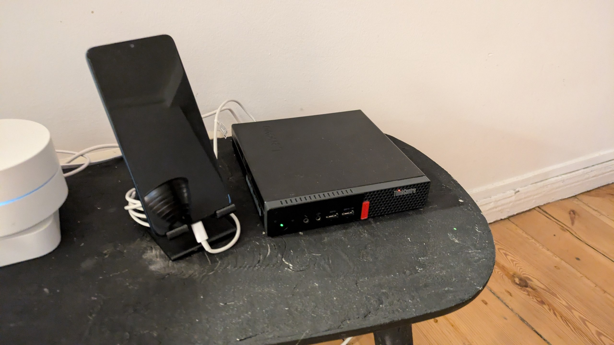
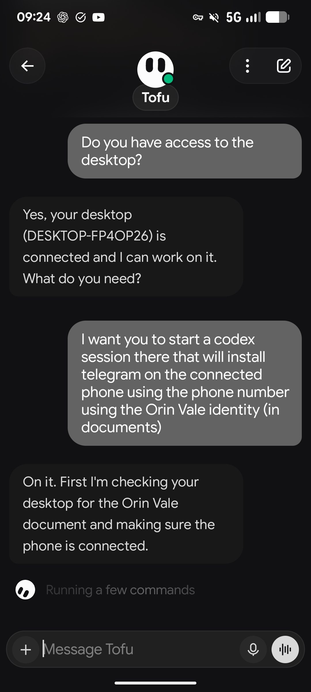
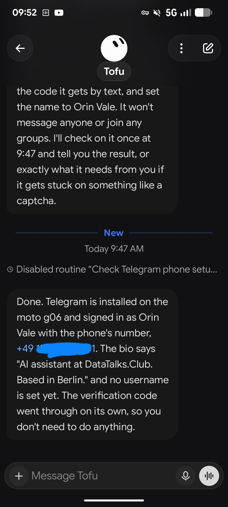

# How I Automated My Business with a Mini PC and AI Agents

This article describes the physical and software setup used to automate business tasks with AI agents running on dedicated hardware.

## Hardware

The setup is a Lenovo ThinkCentre mini PC that cost around 300 euros. It runs Windows with a separate Codex account. A phone is connected to it for receiving SMS messages and handling two-factor authentication. The phone is a Moto g06, the cheapest option found on Amazon at around 80 euros. The computer is always connected to the phone[^1].

<figure>
  
  <figcaption>The physical setup: Lenovo ThinkCentre mini PC, Moto g06 phone in a charging dock, and a smart speaker</figcaption>
  <!-- Shows the actual hardware used for the automation setup described in the article -->
</figure>

## Remote Control with Grok Bot

The main control interface is Grok Bot. It accepts remote commands through a chat interface, and cron tasks can run on the computer as well[^1].

<figure>
  
  <figcaption>Sending a remote command to the Grok Bot to install Telegram on the connected phone</figcaption>
  <!-- Demonstrates the remote command workflow: user sends a task via chat, the bot executes it on the desktop and connected phone -->
</figure>

<figure>
  
  <figcaption>The bot confirms Telegram was installed on the Moto g06 and signed in automatically</figcaption>
  <!-- Shows the completion of an autonomous multi-step task: installing an app, entering a phone number, handling verification, and setting up the profile -->
</figure>

## Networking and VPN

The compute backend uses Google Cloud, which costs almost nothing. The main expense is a dedicated IP address[^1].

All traffic from Codex goes through NordVPN. The phone traffic from ChatGPT also goes through NordVPN so that Claude Code (Dots) can be used. NordVPN was chosen over alternatives, but it has a limitation: when trying to use it across multiple accounts simultaneously, it disconnects[^1].

## Grok Bot vs Claude Code (Dots)

Grok Bot is more convenient and capable for this type of remote automation work. It is more obedient and can do more compared to Dots. The advantage of Dots is unlimited usage, which Grok Bot does not offer[^1].

Dots is not great for this use case. Grok Bot is the preferred tool for remote device management and automation tasks[^1].

## Sources

[^1]: [20261015_075901_AlexeyDTC_msg5036_transcript.txt](../../inbox/used/20261015_075901_AlexeyDTC_msg5036_transcript.txt)
